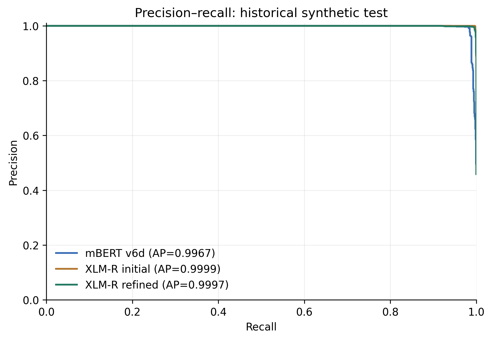
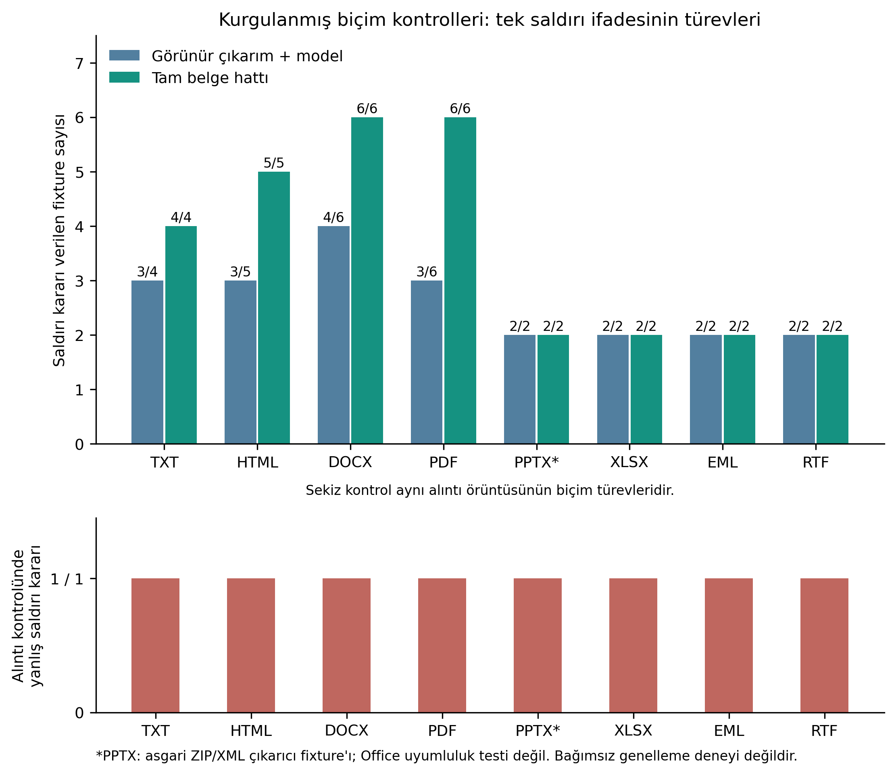

# Türkçe Belgelerde Dolaylı İstem Enjeksiyonu Tespiti: Belge Düzeyinde Çok Görünümlü Çoklu Örnek Öğrenmesi, Veri Soy Ağacı ve RAG Güvenlik Tanıları

**Indirect Prompt Injection Detection in Turkish Documents: Document-Level Multi-View Multiple-Instance Learning, Data Provenance and RAG Security Diagnostics**

---

**Makale türü:** Özgün araştırma makalesi (Original Research Article)

**Yazarlar:** [Yazar 1]¹\*, [Yazar 2]²
¹ [Bölüm, Üniversite, Şehir, Ülke] · ² [Bölüm, Üniversite, Şehir, Ülke]
\*Sorumlu yazar: [e-posta] · ORCID: [0000-0000-0000-0000]

**Hedef dergi:** [Belirlenecek — ör. bilgi güvenliği / uygulamalı yapay zekâ alanında SCIE kapsamlı bir dergi]
**Kelime sayısı (ana metin):** [gönderim öncesi hesaplanacak] · **Tablo:** 20 · **Şekil:** 7

> **Gönderim öncesi not (makale metnine dahil değildir):** Yazar, kurum, finansman, etik ve hedef dergi alanları köşeli parantezle bırakılmıştır ve kullanıcı adına doldurulmamıştır. Tüm sayısal değerler projedeki ham deney kayıtlarından alınmıştır; kanıt dosyalarının eşlemesi Ek C'dedir. Bağımsız insan etiketli dış test tamamlanmadığı için makale bu sınırı açıkça beyan edecek biçimde yazılmıştır. Önceki sürüm `artifacts/publication_revision_20261107/article_before_sci_format_20261116.md` olarak korunmuştur.

---

## Öne Çıkanlar (Highlights)

- Türkçe RAG belgeleri için katmanlı istem enjeksiyonu tarama hattı önerildi.
- 192.261 kayıtlık 16 veri dosyası için kaynak ve soy ağacı envanteri raporlandı.
- XLM-R hard-max MIL, 2.675 metinde F1=0,9947 ve %0,55 FPR elde etti.
- Ayrılmış 40 saldırı ifadesinde recall %99,59'dan %77,92'ye düştü.
- Yerel RAG tanısında saldırı hedefi gerçekleşmesi 6/8'den 0/8'e indi.

## Yapılandırılmış Öz

**Amaç:** Getirim destekli üretim (RAG) sistemlerinde dış belgelere gömülü talimatlar, dil modelinin görevini saptırabilir (dolaylı istem enjeksiyonu). Türkçe için bu tehdide yönelik belge düzeyinde, izlenebilir veriyle değerlendirilmiş bir tespit çalışması bulunmamaktadır. Bu çalışma Türkçe belgelerde enjeksiyon taramasını yöntem, veri ve sistem düzeyinde incelemektedir.

**Yöntem:** Biçime özgü metin çıkarımı, gizleme göstergeleri (beyaz metin, sıfır genişlikli karakter, üstveri, Base64), Unicode normalizasyonu ve çok görünümlü pencerelemeyi belge düzeyinde hard-max çoklu örnek öğrenmesi (MIL) ile birleştiren bir hat geliştirilmiştir. Eğitim verisi; büyük dil modeliyle (DeepSeek V4 Flash) üretilmiş 26.997 sentetik Türkçe metin, OpenAlex üzerinden indirilen 1.001 açık erişimli Türkçe akademik PDF'ten türetilmiş 12.026 parça ve Türkçe Vikipedi'den türetilmiş 3.586 parçadan oluşmaktadır. XLM-R tabanlı model mBERT, BERTurk, beş TF-IDF yöntemi ve yayımlanmış İngilizce bir dedektörle karşılaştırılmış; karşılaştırmalar ortak kalibrasyon hedefi (%1 FPR) ve üç tohumla yinelenmiştir.

**Bulgular:** Son model 2.675 metinlik tarihsel testte F1=0,9947, recall=%99,59, FPR=%0,55 ve ROC-AUC=0,9997 elde etmiştir. Standart ve uyarlamalı parçalar arası saldırılarda yakalama mBERT'e göre sırasıyla %50→%90 ve %42→%69 artmıştır. Eğitimde hiç görülmemiş 40 saldırı ifadesinde recall %77,92'ye düşmüştür. Küçük yerel RAG tanısında saldırı hedefi gerçekleşmesi 6/8'den 0/8'e inmiş, ancak normal görev başarısı 1/2'de kalmış ve alıntılanan saldırı örüntüleri yanlış alarm üretmiştir.

**Sonuç:** Yüksek metin düzeyi F1 tek başına belge güvenliğini, yeni saldırı ifadelerine genellemeyi ve görev yararını açıklamamaktadır. Tarihsel testin tasarıma geri bildirim vermesi, eksik kaynak kimlikleri ve bağımsız insan etiketli dış test yokluğu genelleme iddialarını sınırlamaktadır.

**Anahtar kelimeler:** dolaylı istem enjeksiyonu; RAG güvenliği; Türkçe doğal dil işleme; çoklu örnek öğrenmesi; XLM-RoBERTa; sentetik veri soy ağacı

## Abstract

**Purpose:** Instructions embedded in untrusted documents can hijack retrieval-augmented generation (RAG) pipelines. Document-level detection of such indirect prompt injection in Turkish, evaluated with traceable data, has not been reported. **Methods:** We combine format-specific extraction, obfuscation indicators, Unicode normalization and multi-view windowing with document-level hard-max multiple-instance learning (MIL) on XLM-R. Training data comprise 26,997 Turkish texts synthesized with an LLM (DeepSeek V4 Flash), 12,026 chunks derived from 1,001 open-access Turkish academic PDFs retrieved via OpenAlex, and 3,586 chunks derived from Turkish Wikipedia. We compare against mBERT, BERTurk, five TF-IDF baselines and a published English detector under a common 1% calibration-FPR target with three seeds. **Results:** On 2,675 historical texts the final model reaches F1=0.9947, recall=99.59%, FPR=0.55% and ROC-AUC=0.9997. Cross-chunk detection improves over mBERT from 50% to 90% (standard) and from 42% to 69% (adaptive). Recall drops to 77.92% on 40 attack expressions withheld from training. In a small local RAG diagnostic, attack-goal fulfilment falls from 6/8 to 0/8, while benign task success remains 1/2 and quoted attack patterns cause false alarms. **Conclusion:** High text-level F1 does not by itself establish document security, generalization to new attack phrasing or task utility. Test reuse during design, missing source identifiers and the absence of an independent human-labelled external test limit generalization claims.

**Keywords:** indirect prompt injection; RAG security; Turkish NLP; multiple-instance learning; XLM-RoBERTa; synthetic data provenance

---

## 1. Giriş

Büyük dil modelleri (BDM) kurumsal uygulamalarda giderek daha fazla getirim destekli üretim (retrieval-augmented generation, RAG) mimarisiyle kullanılmaktadır [1]. RAG, kullanıcı sorgusuyla ilişkili dış belgeleri getirip modelin bağlamına ekler. Bu tasarım, güvenilir görev yönergeleri ile güvenilmeyen belge içeriğini aynı metin akışında birleştirdiği için yeni bir saldırı yüzeyi oluşturur: belgeye yerleştirilmiş bir talimat, model tarafından görev yönergesi gibi yorumlanabilir. Bu tehdit **dolaylı istem enjeksiyonu** (indirect prompt injection) olarak adlandırılmakta [2] ve OWASP'ın BDM uygulamaları için güncel risk listesinde birinci sırada yer almaktadır [3].

Literatürdeki savunmalar üç ana grupta toplanabilir: (i) modelin talimat ile veriyi ayırmasını sağlayan eğitim/istem tasarımı yaklaşımları [4–6], (ii) uçtan uca saldırı başarısını ölçen kıyaslama ortamları [7–10] ve (iii) girdiyi modele ulaşmadan sınıflandıran dedektörler [11–13]. Üçüncü grup, mevcut BDM'yi değiştirmeden RAG indeksleme hattına eklenebildiği için uygulamada yaygındır. Ancak yayımlanmış dedektörlerin büyük kısmı İngilizce odaklıdır; çok dilli çalışmalar ise çoğunlukla yüksek kaynaklı dillere yönelik çeviri tabanlı test kümeleri kullanmaktadır [13, 14].

Türkçe bu bağlamda üç nedenle ayrı bir inceleme gerektirmektedir. Birincisi, eklemeli morfoloji nedeniyle aynı saldırı niyeti çok sayıda yüzey biçimiyle ifade edilebilir; sözcük listesi tabanlı filtreler kolayca atlatılır. İkincisi, Türkçe kamuya açık enjeksiyon kaynakları büyük ölçüde İngilizce veri kümelerinin makine çevirisidir ve kısa sohbet istemlerinden oluşur [15, 16]; belge düzeyinde, çoklu biçimli ve kaynağı izlenebilir bir değerlendirme kümesi bulunmamaktadır. Üçüncüsü, normal Türkçe kurumsal belgeler (yönetmelikler, dergi şablonları, kullanım kılavuzları) yoğun emir kipi içerir; bu da yanlış alarm riskini artırır.

Belge düzeyinde tespit ayrıca yapısal sorunlar içerir. Saldırı metni belgenin sonunda, görünmez karakterlerde, üstveride veya birbirinden uzak parçalarda yer alabilir; RAG parçalama işlemi talimatı birden fazla parçaya bölebilir. Bu durumda yalnız belgenin başını veya tek bir parçayı inceleyen sınıflandırıcılar yetersiz kalır.

Bu çalışma aşağıdaki araştırma sorularına (AS) odaklanmaktadır:

- **AS1:** Belge düzeyinde hard-max MIL ile eğitilmiş XLM-R modeli, mBERT ve klasik taban çizgilerine göre Türkçe metin düzeyi tespitte nasıl bir başarım sağlamaktadır?
- **AS2:** Kısa pencereler ve uzak parçaları birleştiren görünümler, parçalar arası (cross-chunk) saldırıların tespitini nasıl etkilemektedir?
- **AS3:** Bu kazanımlar eğitimde görülmemiş saldırı ifadelerinde, normal uzun belgelerde ve uçtan uca RAG kullanımında hangi sınırlara sahiptir?

**Katkılar.** Çalışmanın katkıları şunlardır:

1. **Türkçe belge enjeksiyonu veri kaynağı ve soy ağacı.** BDM üretimi, gerçek akademik makaleler ve Vikipedi'den türetilmiş eğitim/test kümelerinin üretim parametreleri, sayıları, bölme birimleri ve bilinen sınırlılıkları Datasheets for Datasets [17] yaklaşımıyla belgelenmiştir (Bölüm 3, Ek A).
2. **Belge düzeyinde çok görünümlü MIL tespit hattı.** Normalizasyon, gizleme göstergeleri ve uzun/kısa/köprü pencere görünümlerini birleştiren bir hard-max MIL yapılandırması tanımlanmış ve uygulanmıştır (Bölüm 4).
3. **Çok eksenli değerlendirme.** Metin sınıflandırma, düşük FPR bölgesi, parçalar arası saldırılar, ayrılmış saldırı ifadeleri, belge biçimleri, OCR, normalizasyon ve küçük bir uçtan uca RAG tanısı aynı çerçevede raporlanmıştır (Bölüm 6).
4. **Geçerlilik tehditlerinin nicel gösterimi.** Üretici filtrelerinden kaynaklanabilecek sözcüksel kısa yol riski, test geri bildirimi ve inceleme yükü sayısal olarak ortaya konmuştur (Bölüm 6.4, 7).

Çalışma yeni bir temel dil modeli veya genel bir MIL algoritması önermemektedir; katkı Türkçe belge güvenliği için veri, sistem ve değerlendirme düzeyindedir. Yönetim paneli ve kullanıcı arayüzü kapsam dışıdır.

**Makalenin düzeni.** Bölüm 2 ilgili çalışmaları, Bölüm 3 veri kümesi oluşturma sürecini, Bölüm 4 yöntemi, Bölüm 5 deney düzenini, Bölüm 6 bulguları sunmaktadır. Bölüm 7 tartışma ve geçerlilik tehditlerini, Bölüm 8 sonuçları içermektedir.

## 2. İlgili Çalışmalar

### 2.1. İstem enjeksiyonu saldırıları

Perez ve Ribeiro [18], "önceki talimatları yoksay" türü doğrudan saldırıların BDM çıktısını hedef görevden saptırabildiğini göstermiştir. Greshake ve diğerleri [2], saldırganın sorgu göndermek yerine sonradan getirilecek bir web sayfasına veya belgeye talimat yerleştirdiği dolaylı enjeksiyonu tanımlamış ve gerçek uygulamalarda göstermiştir. Liu ve diğerleri [19], saldırıları biçimsel bir çerçevede birleştirmiş; 5 saldırı, 10 savunma, 10 BDM ve 7 görev üzerinde sistematik kıyaslama yapmıştır. Zou ve diğerleri [20], RAG bilgi tabanına az sayıda zehirli metin eklenmesinin üretimi yönlendirebildiğini göstermiştir.

### 2.2. Kıyaslama ortamları

BIPIA [7], dolaylı enjeksiyon için görev ve saldırı kümeleri ile sınır farkındalığı savunmalarını değerlendirmiştir. InjecAgent [8] araç kullanan ajanlarda, AgentDojo [9] ise görev yararı ile saldırı başarısını birlikte ölçen dinamik bir ortamda dolaylı enjeksiyonu incelemiştir. GenTel-Safe [13] birleşik bir kıyaslama ve koruma modeli sunmuş, test kümelerini birkaç yüksek kaynaklı dile çevirmiştir. Bu çalışmaların ortak dersi, tespit başarısının saldırı başarı oranı ve normal görev yararıyla birlikte raporlanması gerektiğidir; bu ilke Bölüm 6.8'deki RAG tanısında benimsenmiştir.

### 2.3. Tespit ve savunma yöntemleri

Girdi düzeyi dedektörler genellikle ince ayarlı Transformer sınıflandırıcılarıdır. Protect AI'nin DeBERTa-v3 tabanlı modeli [11] ve Meta'nın Prompt Guard 2 modeli [12] İngilizce odaklı hazır dedektörlerdir. PromptShield [21], dedektörlerin düşük FPR bölgesinde değerlendirilmesinin pratik önemini vurgulamıştır. Model tarafı savunmalar arasında yapılandırılmış sorgular (StruQ) [4], talimat hiyerarşisi eğitimi [5] ve güvenilmeyen içeriği işaretleme (spotlighting) [6] yer alır. Bu yaklaşımlar BDM'nin yeniden eğitilmesini veya istem yapısının değiştirilmesini gerektirirken, bu çalışmadaki dedektör RAG indeksleme hattına model bağımsız bir ön filtre olarak eklenir.

### 2.4. Çoklu örnek öğrenmesi

MIL'de etiket tek tek örneklere değil örnek kümelerine (torbalara) atanır [22, 23]. Pozitif torba en az bir pozitif örnek içerir. Ilse ve diğerleri [24] dikkat tabanlı bir toplama işlevi önermiştir. Belge enjeksiyonu doğal bir MIL problemidir: belge etiketi bilinir, saldırının hangi pencerede olduğu bilinmez. Bu çalışmada dikkat tabanlı toplama yerine en yüksek pencere skorunu kullanan hard-max toplama tercih edilmiştir.

### 2.5. Türkçe ve çok dilli kaynaklar

Çok dilli kodlayıcılar mBERT [25] ve XLM-R [26], Türkçeye özgü BERTurk [27] ise Türkçe sınıflandırma çalışmalarında yaygın omurgalardır. Türkçe istem enjeksiyonu için kamuya açık kaynaklar sınırlıdır: Hugging Face üzerinde İngilizce deepset/prompt-injections kümesinin Türkçe çevirisi [15] ve doğrudan/dolaylı saldırı türlerine göre gruplanmış küçük test vakaları [16] bulunmaktadır. Düşük kaynaklı dillerde dolaylı enjeksiyon üzerine yeni çalışmalar (ör. Bangla için MIPIAD [14]) ortaya çıkmakla birlikte, bildiğimiz kadarıyla Türkçe belgelerde belge düzeyinde ve çoklu biçimde değerlendirilmiş bir dedektör çalışması yayımlanmamıştır.

**Tablo 1. İlgili çalışmaların bu çalışmayla karşılaştırılması.**

| Çalışma | Dil | Birincil görev | Veri kaynağı | Belge/çoklu biçim | Uzak parça saldırısı | Görev yararı ölçümü |
|---|---|---|---|---|:---:|:---:|
| Greshake vd. [2] | EN | Saldırı tanımı/gösterimi | Gerçek uygulamalar | Web/e-posta | — | — |
| Liu vd. [19] | EN | Saldırı/savunma kıyaslama | Mevcut NLP görevleri | Hayır | — | Kısmen |
| BIPIA [7] | EN | Dolaylı enjeksiyon kıyaslaması | Görev + saldırı şablonları | Kısmen | — | Evet |
| InjecAgent [8] | EN | Ajan güvenliği | Araç çağrısı senaryoları | Hayır | — | — |
| AgentDojo [9] | EN | Ajan güvenliği ortamı | Görev/saldırı ortamı | Hayır | — | Evet |
| GenTel-Safe [13] | EN + çeviri | Dedektör + kıyaslama | Derlenmiş + çevrilmiş | Hayır | — | — |
| PromptShield [21] | EN | Düşük FPR dedektör | Konuşma/uygulama verisi | Hayır | — | — |
| Protect AI DeBERTa [11] | EN | Hazır dedektör | Derlenmiş açık kümeler | Hayır | — | — |
| Türkçe HF kümeleri [15, 16] | TR | Sınıflandırma verisi | Makine çevirisi / el yapımı | Hayır | — | — |
| **Bu çalışma** | **TR** | **Belge düzeyi tespit + RAG tanısı** | **BDM sentetik + OpenAlex + Vikipedi** | **Evet (PDF, DOCX, TXT, HTML, OCR)** | **Evet** | **Evet (küçük ölçek)** |

*Not:* Tablo yöntem ve kapsam farklarını gösterir; farklı veri kümelerinde raporlanan skorlar aynı başarı sıralamasına alınmamıştır. "—" ilgili boyutun çalışmanın birincil odağı olmadığını belirtir.

## 3. Veri Kümesi Oluşturma

Bu bölüm, eğitim ve değerlendirmede kullanılan bütün verilerin **nereden geldiğini, nasıl üretildiğini ve kaç kayıt içerdiğini** açıklamaktadır. Etiketler normal içerik için 0, enjeksiyon için 1'dir. Kayıt sayısı, benzersiz kaynak belge sayısı ve modele sunulan pencere sayısı farklı büyüklüklerdir; aynı kaynak belgeden birden fazla parça veya pencere üretilebildiği için bu sayılar birbirinin yerine kullanılmamıştır.

### 3.1. Veri kaynaklarına genel bakış

Veriler beş kaynak ailesinden türetilmiştir (Tablo 2, Şekil 1).

**Tablo 2. Veri kaynakları, üretim yöntemleri ve kayıt sayıları.**

| Kod | Kaynak ailesi | Üretim/edinim yöntemi | Kaynak birimi | Üretilen kayıt (normal / saldırı) | Kullanım |
|---|---|---|---|---|---|
| K1 | BDM sentetik çekirdek | DeepSeek V4 Flash (OpenRouter API) ile istem şablonlu üretim | Tek üretim çağrısı | 24.322 eğitim (12.909 / 11.413) + 2.675 test (1.447 / 1.228) = **26.997** | XLM-R ana eğitim, doğrulama, kalibrasyon, tarihsel test |
| K2 | BDM sentetik normal belgeler | Aynı BDM; akademik, hukuki, haber, teknik, resmî rapor ve dergi/tez şablonu türleri | Tek üretim çağrısı | 1.000 düz belge + 400 şablon = **1.400** (1.400 / 0) | Emir kipli normal belge yanlış alarmlarını azaltma |
| K3 | Gerçek akademik makaleler | OpenAlex API [28]; yalnız açık erişimli, PDF bağlantılı, Türkçe eserler; **1.001 PDF** | Makale | 9.633 eğitim (6.397 / 3.236) + 2.393 test (1.592 / 801) = **12.026** | mBERT tarihsel eğitimi, gerçek taşıyıcıda gömülü saldırı |
| K4 | Türkçe Vikipedi | Rastgele madde API'si (**500 madde**) ve HTML görünür metni (**250 madde**) | Madde | 2.040 düz metin (1.357 / 683) + 1.546 HTML (1.546 / 0) = **3.586** | Alan genellemesi, HTML yanlış alarmı |
| K5 | Kural tabanlı türetme (BDM'siz) | Mevcut kayıtlardan seyreltme, kısa parça ve taşıyıcı birleştirme | Ebeveyn kayıt | **4.900** (2.800 / 2.100) | Seyreltilmiş ve kısa saldırılara dayanıklılık |
| D1 | Dosya düzeyi saldırı kümeleri | Kod ile PDF/DOCX/TXT dosyası üretimi; taşıyıcı ve talimatlar K1 testinden | Dosya | **300 dosya** (Tablo 5) | Parçalar arası, gizleme ve dosya hattı değerlendirmesi |
| D2 | Bağımsız normal Vikipedi derlemi | Talimat yoğun konular; eğitime alınmamış başlıklar | Madde | **54 TXT**, 56 PDF, 58 HTML | Uzun normal belge yanlış alarmı |

*Not:* Ayrıntılı üretim parametreleri Tablo 3'te, sürüm kümelerinin bileşimi Tablo 4'te verilmiştir. K1 ve K3–K4'teki saldırı kayıtlarının bir kısmı aynı sınırlı talimat havuzlarından türetildiğinden (Bölüm 3.4) saldırı kayıt sayısı bağımsız saldırı ailesi sayısı değildir.

**Şekil 1. Veri soy ağacı (metinsel gösterim).**

```text
 DeepSeek V4 Flash ──► K1 sentetik çekirdek (26.997) ──┬─► XLM-R aşama 1: eğitim/doğrulama/kalibrasyon (24.322)
   (OpenRouter)         ├─ 20 saldırı taktiği            ├─► Tarihsel test (2.675)  ──► D1 dosya kümeleri (300)
                        ├─ 4 biçim, 5 uzunluk, 3 zorluk  └─► Payload havuzu (160 = 120 eğitim + 40 ayrılmış)
                        └─► K2 normal belgeler (1.400)                     │
 OpenAlex ──► 1.001 Türkçe OA PDF ──► 200 sözcüklük parçalar ──► K3 (12.026) ──┐   ▼
 Vikipedi ──► 500 rastgele madde + 250 HTML ───────────────────► K4 (3.586) ──┼─► mBERT v5/v6/v6c/v6d tarihsel karışımları
 Kural tabanlı türetme (K1+K3 ebeveynleri) ──────────────────────► K5 (4.900) ──┘
 Vikipedi (eğitimden ayrık başlıklar) ──► D2 (54 uzun normal metin)
 XLM-R aşama 2 (kısa pencere düzeltmesi) ◄── 84 eğitim payload'ı + mevcut taşıyıcılar (2.704)
```

### 3.2. BDM ile sentetik veri üretimi (K1, K2)

K1, OpenRouter API üzerinden `deepseek/deepseek-v4-flash` modeliyle üretilmiştir. Üretici, her çağrıda bir **biçim**, **uzunluk sınıfı**, **zorluk düzeyi**, **saldırı taktiği** (yalnız etiket 1 için), **kurum** ve **dil tonu** örnekleyerek bir istem oluşturur. Etiket dengesi için %50/%50 kota uygulanmıştır. Parametreler Tablo 3'te özetlenmiştir.

**Tablo 3. BDM üretim parametreleri (K1, K2).**

| Parametre | Değer |
|---|---|
| Üretici model / erişim | `deepseek/deepseek-v4-flash` / OpenRouter (OpenAI uyumlu API) |
| Sıcaklık (temperature) | 0,9 (K1); K2 için ayrı sabit |
| En fazla çıktı tokenı | 2.000 (K1); 1.600 (K2 düz belge); 1.700 (K2 şablon) |
| Hedef örnek sayısı | 25.000 (K1, %50 saldırı / %50 normal) |
| En az uzunluk | 200 karakter; istemlerde en az 80–700+ sözcük yönergesi |
| Biçim havuzu (ağırlık) | `[USER_INTENT]/[EXTERNAL_CONTENT]` dolaylı RAG %63; `[SYSTEM]/[USER]` %17; düz metin %10; sahte kod incelemesi %10 |
| Uzunluk havuzu | kısa (80–150 sözcük) %16; orta (150–300) %26; uzun (300–500) %36; çok uzun (500–700) %14; dev (700+) %8 |
| Zorluk havuzu | kolay %30; orta %50; zor %20 (zor saldırılarda klişe tetikleyici sözcükler yasak) |
| Saldırı taktikleri | 20 kategori (Ek A.2): talimat yoksayma, kimlik değiştirme, sistem istemi sızdırma, veri sızdırma, sahte yetki, filtre atlatma, DAN/jailbreak, sahte sistem etiketi, kod/SQL çalıştırma, kademeli saldırı, sahte onay kodu, Türkçe–İngilizce karışık komut, SGK, KVKK, e-Devlet kimliğine bürünme, dezenformasyon, övgü sonrası istisna, kurgu içine gizleme, çeviri/özet kılıfı, çok adımlı görev zinciri |
| Kurum bağlamı | 9 sektör, 74 gerçek Türk kurum adı (banka, telekom, kargo, havayolu, kamu, üniversite, sağlık, perakende, sanayi) |
| Dil tonu | resmî-kurumsal; yarı resmî; günlük; teknik-akademik |
| Çeşitlilik yönergesi | 6 seçenekten rastgele "çeşni" (farklı şehir, tarih, kişi, cümle yapısı, alt konu) |
| Kalite filtreleri | en az uzunluk; yabancı dil oranı; etiket 1 için `INJECTION_RE` eşleşmesi zorunlu; etiket 0 için `STRICT_INJ_BENIGN_RE` eşleşmesi yasak |
| Tekrar ayıklama | boşluk normalize, küçük harfli tam metnin SHA-1 özeti |
| Bölme | rastgele %90 eğitim / %10 test |

Üretilen biçim dağılımı Tablo 4'te verilmiştir. Gözlenen dağılım (K1 toplamında dolaylı RAG biçimi %67,7, sistem/kullanıcı %15,7, işaretsiz %16,7) hedeflenen havuz ağırlıklarıyla uyumludur.

**Tablo 4. K1 sentetik çekirdeğin biçim ve etiket dağılımı.**

| Biçim | Eğitim normal | Eğitim saldırı | Test normal | Test saldırı | Toplam | Oran |
|---|---:|---:|---:|---:|---:|---:|
| `EXTERNAL_CONTENT` (dolaylı RAG) | 8.303 | 8.125 | 947 | 893 | 18.268 | %67,7 |
| `SYSTEM/USER` | 1.796 | 2.022 | 209 | 204 | 4.231 | %15,7 |
| İşaretsiz (düz metin, kod incelemesi) | 2.810 | 1.266 | 291 | 131 | 4.498 | %16,7 |
| **Toplam** | **12.909** | **11.413** | **1.447** | **1.228** | **26.997** | %100 |

*Not:* Biçimler metin içindeki işaretlere göre otomatik atanmıştır; insan tarafından doğrulanmış doğrudan/dolaylı saldırı taksonomisi değildir. Ortalama uzunluk eğitimde 1.876 (medyan 1.771), testte 1.920 (medyan 1.831) karakterdir.

K2, mevcut normal örneklerin neredeyse tamamının işaretli sohbet biçiminde olması nedeniyle modelin "düz belge = saldırı" kısa yolunu öğrenmesini engellemek amacıyla üretilmiştir. 1.000 düz belge (ortalama 2.061 karakter) akademik, hukuki, haber, teknik ve resmî rapor türlerini; 400 şablon belge (ortalama 3.164 karakter) emir kipli, büyük harfli uyarılar içeren dergi/tez yazım kılavuzlarını kapsar. K2 kayıtları birleştirme betiğiyle %90/%10 oranında eğitim/teste eklenmek üzere hazırlanmıştır; satır düzeyinde kaynak kimliği tutulmadığından K1 dosyalarındaki K2 payı kesin olarak ayrıştırılamamaktadır (Bölüm 7.3).

### 3.3. Gerçek metin kaynakları (K3, K4, D2)

**OpenAlex akademik makaleleri (K3).** OpenAlex [28] üzerinden yalnız açık erişimli (`is_oa`), PDF bağlantısı bulunan ve dili Türkçe olarak işaretlenmiş eserler imleç sayfalamasıyla taranmıştır. Dil filtresi gürültüsü başlıkta Türkçe karakter kontrolüyle azaltılmış; indirilen dosyalarda `%PDF` imzası ve en küçük boyut doğrulanmıştır. Google Scholar, kullanım koşulları nedeniyle kullanılmamıştır. Toplam 1.001 PDF indirilmiştir. Metinler PyMuPDF ile çıkarılmış, temizlenmiş ve yaklaşık 200 sözcüklük parçalara ayrılmıştır. Parçaların bir kısmına saldırı talimatı (ön ekler: "", "NOT:", "ÖNEMLİ:", "[SİSTEM]", "Uyarı:", "Lütfen:") gömülerek etiket 1 kayıtları oluşturulmuştur. Bölme **makale düzeyinde** yapılmıştır: eğitim 800 makaleden (9.633 parça), test 199 makaleden (2.393 parça) türetilmiştir; aynı makalenin parçaları iki bölümde birlikte bulunmaz. Tohum 2024'tür.

**Türkçe Vikipedi (K4).** Vikipedi'nin rastgele madde üreticisiyle 500 madde düz metni indirilmiştir. Maddeler 200 sözcüklük parçalara bölünmüş, parçaların yaklaşık yarısına kısa saldırı talimatı gömülmüştür (2.040 kayıt; 425 maddeden). Ayrıca 250 maddenin HTML görünür metni, üretim hattındaki HTML çıkarıcısıyla aynı dağılımı yansıtacak şekilde (kaynakça, bilgi kutusu, dipnot dahil) 1.546 normal parça olarak eklenmiştir. Bölme madde düzeyindedir (tohum 61).

**Bağımsız normal derlem (D2).** İlk yardım, yemek tarifi, güvenlik ve kullanım kılavuzu gibi emir kipi yoğun konulardan seçilen Türkçe Vikipedi maddeleri TXT, PDF ve HTML olarak indirilmiştir. Bu başlıklar eğitim derlemlerinden açıkça dışlanmıştır (kontaminasyon koruması). Makalede 54 uzun TXT metni "normal tam metin" yanlış alarm testi olarak kullanılmıştır.

### 3.4. Saldırı talimat havuzları ve kural tabanlı türetme (K5)

Tarihsel mBERT verilerinde K3 ve K4'e gömülen saldırılar **20 sabit talimat cümlesinden** türetilmiştir. Payload düzeyinde yapılan denetim, tarihsel `gercek_test` kümesindeki 801 saldırının tamamının bu 20 cümleden üretildiğini ve 20 cümlenin tamamının eğitim verisinde de bulunduğunu göstermiştir. Bu nedenle söz konusu küme bağımsız genelleme testi olarak kullanılmamıştır. Sorunu gidermek için talimat havuzu **160 cümleye** genişletilmiş ve inşa aşamasında 120 eğitim / 40 ayrılmış olarak bölünmüştür. XLM-R ikinci aşamasında 84 eğitim, 8 doğrulama, 8 kalibrasyon ve 40 ayrılmış talimat kullanılmış; tarihsel 20 talimat ek eğitimden çıkarılmıştır.

K5 (BDM gerektirmeyen seyreltme kümesi; tohum 1337) dört alt türden oluşur: 1.400 seyreltilmiş saldırı (kısa talimat, normal taşıyıcının %5–30'luk konumuna gömülü), 700 kısa saldırı parçası, 1.400 kısa normal parça ve 1.400 talimatsız normal taşıyıcı.

### 3.5. Dosya düzeyi değerlendirme kümeleri (D1)

Dosya düzeyi kümeler, K1 test bölümündeki normal metinleri taşıyıcı, saldırı metinlerini talimat kaynağı olarak kullanarak kodla üretilmiştir (tohum 42). Böylece eğitim verisi ile dosya kümeleri arasında metin düzeyinde sızıntı engellenmiştir; ancak taşıyıcıların tarihsel testten gelmesi bu kümeleri tarihsel testle ilişkili kılar.

**Tablo 5. Dosya düzeyi değerlendirme kümeleri (D1).**

| Küme | PDF | DOCX | TXT | Toplam | Etiket | Üretim ayrıntısı |
|---|---:|---:|---:|---:|---|---|
| Standart cross-chunk | 34 | 33 | 33 | 100 | Saldırı | 20 farklı talimat; 2–3 parçaya bölünüp taşıyıcının uzak konumlarına serpiştirilmiş; parça boyu 400, örtüşme 50 karakter varsayımı |
| Uyarlamalı cross-chunk | 34 | 33 | 33 | 100 | Saldırı | Aynı 20 talimat; 3–4 parça; bilinen parçalama boyutuna göre ek dolgu |
| Beyaz metin | 13 | 13 | — | 26 | Saldırı | Görünmeyen renkte talimat |
| Sıfır genişlikli karakter | — | 6 | 6 | 12 | Saldırı | U+200B vb. ile bölünmüş talimat |
| Üstveri | 6 | — | — | 6 | Saldırı | PDF üstveri alanlarında talimat |
| Base64 | — | 6 | — | 6 | Saldırı | Kodlanmış talimat |
| Normal kontrol | 17 | 17 | 16 | 50 | Normal | Talimatsız taşıyıcı |
| **Toplam** | **104** | **108** | **88** | **300** | | 17 dosyalık hat kontrolü bu 100 dosyalık gizleme/normal kümesinin alt kümesidir |

Ek olarak sistem tanısı için sekiz biçimde (PDF metin, görüntü PDF, DOCX, HTML, TXT, PPTX, EML, RTF) 46 kontrollü dosya (29 saldırı, 17 normal) oluşturulmuştur. Saldırılar tek açık komutun biçim ve yerleştirme türevleridir; normal kontrollerin sekizi aynı saldırı alıntısını içeren güvenlik eğitim metninin biçim türevleridir (Bölüm 6.7).

### 3.6. Eğitim karışımları ve model sürümleri

**Tablo 6. Modellerin eğitiminde kullanılan veri karışımları.**

| Karışım | Normal | Saldırı | Toplam | Bileşim |
|---|---:|---:|---:|---|
| K1 + K3 birleşik (augmented) | 18.870 | 14.523 | 33.393 | K1 eğitimin denetlenen sürümü (23.760) + K3 eğitim (9.633) |
| mBERT v5 | 21.270 | 14.523 | 35.793 | Birleşik küme + yalnız normal ek kayıtlar (2.400); ek kayıtların kaynağı satır düzeyinde kayıtlı değildir |
| mBERT v6 | 5.357 | 4.683 | 10.040 | v5'ten dengeli alt örneklem + K4 düz metin |
| mBERT v6c/v6d (taban çizgisi) | 6.903 | 4.000 | 10.903 | 8.000 dengeli tampon + 1.357 Vikipedi düz + 1.546 Vikipedi HTML |
| mBERT v6d-full | 15.376 | 11.287 | 26.663 | 23.760 ana kayıt + 2.903 Vikipedi kaydı |
| XLM-R aşama 1 (artırma öncesi) | 10.327 | 9.129 | 19.456 | K1 eğitim dosyasının gruplanarak ayrılan eğitim bölümü |
| XLM-R aşama 1 (artırma sonrası) | 11.527 | 10.329 | 21.856 | + 2.400 türetilmiş kayıt; **57.134 pencere** |
| XLM-R aşama 2 (kısa pencere düzeltmesi) | 1.352 | 1.352 | 2.704 | 84 talimat × mevcut taşıyıcılar; **13.914 pencere** |
| Ortak sınırlı bütçeli pilot | 512 | 512 | 1.024 | Aşama 1 eğitim bölümünden sabit alt küme |

*Not:* Satırlar bağımsız veri kümeleri değildir; birbirlerinin alt kümesi veya türevi olabildikleri için toplanamaz. XLM-R aşamalarında toplam 24.560 kayıt kullanımı vardır; bu sayı benzersiz belge sayısı değildir.

### 3.7. Bölme, tekrar ayıklama ve veri denetimi

XLM-R birinci aşamasında K1 eğitim dosyası (24.322 kayıt; SHA-256 ile manifest kaynağı doğrulanmıştır) Unicode normalizasyonundan sonra birebir tekrar ve MinHash [29] tabanlı sözcüksel yakınlık adaylarıyla gruplanmış, gruplar yaklaşık %80 eğitim, %10 doğrulama, %10 kalibrasyon olarak bölünmüştür (tohum 42). Tanımlanan gruplar arasında örtüşme ve yakın tekrar bağlantısı sıfırdır. Test kümesi yalnız tekrar ayıklamada kullanılmış; eğitim, epoch veya eşik seçimine girmemiştir.

**Tablo 7. XLM-R ayrımları ve değerlendirme kümeleri.**

| Bölüm / küme | Normal | Saldırı | Toplam | İşlev |
|---|---:|---:|---:|---|
| Aşama 1 doğrulama (artırma sonrası) | 1.441 | 1.292 | 2.733 | Epoch/model seçimi |
| Aşama 1 kalibrasyon (artırma sonrası) | 1.441 | 1.292 | 2.733 | Eşik seçimi |
| Aşama 2 doğrulama | 1.489 | 1.340 | 2.829 | Model seçimi |
| Aşama 2 kalibrasyon | 1.489 | 1.340 | 2.829 | Son eşik seçimi |
| Tarihsel Türkçe test (K1) | 1.447 | 1.228 | 2.675 | Ana karşılaştırma |
| Ayrılmış 40 talimat testi | 240 | 240 | 480 | Görülmemiş saldırı ifadesine genelleme |
| Tarihsel kısa metin kontrolü | 106 | 25 | 131 | Önceki modellerle regresyon |
| Uzun normal tam metin (D2) | 54 | 0 | 54 | Uzun belge yanlış alarmı |
| Standart / uyarlamalı cross-chunk (D1) | 0 | 100 + 100 | 200 | Parçalar arası yakalama |
| Dosya hattı kontrolü (D1 alt kümesi) | 3 | 14 | 17 | Çıkarım + karar politikası |

**Otomatik veri denetimi.** K1 eğitim dosyasının denetlenen sürümünde (23.760 kayıt) 2.277 satırda yalnız biçimsel normalizasyon (çoklu boşluk, NFC) gerekmiş; 1.131 satır inceleme için işaretlenmiştir: 567 "normal etiketli ama saldırıya benzer", 410 "saldırı etiketli ama zayıf saldırı göstergesi", 111 yakın tekrar ve 46 çok kısa. Bağımsız bir mBERT modeliyle yapılan çelişki taramasında (eşik 0,9) eğitimde 121/23.760 (%0,51), testte 32/2.640 (%1,21) kayıt etiketle çelişen skor almıştır. Hiçbir satır otomatik olarak silinmemiş veya etiketi değiştirilmemiştir. Denetlenen sürüm ile son dosya sürümü arasındaki satır farkı (eğitim 23.760 → 24.322; test 2.640 → 2.675), K2 birleştirmesi gibi sonraki eklemelere aittir ve kaynak kimliği eksikliği nedeniyle satır düzeyinde ayrıştırılamamıştır.

**Soy ağacı envanteri.** 16 tarihsel veri dosyasındaki 192.261 kayıt (benzersiz belge sayısı değildir) SHA-256 özetleriyle envantere alınmıştır. Açık `source_id`, `document_family_id`, `attack_family_id`, `payload_id` ve `parent_id` alanlarının kapsamı tarihsel K1 dosyalarında sıfırdır; K3/K4 kayıtlarında ise `src` (OpenAlex/Vikipedi kimliği), `src_url` ve `payload` alanları mevcuttur. Eksik kimlikler sonradan uydurulmamıştır.

### 3.8. Etik, lisans ve mahremiyet

Kişisel veya kurumdan toplanmış özel belge kullanılmamıştır. K1/K2'deki kurum adları gerçekçilik için kullanılmış olup içerikler kurgusaldır ve ilgili kurumların gerçek belgelerini temsil etmez. K3 yalnız açık erişimli eserlerden, K4/D2 Vikipedi'den (CC BY-SA) türetilmiştir; yeniden dağıtım koşulları eser bazında doğrulanmadan ham metinler kamuya açılmayacaktır. Sentetik saldırı metinleri yalnız tespit amaçlıdır.

## 4. Yöntem

### 4.1. Tehdit modeli

Saldırganın RAG sistemine alınabilecek bir dış belgenin içeriğini (görünür metin, gizli metin, üstveri, kodlanmış içerik) değiştirebildiği; dedektör ağırlıklarına, eşiklere ve sistem yönergesine erişemediği varsayılır. Saldırı amacı özgün görevi bastırma, önceki yönergeleri geçersiz kılma, bilgi sızdırma veya yetkisiz davranışa yönlendirmedir. Uyarlamalı saldırgan parçalama boyutunu bildiği varsayımıyla talimatı parçalara bölebilir (Bölüm 3.5) veya sınırlı sayıda skor sorgusuyla kaçınma deneyebilir (Bölüm 6.8). Gradyan bilgili beyaz kutu saldırılar kapsam dışıdır.

### 4.2. Sistem mimarisi

**Şekil 2. Tespit hattı.**

```text
Belge (PDF, DOCX, HTML, TXT, PPTX, XLSX, EML, RTF)
  → biçime özgü metin çıkarımı (+ gerektiğinde Tesseract OCR)
  → ham içerikte gizleme göstergeleri: beyaz metin, sıfır genişlikli karakter, üstveri, Base64
  → model girdisi normalizasyonu: NFKC, homoglif eşleme, görünmez biçim karakterlerinin silinmesi
  → pencere görünümleri: uzun (512/128), son pencere, baş–son köprüsü, uzak blok çiftleri, kısa (128/64)
  → XLM-R pencere skorları  →  belge skoru = max(pencere skorları)
  → karar: SALDIRI / İNCELEME GEREKLİ / TEMİZ / TARANAMADI
  → RAG indeksleme kapısı: yalnız açık TEMİZ kararı indekse alınır
```

Ham içerik normalizasyondan önce ayrıca saklanır; böylece model girdisinin sadeleştirilmesi gizleme kanıtının kaybolmasına yol açmaz. Gizleme göstergelerinin varlığı tek başına saldırı kanıtı sayılmaz; bu göstergeler çözümlenen içeriğin modele ayrıca sunulmasını sağlar.

### 4.3. Normalizasyon ve pencereleme

Uzun görünüm 512 token (özel tokenlar nedeniyle 510 içerik tokenı) ve 128 token örtüşmeyle kaydırılır; belgenin sonunu kapsayan pencere her zaman eklenir. Baş ve son parçaların birleştirildiği köprü görünümü ile sınırlı sayıda komşu olmayan blok çifti, uzak talimat parçalarını aynı pencerede görünür kılmayı amaçlar. Son modelde 128 tokenlık kısa görünümler (126 içerik tokenı, 64 örtüşme) de eklenmiştir. Bu yaklaşım bütün uzak parça kombinasyonlarını kapsamaz.

### 4.4. Belge düzeyinde hard-max MIL

Bir $D$ belgesi için pencere kümesi $W(D)=\{w_1,\ldots,w_m\}$ ve pencere skoru $p_i=f_\theta(w_i)$ olsun. Belge skoru

$$
s(D)=\max_{i=1,\ldots,m} p_i \tag{1}
$$

olarak tanımlanır. Eğitimde her belge için mevcut modelle en yüksek skorlu pencere seçilir,

$$
i^{*}=\arg\max_{i} f_\theta(w_i), \tag{2}
$$

ve kayıp yalnız bu pencere üzerinden belge etiketi $y\in\{0,1\}$ ile hesaplanır:

$$
\mathcal{L}(D,y)=-\big[y\log p_{i^{*}}+(1-y)\log(1-p_{i^{*}})\big]. \tag{3}
$$

Böylece saldırılı belgenin normal pencereleri pozitif etiketle eğitilmez; normal belgede seçilen pencere ise modelin en çok yanıldığı zor negatiftir. Erken eğitimde seçilen pozitif pencerenin gerçek saldırı aralığını içermesi garanti değildir. Maksimum toplama tek bir güçlü göstergeye duyarlı olduğundan, pencere sayısı arttıkça uzun normal belgelerde yanlış alarm olasılığı da artabilir; bu nedenle uzun belge yanlış alarmları ayrıca raporlanmıştır.

### 4.5. Karar politikası ve eşikler

Model seçimi doğrulama bölümünde, eşik seçimi ayrı kalibrasyon bölümünde yapılmıştır. Son modelin saldırı eşiği $\tau_a=0{,}9981897473$, inceleme eşiği $\tau_r=0{,}3276683092$'dir. Karar

$$
\text{karar}(D)=\begin{cases}\text{SALDIRI}, & s(D)\ge\tau_a\\ \text{İNCELEME}, & \tau_r\le s(D)<\tau_a\\ \text{TEMİZ}, & s(D)<\tau_r\end{cases} \tag{4}
$$

biçimindedir. Metin çıkarımı başarısız olursa veya tarama tamamlanamazsa karar TARANAMADI olur ve RAG kapısı belgeyi indekse almaz (fail-closed). İncelemeye yönlendirilen saldırı doğrudan tespit sayılmamış, ancak temiz geçen saldırıdan ayrı raporlanmıştır.

## 5. Deney Düzeni

### 5.1. Karşılaştırılan modeller

- **mBERT v6d** [25]: Tarihsel taban çizgisi; mBERT v5'ten devam eden ince ayar, tek uzun pencere, eşik 0,95.
- **XLM-R ilk MIL** [26]: `FacebookAI/xlm-roberta-base`'den aşama 1 eğitimi.
- **XLM-R düzeltilmiş MIL (önerilen):** İlk MIL'den devam eden aşama 2 (kısa pencere + 84 yeni talimat).
- **Klasik taban çizgileri** [30]: TF-IDF karakter/sözcük n-gram ile lojistik regresyon, doğrusal SVM, çok terimli Naive Bayes ve rastgele orman.
- **Ortak pilot Transformer'lar:** XLM-R, BERTurk [27], ön eğitimli mBERT ve görev verisi görmüş mBERT (continuation); aynı 1.024 kayıt.
- **Dış dedektör:** Protect AI DeBERTa-v3-base-prompt-injection-v2 [11, 31].
- **Kural taban çizgisi:** Üreticideki `INJECTION_RE` düzenli ifadesi (kısa yol tanısı).

### 5.2. Hiperparametreler ve donanım

**Tablo 8. Eğitim yapılandırmaları.**

| Özellik | mBERT v6d | XLM-R ilk MIL | XLM-R düzeltilmiş MIL | Ortak pilot |
|---|---|---|---|---|
| Başlangıç ağırlığı | mBERT v5 | xlm-roberta-base | İlk MIL | Model başına ön eğitimli |
| Epoch | 1 | 2 | 2 | 1 |
| Öğrenme oranı | 2×10⁻⁵ | 1×10⁻⁵ | 3×10⁻⁶ | 1×10⁻⁵ |
| Batch | 32 | 16 | 16 | 16 |
| Optimizasyon | AdamW | AdamW [32], wd 0,01, ~%6 ısınma, grad. kırpma 1,0 | Aynı | Aynı |
| Uzun / kısa pencere | 512 / — | 512 / — | 512 / 128 | Koşula göre |
| Eğitim penceresi | kayıtlı değil | 57.134 | 13.914 | — |
| Sabit katman | kayıtlı değil | Sözcük embedding | Sözcük embedding | Sözcük embedding |
| Hassasiyet | kayıtlı değil | BF16 hesap, FP32 ana ağırlık | Aynı | Aynı |
| Tohum | kayıtlı değil | 42 | 42 | 42, 123, 456 |
| Eğitim süresi | — | ~1.651 s | ~1.101 s | — |
| Karar eşiği | 0,95 | 0,0006986757 | 0,9981897473 | Kalibrasyonda %1 FPR |

Parametre sayısı 278.045.186 (eğitilebilir 86.043.650). Donanım: NVIDIA GeForce RTX 4060 Laptop GPU. Yazılım: tarihsel koşular PyTorch 2.12.1+cu126 / Transformers 5.12.1; revizyon koşuları Python 3.11, PyTorch 2.9.1+cu130, Transformers 4.57.3 [33]; OCR için Tesseract [34], PDF için PyMuPDF.

### 5.3. Değerlendirme ölçütleri ve istatistiksel analiz

Pozitif sınıf enjeksiyondur:

$$
\text{Precision}=\frac{TP}{TP+FP},\quad \text{Recall}=\frac{TP}{TP+FN},\quad F_1=\frac{2TP}{2TP+FP+FN},\quad \text{FPR}=\frac{FP}{FP+TN}. \tag{5}
$$

Eşikten bağımsız sıralama başarısı için ROC-AUC ve basamaklı ortalama kesinlik (AP) [35, 36]; düşük FPR bölgesi için hedef FPR ∈ {%0,1, %0,5, %1} noktalarında ulaşılabilir TPR raporlanmıştır. Bu son ölçüm test eğrisi üzerinde geriye dönük bir tanıdır; eşik olarak benimsenmemiştir. Ham skor davranışı Brier ve ECE [37] ile betimlenmiştir. Ayrılmış talimat testinde model farkları için eşleştirilmiş, pozitiflerde talimat, negatiflerde taşıyıcı ekseninde kümelenmiş bootstrap (5.000 tekrar) [38] kullanılmıştır. Kaynak/aile grupları bilinmeyen tarihsel testte satır bağımsızlığı varsayan Wilson aralıkları [39] ve anlamlılık testleri ana çıkarım olarak kullanılmamıştır. Pilotlarda ortalama ± örneklem standart sapması üç tohum üzerinden verilmiştir.

Yalnız saldırı içeren kümelerde (cross-chunk) FPR tanımsızdır; bu kümelerde yalnız yakalama oranı yorumlanır.

## 6. Bulgular

### 6.1. Ortak tarihsel testte ana karşılaştırma (AS1)

**Tablo 9. 2.675 metinlik tarihsel Türkçe testte karışıklık matrisi ve eşik ölçütleri.**

| Model | TP | FP | FN | TN | Precision | Recall (%) | F1 | FPR (%) |
|---|---:|---:|---:|---:|---:|---:|---:|---:|
| `INJECTION_RE` (kural) | — | — | — | — | — | 98,86 | — | 21,91 |
| mBERT v6d | 1.209 | 28 | 19 | 1.419 | 0,9774 | 98,45 | 0,9809 | 1,94 |
| XLM-R ilk MIL | 1.225 | 10 | 3 | 1.437 | 0,9919 | **99,76** | **0,9947** | 0,69 |
| **XLM-R düzeltilmiş MIL** | 1.223 | **8** | 5 | **1.439** | **0,9935** | 99,59 | **0,9947** | **0,55** |

Son model mBERT'e göre 14 ek saldırı yakalamış, yanlış alarmı 28'den 8'e indirmiştir (göreli %71,4 azalma); F1 farkı +0,0138'dir. İlk XLM-R adayı ile son model arasında yuvarlanmış F1 aynıdır (ham değerler 0,99472 ve 0,99471); son model iki saldırıyı daha kaçırırken iki yanlış alarmı gidermiştir. Kural taban çizgisinin %98,86 recall'a karşın %21,91 FPR üretmesi, üretici filtrelerinin sınıfa bağlı sözcüksel ipuçları oluşturduğunu ve tarihsel testin bu ipuçlarıyla kısmen çözülebildiğini göstermektedir (Bölüm 7.3).

**Tablo 10. Eşikten bağımsız sıralama ve düşük FPR ölçütleri.**

| Küme | Model | ROC-AUC | AP | TPR@%0,1 FPR | TPR@%0,5 FPR | TPR@%1 FPR | Brier | ECE |
|---|---|---:|---:|---:|---:|---:|---:|---:|
| Tarihsel test | mBERT v6d | 0,9959 | 0,9967 | %95,20 | %98,21 | %98,45 | 0,0308 | 0,0355 |
| Tarihsel test | XLM-R ilk MIL | **0,9999** | **0,9999** | **%99,67** | %99,76 | %99,76 | **0,0018** | **0,0017** |
| Tarihsel test | XLM-R düzeltilmiş | 0,9997 | 0,9997 | %92,43 | %99,59 | %99,59 | 0,0154 | 0,0173 |
| Ayrılmış 40 talimat | mBERT v6d | 0,7782 | 0,7783 | %8,33 | %18,75 | %20,83 | — | — |
| Ayrılmış 40 talimat | XLM-R ilk MIL | 0,6381 | 0,7475 | %26,67 | %28,33 | %29,58 | — | — |
| Ayrılmış 40 talimat | **XLM-R düzeltilmiş** | **0,9660** | **0,9747** | **%79,58** | **%83,75** | **%88,33** | — | — |

*Not:* TPR@FPR değerleri test eğrisi üzerinde geriye dönük hesaplanmıştır; dağıtım eşiği değildir. Brier/ECE ham skorları betimler; skorların kalibre risk olasılığı olduğu iddia edilmemektedir.




**Belge uzunluğuna göre başarım.** Tablo 11, hataların uzun metinlerde yoğunlaştığını göstermektedir. mBERT'in FPR'si 4.000 karakterin üzerindeki metinlerde %6,90'a çıkarken son modelde %0,86'da kalmıştır. Son modelin sekiz yanlış alarmının yedisi 2.000–4.000 karakter aralığındadır.

**Tablo 11. Karakter uzunluğu dilimlerine göre tarihsel test sonuçları.**

| Uzunluk (karakter) | n (normal/saldırı) | mBERT F1 | mBERT FPR | İlk MIL F1 | İlk MIL FPR | Son MIL F1 | Son MIL FPR |
|---|---:|---:|---:|---:|---:|---:|---:|
| 0–1.000 | 804 (429/375) | 0,9782 | %0,00 | 0,9987 | %0,23 | 0,9987 | %0,00 |
| 1.000–2.000 | 701 (308/393) | 0,9936 | %0,97 | 1,0000 | %0,00 | 0,9987 | %0,00 |
| 2.000–4.000 | 991 (594/397) | 0,9778 | %2,86 | 0,9887 | %1,01 | 0,9875 | %1,18 |
| > 4.000 | 179 (116/63) | 0,9403 | %6,90 | 0,9767 | %2,59 | 0,9921 | %0,86 |

**Tablo 12. Giriş biçimine göre tarihsel test sonuçları (recall / FPR).**

| Biçim | Saldırı / normal | mBERT v6d | XLM-R ilk MIL | XLM-R düzeltilmiş |
|---|---:|---:|---:|---:|
| `EXTERNAL_CONTENT` (dolaylı) | 893 / 947 | %99,66 / %2,53 | %99,89 / %1,06 | %99,78 / %0,42 |
| `SYSTEM/USER` | 204 / 209 | %100,00 / %1,91 | %99,02 / %0,00 | %99,02 / %0,96 |
| İşaretsiz | 131 / 291 | %87,79 / %0,00 | %100,00 / %0,00 | %99,24 / %0,69 |

### 6.2. Parçalar arası saldırılar ve uzun belge yanlış alarmları (AS2)

**Tablo 13. Sağlamlık ve dosya hattı karşılaştırması.**

| Değerlendirme | mBERT v6d | XLM-R ilk MIL | XLM-R düzeltilmiş |
|---|---:|---:|---:|
| Standart cross-chunk yakalama | 50/100 (%50) | 41/100 (%41) | **90/100 (%90)** |
| Uyarlamalı cross-chunk yakalama | 42/100 (%42) | 27/100 (%27) | **69/100 (%69)** |
| 25 tarihsel kısa saldırıda yakalama | 18/25 | 25/25 | 25/25 |
| 106 tarihsel kısa normal metinde FP | 0/106 | 0/106 | 1/106 |
| 54 uzun normal metinde (D2) FP | **0/54** | **0/54** | 3/54 |
| 14 saldırılı dosyada doğrudan tespit | 11/14 | 12/14 | 12/14 |
| Saldırılı dosyanın temiz geçmesi | 2/14 | 1/14 | **0/14** |
| Normal dosyanın temiz dışı kararı | 0/3 | 2/3 | 0/3 |

Son model standart ve uyarlamalı saldırılarda mBERT'e göre sırasıyla 40 ve 27 yüzde puan kazanç sağlamıştır. İlk XLM-R adayının metin F1'i en yüksek olmasına karşın cross-chunk başarısının mBERT'in altında kalması, kısa metin testinin bu zayıflığı göstermediğini ortaya koymaktadır. Her cross-chunk kümesi yalnız 20 farklı talimat içerdiğinden 100 dosya 100 bağımsız saldırı ailesi olarak yorumlanmamalıdır.

**Tablo 14. Son modelde parça sayısına göre cross-chunk sonuçları (her satır n=50).**

| Küme | Parça | Saldırı kararı | İnceleme | Temiz geçen |
|---|---:|---:|---:|---:|
| Standart | 2 | 47 (%94) | 1 | 2 |
| Standart | 3 | 43 (%86) | 3 | 4 |
| Uyarlamalı | 3 | 36 (%72) | 5 | 9 |
| Uyarlamalı | 4 | 33 (%66) | 8 | 9 |

Parça sayısı arttıkça doğrudan yakalama monoton olarak azalmaktadır. Uzun normal metinlerdeki ödünleşme belirgindir: son model 54 metnin üçünde (%5,56; "Meditasyon", "Nasreddin Hoca", "Parola") yanlış alarm üretmiştir. Bu, tarihsel testteki %0,55 FPR'nin farklı bir normal belge dağılımına doğrudan taşınamadığını göstermektedir.

### 6.3. Görülmemiş saldırı ifadelerine genelleme (AS3)

**Tablo 15. 40 ayrılmış talimattan oluşturulan 480 örnekte sonuçlar.**

| Model | TP/240 | FP/240 | Recall (%) | Precision | F1 |
|---|---:|---:|---:|---:|---:|
| `INJECTION_RE` (kural) | — | — | 18,75 | — | — |
| mBERT v6d | 12 | 0 | 5,00 | 1,0000 | 0,0952 |
| XLM-R ilk MIL | 104 | 10 | 43,33 | 0,9123 | 0,5876 |
| **XLM-R düzeltilmiş MIL** | **187** | **0** | **77,92** | **1,0000** | **0,8759** |

**Tablo 16. Eşleştirilmiş farklar ve kümelenmiş bootstrap %95 aralıkları (5.000 tekrar).**

| Karşılaştırma | Recall farkı (yp) | %95 aralık | FPR farkı (yp) | %95 aralık |
|---|---:|---|---:|---|
| XLM-R ilk − mBERT | +38,33 | [+30,00; +47,50] | +4,17 | [+1,69; +6,81] |
| XLM-R düzeltilmiş − mBERT | **+72,92** | **[+64,58; +81,25]** | 0,00 | [0,00; 0,00] |
| XLM-R düzeltilmiş − XLM-R ilk | +34,58 | [+26,25; +42,50] | −4,17 | [−6,81; −1,69] |

Son modelin recall'u tarihsel testteki %99,59'dan ayrılmış talimatlarda %77,92'ye düşmüştür (53/240 saldırı kaçırılmıştır). Aralıklar yalnız gözlenen talimat ve taşıyıcı örneklemine koşulludur; eğitim rastlantısallığını ve yeni alanları kapsamaz. Ayrılmış talimatlar bilinen kategorilerden ve mevcut taşıyıcılardan oluştuğu için bu test ifade düzeyinde bir ayrımdır, alan düzeyinde değildir.

### 6.4. İnceleme yükü ve düşük taban oranı

**Tablo 17. Normal içerikte karar yükü (tarihsel test).**

| Model | Normal → saldırı | Normal → inceleme | Normal otomatik geçememe | Saldırı → temiz bandı |
|---|---:|---:|---:|---:|
| mBERT v6d | 28/1.447 | 22/1.447 | 50/1.447 (%3,46) | 14/1.228 |
| XLM-R ilk MIL | 10/1.447 | 60/1.447 | 70/1.447 (%4,84) | 1/1.228 |
| XLM-R düzeltilmiş | 8/1.447 | 43/1.447 | 51/1.447 (%3,52) | 2/1.228 |

Son modelin daha düşük saldırı yanlış alarmı, inceleme bandı da hesaba katıldığında mBERT'e göre daha düşük toplam operasyonel yük anlamına gelmemektedir. Ayrıca dengeli test kümesi gerçek kullanımdaki düşük saldırı sıklığını yansıtmaz: saldırı sıklığı %0,1 olsaydı ve gözlenen recall/FPR korunsaydı, Bayes kuralına göre saldırı alarmlarının precision değeri yalnız yaklaşık **%15,3** olurdu. Ayrıca bağımsız normal belgelerde sıfır hata gözlense dahi gerçek FPR'nin tek taraflı %95 üst sınırını %0,1'in altına indirmek için yaklaşık 2.995 bağımsız belge gerekir ($1-0{,}05^{1/n}$).


### 6.5. Ortak protokolle yeniden eğitim ve ablasyonlar

Bu deneylerde model seçimi ve eşik ayarı test üzerinden yapılmamış; birincil karar hedefi kalibrasyonda %1 FPR olarak sabitlenmiş, 30 klasik ve 21 sinir ağı koşusunun tamamı skordan bağımsız olarak raporlanmıştır.

**Tablo 18. Ortak protokolde tarihsel test sonuçları (3 tohum; ortalama ± SS).**

| Grup | Model / koşul | Eğitim kaydı | F1 | Recall | FPR |
|---|---|---:|---:|---:|---:|
| Tam veri, klasik | TF-IDF karakter + LogReg | 21.856 | 0,9874 ± 0,0000 | %99,10 | %1,38 |
| | TF-IDF sözcük + LogReg | 21.856 | 0,9887 ± 0,0000 | %99,76 | %1,73 |
| | TF-IDF sözcük + Naive Bayes | 21.856 | 0,9541 ± 0,0000 | %93,08 | %1,73 |
| | TF-IDF sözcük + Rastgele Orman | 21.856 | 0,9916 ± 0,0017 | %99,67 | %1,15 |
| | TF-IDF sözcük + Doğrusal SVM | 21.856 | **0,9939 ± 0,0000** | %100,00 | %1,04 |
| Pilot, klasik | TF-IDF karakter + LogReg | 1.024 | 0,9592 ± 0,0000 | %93,89 | %1,59 |
| | TF-IDF sözcük + LogReg | 1.024 | 0,9729 ± 0,0000 | %96,34 | %1,45 |
| | TF-IDF sözcük + Naive Bayes | 1.024 | 0,9362 ± 0,0000 | %89,58 | %1,52 |
| | TF-IDF sözcük + Rastgele Orman | 1.024 | 0,9730 ± 0,0019 | %96,44 | %1,52 |
| | TF-IDF sözcük + Doğrusal SVM | 1.024 | 0,9788 ± 0,0000 | %97,88 | %1,80 |
| Pilot, Transformer | mBERT continuation / hardmax_long | 1.024 | **0,9865 ± 0,0025** | %99,19 | %1,61 |
| | mBERT ön eğitimli / hardmax_long | 1.024 | 0,4883 ± 0,1446 | %33,41 | %0,90 |
| | BERTurk / hardmax_long | 1.024 | 0,1398 ± 0,0607 | %7,65 | %0,74 |
| Pilot, XLM-R ablasyonu | first_window_ce | 1.024 | 0,2798 ± 0,2519 | %18,16 | %0,81 |
| | hardmax_long | 1.024 | 0,2862 ± 0,2515 | %18,54 | %0,69 |
| | hardmax_bridge | 1.024 | 0,2556 ± 0,2552 | %16,53 | %0,71 |
| | hardmax_bridge_short | 1.024 | **0,4823 ± 0,1199** | %32,71 | %0,99 |

İki bulgu öne çıkmaktadır. Birincisi, tam veriyle eğitilen doğrusal SVM tarihsel testte F1=0,9939'a ulaşarak tam ölçekli XLM-R (0,9947) ile neredeyse aynı başarıyı göstermiştir. Bu, tarihsel testin büyük ölçüde sözcüksel ipuçlarıyla çözülebildiğini ve bu test üzerindeki küçük F1 farklarının mimari üstünlük kanıtı olmadığını göstermektedir; Transformer modellerinin farkı ayrılmış talimat ve cross-chunk testlerinde ortaya çıkmaktadır. İkincisi, tek epoch ve 1.024 kayıtlık bütçede temiz ön eğitimli omurgalar yakınsamamıştır; tohumlar arası standart sapma çok yüksektir. Bu bütçede kısa pencere eklenmesi XLM-R ortalama F1'ini 0,2862'den 0,4823'e çıkarmıştır; ancak varyans nedeniyle tek bir en iyi koşu seçilmemiştir. mBERT continuation modeli daha önce görev verisi gördüğünden omurga karşılaştırmasına dahil edilmemelidir.


### 6.6. Yayımlanmış İngilizce dedektörün Türkçeye aktarımı

**Tablo 19. Protect AI DeBERTa-v3 dedektörünün Türkçe sonuçları.**

| Küme | Eşik | Precision | Recall | F1 | FPR |
|---|---|---:|---:|---:|---:|
| Tarihsel test | Sabit 0,5 | 0,6241 | %7,17 | 0,1286 | %3,66 |
| Tarihsel test | Kalibrasyon %1 FPR | 0,7286 | %4,15 | 0,0786 | %1,31 |
| Tarihsel test | Kalibrasyon %0,1 FPR | 0,8000 | %0,33 | 0,0065 | %0,07 |
| Ayrılmış talimatlar | Sabit 0,5 | 0,6552 | %15,83 | 0,2550 | %8,33 |
| Ayrılmış talimatlar | Kalibrasyon %1 FPR | 0,7805 | %13,33 | 0,2278 | %3,75 |
| Ayrılmış talimatlar | Kalibrasyon %0,1 FPR | 0,9375 | %6,25 | 0,1172 | %0,42 |

İngilizce odaklı dedektör Türkçe testte %7,17'nin üzerinde recall elde edememiştir. Bu sonuç, dil aktarımının kendiliğinden gerçekleşmediğini ve Türkçeye özgü eğitim verisinin gerekliliğini desteklemektedir; ancak evrensel bir mimari yetersizlik olarak yorumlanmamalıdır.

### 6.7. Belge biçimleri, OCR ve normalizasyon

Sekiz biçimdeki 46 kontrollü dosyada yalnız görünür metin çıkarımı ve model yolu 21/29 saldırıyı, tam belge hattı (OCR ve yapısal inceleme dahil) **29/29** saldırıyı işaretlemiştir; hiçbir saldırılı dosya temiz geçmemiş ve işlem hatası oluşmamıştır. Buna karşılık 17 normal kontrolün 8'i (aynı saldırı alıntısını içeren güvenlik eğitimi metninin sekiz biçim türevi) yanlış işaretlenmiştir. Gecikme medyanı (p50) görünür yolda 0,0289 s, tam hatta 0,0732 s; p95 sırasıyla 0,3670 s ve 1,2019 s'dir (model yükleme hariç). Gerçek Tesseract OCR üç görüntü PDF'sinde metni %1,08–%2,16 karakter hata oranıyla geri kazanmıştır.



Aynı dondurulmuş modelde yalnız çıkarım normalizasyonu açılıp kapatıldığında (15 kontrollü metin; CPU FP32), homoglif, sıfır genişlikli karakter ve birleşik dönüşümlerle gizlenen saldırılar normalizasyon kapalıyken 0/1, açıkken 1/1 tespit edilmiştir. Normal saldırı alıntısındaki yanlış alarm her iki koşulda da sürmüştür. Bu ölçüm üç temel metnin türevlerine dayanan bir tanıdır, eğitim ablasyonu değildir.

### 6.8. Uçtan uca yerel RAG tanısı

Yerel Qwen2.5-7B [40], TF-IDF getirimi, 400 karakterlik parçalar, 50 karakter örtüşme, top-3 getirim, temperature=0, seed=42, en fazla 32 çıktı tokenı ve 2.048 token bağlamla küçük bir RAG tanısı yürütülmüştür. Koruma, getirim öncesi yalnız model skoruna dayalı olarak inceleme eşiğinde ($\tau_r$) uygulanmıştır; OCR ve yapısal katmanlar bu koşulda çalıştırılmamıştır. Saldırı hedefi, sabit bir işaretçinin çıktıda yer almasıdır.

**Tablo 20. Yerel RAG tanısı.**

| Koşul | Saldırı hedefi gerçekleşti | Normal görev başarısı | Normal belge engellendi |
|---|---:|---:|---:|
| Koruma kapalı | 6/8 | 1/2 | 0/2 |
| Koruma açık | **0/8** | 1/2 | 1/2 |

Dört komut ailesi için toplam 24 skor sorgusuyla yapılan sınırlı kaçınma aramasında en düşük skorlu dört aday Base64 kodlamayla dedektör bandının altında kalmış; ancak hiçbiri hedef BDM'de saldırı amacını gerçekleştirmemiştir (koruma açık ve kapalı 0/4). Dolayısıyla dedektörden kaçmak ile başarılı uçtan uca saldırı eşdeğer değildir. Bu küçük ölçekli tanı genel bir saldırı engelleme oranı olarak yorumlanmamalıdır.

## 7. Tartışma

### 7.1. Araştırma sorularının yanıtları

**AS1.** Tarihsel testte XLM-R MIL yapılandırması mBERT'e göre daha yüksek F1 ve daha düşük FPR sağlamıştır. Ancak tam veriyle eğitilmiş doğrusal SVM'nin aynı testte F1=0,9939'a ulaşması ve üretici düzenli ifadesinin %98,86 recall üretmesi, bu testin sözcüksel ipuçları içerdiğini ve model ayrımında sınırlı güce sahip olduğunu göstermektedir. Farklar veri, eğitim geçmişi, pencereleme ve eşiğin birlikte değiştiği yapılandırmalara aittir; tek başına omurgaya atfedilemez.

**AS2.** Kısa pencere ve yeni talimatlarla yapılan ikinci aşama, cross-chunk yakalamayı %41'den %90'a (standart) ve %27'den %69'a (uyarlamalı) çıkarmıştır. Ortak pilot ablasyonunda kısa görünüm eklenmesi aynı veriyle ortalama F1'i artırmış, ancak yüksek tohum varyansı nedeniyle kesin bir bileşen etkisi kurulamamıştır. Parça sayısı arttıkça başarı düşmektedir; uzak parça birleştirmesi kapsamlı bir ilişkisel akıl yürütme mekanizması değildir.

**AS3.** Görülmemiş talimatlarda recall %77,92'ye düşmüş, uzun normal metinlerde FPR %5,56'ya çıkmış, toplam normal otomatik geçememe oranı %3,52 olmuştur. RAG tanısında koruma saldırı hedefini engellemiş; ancak normal görev yararı artmamış ve bir normal belge engellenmiştir.

### 7.2. Literatürle ilişki ve pratik çıkarımlar

Bulgular, BIPIA [7] ve AgentDojo [9]'nun vurguladığı ilkeyle uyumludur: tespit başarısı, saldırı başarı oranı ve görev yararı ayrı eksenlerdir. PromptShield [21]'in düşük FPR vurgusu, Bölüm 6.4'teki taban oranı hesabıyla Türkçe bağlamda da geçerlidir: dengeli testte %0,55 FPR, düşük saldırı sıklığında alarmların çoğunun yanlış olacağı anlamına gelir. İngilizce dedektörün Türkçe aktarımındaki düşük başarım, çok dilli savunmalarda çeviriye dayalı test kümelerinin [13] gerçek dil başarımını temsil etmeyebileceğine işaret etmektedir.

Uygulayıcılar için üç öneri çıkarılabilir: (i) dedektör, çıkarım hatalarında fail-closed çalışan bir karar politikasıyla birlikte kullanılmalıdır; (ii) güvenlik eğitimi, siber güvenlik raporları gibi saldırı alıntısı içeren normal belgeler için ayrı bir inceleme yolu veya izin listesi tanımlanmalıdır; (iii) dedektör, talimat hiyerarşisi [5] veya spotlighting [6] gibi model tarafı savunmaların yerine değil, onlarla birlikte katmanlı savunmanın bir parçası olarak konumlandırılmalıdır.

### 7.3. Geçerlilik tehditleri

**İç geçerlilik.** Tarihsel test, önceki hataların incelenmesi yoluyla yöntem tasarımını etkilemiştir; bu nedenle nihai bağımsız kabul testi değildir. Tarihsel ana MIL eğitimleri tek tohumla yürütülmüştür; çok tohumlu pilotlar tam ölçekli eğitimin varyansını açıklamaz. İkinci aşamada veri, kısa pencere, öğrenme oranı ve eşik birlikte değişmiştir.

**Yapı geçerliliği.** Etiket 1 üretiminde düzenli ifade eşleşmesinin zorunlu, etiket 0'da yasak tutulması sınıfa bağlı sözcüksel kısa yollar oluşturmuştur (Tablo 9). Kesin saldırı aralığı etiketi bulunmadığından pencere düzeyinde lokalizasyon başarısı raporlanmamıştır; en yüksek skorlu pencere açıklama olarak sunulmamıştır.

**Dış geçerlilik.** Veriler sentetik veya gerçek taşıyıcılara yapay olarak gömülmüş saldırılardan oluşmaktadır. Yeni kurumlardan toplanmış, uzmanlarca etiketlenmiş, model geliştirmesinden ayrılmış gerçek bir belge kümesi bulunmamaktadır. 74 kayıtlık kör inceleme paketi ve iki bağımsız değerlendirici formu hazırlanmış, ancak bağımsız insan değerlendirmesi tamamlanmamıştır. Desteklenen her belge biçimi yeterli örneklemle doğrulanmış değildir.

**Sonuç geçerliliği.** Kaynak, üretim ailesi ve saldırı ailesi kimlikleri eksik olduğundan sözcüksel tekrar ayıklaması anlamsal bağımsızlığı kanıtlamaz; bu nedenle tarihsel testte güven aralığı ve anlamlılık testi ileri sürülmemiştir. Cross-chunk kümeleri yalnız 20 talimat içerir. RAG tanısı tek bir yerel BDM ve 10 görevle sınırlıdır; üretici modelin ağırlık/kuantizasyon özeti kaydedilmemiştir.

**Yeniden üretilebilirlik.** K1 üretiminde kullanılan BDM bir API hizmetidir; model sürüm tarihi ve rastgelelik kaydı tutulmadığından veri bit düzeyinde yeniden üretilemez. Bu nedenle üretilmiş veri dosyaları SHA-256 özetleriyle sabitlenmiştir (Ek C).

## 8. Sonuç ve Gelecek Çalışmalar

Bu çalışma, Türkçe RAG belgelerinde dolaylı istem enjeksiyonunu belge düzeyinde ele alan katmanlı bir tespit hattını, onu besleyen veri kaynaklarının soy ağacıyla birlikte incelemiştir. BDM ile üretilmiş 26.997, OpenAlex akademik makalelerinden türetilmiş 12.026 ve Vikipedi'den türetilmiş 3.586 kayıt üzerinde eğitilen XLM-R tabanlı hard-max MIL modeli, tarihsel testte F1=0,9947, %0,55 FPR ve 0,9997 ROC-AUC elde etmiş; parçalar arası saldırılarda mBERT'e göre 40 ve 27 yüzde puan daha yüksek yakalama sağlamıştır. Bununla birlikte görülmemiş saldırı ifadelerinde %77,92 recall, uzun normal metinlerde %5,56 FPR ve klasik bir doğrusal SVM'nin tarihsel testte benzer F1'e ulaşması, yüksek metin F1'inin kapsamlı belge güvenliği anlamına gelmediğini göstermektedir.

Gelecek çalışmalar şu yönlere odaklanacaktır: (i) yöntem dondurulduktan sonra yeni kaynaklardan toplanmış, en az iki bağımsız uzman tarafından etiketlenmiş ve kaynak/saldırı ailesi düzeyinde ayrılmış bir dış test kümesinin oluşturulması; (ii) üretici filtrelerinden bağımsız, alıntı ve örtük saldırı içeren karşı örneklerle sözcüksel kısa yolların azaltılması; (iii) dikkat tabanlı ve uzunluğa duyarlı toplama işlevlerinin karşılaştırılması; (iv) tam ölçekli, hiperparametre aramasıyla eşitlenmiş çok tohumlu omurga karşılaştırması; (v) birden fazla BDM ve daha geniş görev kümesiyle uçtan uca RAG değerlendirmesi.

---

## Beyanlar (Declarations)

**Yazar katkıları (CRediT):** [Yazar 1]: Kavramsallaştırma, Metodoloji, Yazılım, Veri küratörlüğü, Araştırma, Biçimsel analiz, Görselleştirme, Yazım – ilk taslak. [Yazar 2]: Denetim, Doğrulama, Yazım – gözden geçirme ve düzenleme. *(Gerçek katkılara göre yazarlarca doldurulacaktır.)*

**Finansman:** [Bu çalışma herhangi bir kurumdan destek almamıştır / Destek bilgisi ve proje numarası].

**Çıkar çatışması:** Yazarlar, bu makalede bildirilen çalışmayı etkileyebilecek bilinen bir mali çıkar veya kişisel ilişki bulunmadığını beyan eder. *(Yazarlarca doğrulanacaktır.)*

**Etik onay:** Çalışmada insan katılımcı, hasta verisi veya kişisel veri kullanılmamıştır. Veriler sentetik içerik, açık erişimli akademik yayınlar ve Vikipedi maddelerinden oluşmaktadır. [Kurumun gerektirmesi halinde etik kurul muafiyet bilgisi eklenecektir.]

**Veri erişilebilirliği:** Sentetik veri kümeleri, bölme manifestleri, tahmin dosyaları ve SHA-256 özetleri makul talep üzerine sorumlu yazardan temin edilebilir. Üçüncü taraf içeriklerin (OpenAlex aracılığıyla erişilen makaleler, Vikipedi) yeniden dağıtımı ilgili lisanslara tabidir. [Kalıcı depo bağlantısı ve DOI gönderim öncesi eklenecektir.]

**Kod erişilebilirliği:** Eğitim, değerlendirme ve analiz kodları [depo bağlantısı / talep üzerine] erişilebilir olacaktır.

**Üretken yapay zekâ kullanımı:** Eğitim verisinin bir bölümü Bölüm 3.2'de açıklandığı gibi bir BDM ile üretilmiştir. Yazılım geliştirme, analiz ve metin taslağı hazırlamada yapay zekâ destekli araçlardan yararlanılmıştır; içerik yazarlar tarafından gözden geçirilmiş olup sorumluluk yazarlara aittir. *(Hedef derginin politikasına göre uyarlanacaktır.)*

**Teşekkür:** [Varsa].

---

## Kaynakça

[1] Lewis, P., Perez, E., Piktus, A., et al. (2020). Retrieval-augmented generation for knowledge-intensive NLP tasks. *Advances in Neural Information Processing Systems*, 33, 9459–9474. arXiv:2005.11401.

[2] Greshake, K., Abdelnabi, S., Mishra, S., Endres, C., Holz, T., & Fritz, M. (2023). Not what you've signed up for: Compromising real-world LLM-integrated applications with indirect prompt injection. *Proceedings of the 16th ACM Workshop on Artificial Intelligence and Security (AISec '23)*, 79–90. https://doi.org/10.1145/3605764.3623985

[3] OWASP Foundation. (2025). *OWASP Top 10 for Large Language Model Applications 2025: LLM01 Prompt Injection*. https://genai.owasp.org/llmrisk/llm01-prompt-injection/

[4] Chen, S., Piet, J., Sitawarin, C., & Wagner, D. (2025). StruQ: Defending against prompt injection with structured queries. *34th USENIX Security Symposium*. arXiv:2402.06363.

[5] Wallace, E., Xiao, K., Leike, R., Weng, L., Heidecke, J., & Beutel, A. (2024). The instruction hierarchy: Training LLMs to prioritize privileged instructions. arXiv:2404.13208.

[6] Hines, K., Lopez, G., Hall, M., Zarfati, F., Zunger, Y., & Kiciman, E. (2024). Defending against indirect prompt injection attacks with spotlighting. arXiv:2403.14720.

[7] Yi, J., Xie, Y., Zhu, B., et al. (2025). Benchmarking and defending against indirect prompt injection attacks on large language models. *Proceedings of the 31st ACM SIGKDD Conference on Knowledge Discovery and Data Mining*. arXiv:2312.14197.

[8] Zhan, Q., Liang, Z., Ying, Z., & Kang, D. (2024). InjecAgent: Benchmarking indirect prompt injections in tool-integrated large language model agents. *Findings of the Association for Computational Linguistics: ACL 2024*. arXiv:2403.02691.

[9] Debenedetti, E., Zhang, J., Balunović, M., Beurer-Kellner, L., Fischer, M., & Tramèr, F. (2024). AgentDojo: A dynamic environment to evaluate prompt injection attacks and defenses for LLM agents. *NeurIPS 2024 Datasets and Benchmarks Track*. arXiv:2406.13352.

[10] Toyer, S., Watkins, O., Mendes, E. A., et al. (2024). Tensor Trust: Interpretable prompt injection attacks from an online game. *International Conference on Learning Representations (ICLR)*. arXiv:2311.01011.

[11] Protect AI. (2024). *deberta-v3-base-prompt-injection-v2* [Model kartı]. Hugging Face. https://huggingface.co/protectai/deberta-v3-base-prompt-injection-v2

[12] Meta. (2025). *Llama Prompt Guard 2* [Model kartı]. Hugging Face. https://huggingface.co/meta-llama/Llama-Prompt-Guard-2-86M

[13] Li, R., Chen, M., Hu, C., Chen, H., Xing, W., & Han, M. (2024). GenTel-Safe: A unified benchmark and shielding framework for defending against prompt injection attacks. arXiv:2409.19521.

[14] MIPIAD: Multilingual indirect prompt injection attack defense with Qwen–TF-IDF hybrid and meta-ensemble learning. (2026). arXiv:2605.07269. *(Yazar listesi gönderim öncesi doğrulanacaktır.)*

[15] beratcmn. (2024). *turkish-prompt-injections* [Veri kümesi]. Hugging Face. https://huggingface.co/datasets/beratcmn/turkish-prompt-injections

[16] fevziegeyurtsevenler. *guard-blindspots-tr* [Veri kümesi]. Hugging Face. https://huggingface.co/datasets/fevziegeyurtsevenler/guard-blindspots-tr

[17] Gebru, T., Morgenstern, J., Vecchione, B., et al. (2021). Datasheets for datasets. *Communications of the ACM*, 64(12), 86–92. https://doi.org/10.1145/3458723

[18] Perez, F., & Ribeiro, I. (2022). Ignore previous prompt: Attack techniques for language models. *NeurIPS ML Safety Workshop*. arXiv:2211.09527.

[19] Liu, Y., Jia, Y., Geng, R., Jia, J., & Gong, N. Z. (2024). Formalizing and benchmarking prompt injection attacks and defenses. *33rd USENIX Security Symposium*, 1831–1847. arXiv:2310.12815.

[20] Zou, W., Geng, R., Wang, B., & Jia, J. (2025). PoisonedRAG: Knowledge corruption attacks to retrieval-augmented generation of large language models. *34th USENIX Security Symposium*. arXiv:2402.07867.

[21] Jacob, D., et al. (2025). PromptShield: Deployable detection for prompt injection attacks. arXiv:2501.15145.

[22] Dietterich, T. G., Lathrop, R. H., & Lozano-Pérez, T. (1997). Solving the multiple instance problem with axis-parallel rectangles. *Artificial Intelligence*, 89(1–2), 31–71. https://doi.org/10.1016/S0004-3702(96)00034-3

[23] Carbonneau, M.-A., Cheplygina, V., Granger, E., & Gagnon, G. (2018). Multiple instance learning: A survey of problem characteristics and applications. *Pattern Recognition*, 77, 329–353. https://doi.org/10.1016/j.patcog.2017.10.009

[24] Ilse, M., Tomczak, J. M., & Welling, M. (2018). Attention-based deep multiple instance learning. *Proceedings of the 35th International Conference on Machine Learning*, PMLR 80, 2127–2136.

[25] Devlin, J., Chang, M.-W., Lee, K., & Toutanova, K. (2019). BERT: Pre-training of deep bidirectional transformers for language understanding. *Proceedings of NAACL-HLT 2019*, 4171–4186. https://doi.org/10.18653/v1/N19-1423

[26] Conneau, A., Khandelwal, K., Goyal, N., et al. (2020). Unsupervised cross-lingual representation learning at scale. *Proceedings of ACL 2020*, 8440–8451. https://doi.org/10.18653/v1/2020.acl-main.747

[27] Schweter, S. (2020). *BERTurk – BERT models for Turkish*. Zenodo. https://doi.org/10.5281/zenodo.3770924

[28] Priem, J., Piwowar, H., & Orr, R. (2022). OpenAlex: A fully-open index of scholarly works, authors, venues, institutions, and concepts. arXiv:2205.01833.

[29] Broder, A. Z. (1997). On the resemblance and containment of documents. *Proceedings of Compression and Complexity of Sequences*, 21–29. https://doi.org/10.1109/SEQUEN.1997.666900

[30] Pedregosa, F., Varoquaux, G., Gramfort, A., et al. (2011). Scikit-learn: Machine learning in Python. *Journal of Machine Learning Research*, 12, 2825–2830.

[31] He, P., Gao, J., & Chen, W. (2023). DeBERTaV3: Improving DeBERTa using ELECTRA-style pre-training with gradient-disentangled embedding sharing. *ICLR 2023*. arXiv:2111.09543.

[32] Loshchilov, I., & Hutter, F. (2019). Decoupled weight decay regularization. *ICLR 2019*. arXiv:1711.05101.

[33] Wolf, T., Debut, L., Sanh, V., et al. (2020). Transformers: State-of-the-art natural language processing. *Proceedings of EMNLP 2020: System Demonstrations*, 38–45. https://doi.org/10.18653/v1/2020.emnlp-demos.6

[34] Smith, R. (2007). An overview of the Tesseract OCR engine. *Ninth International Conference on Document Analysis and Recognition (ICDAR 2007)*, 629–633. https://doi.org/10.1109/ICDAR.2007.4376991

[35] Davis, J., & Goadrich, M. (2006). The relationship between precision-recall and ROC curves. *Proceedings of the 23rd ICML*, 233–240. https://doi.org/10.1145/1143844.1143874

[36] Saito, T., & Rehmsmeier, M. (2015). The precision-recall plot is more informative than the ROC plot when evaluating binary classifiers on imbalanced datasets. *PLoS ONE*, 10(3), e0118432. https://doi.org/10.1371/journal.pone.0118432

[37] Guo, C., Pleiss, G., Sun, Y., & Weinberger, K. Q. (2017). On calibration of modern neural networks. *Proceedings of the 34th ICML*, PMLR 70, 1321–1330.

[38] Efron, B. (1979). Bootstrap methods: Another look at the jackknife. *The Annals of Statistics*, 7(1), 1–26. https://doi.org/10.1214/aos/1176344552

[39] Wilson, E. B. (1927). Probable inference, the law of succession, and statistical inference. *Journal of the American Statistical Association*, 22(158), 209–212. https://doi.org/10.1080/01621459.1927.10502953

[40] Qwen Team. (2024). Qwen2.5 technical report. arXiv:2412.15115.

---

## Ek A. Veri Kümesi Bilgi Kartı (Datasheet)

### A.1. Özet bilgi kartı

| Alan | Açıklama |
|---|---|
| Amaç | Türkçe belgelerde istem enjeksiyonu tespit modellerinin eğitimi ve tanısal değerlendirmesi |
| Oluşturan | [Yazarlar], [Kurum] |
| Oluşturma dönemi | 2026 (Temmuz–Ekim; dosya zaman damgalarına göre) |
| Örnek birimi | Metin kaydı (K1–K5) veya dosya (D1, D2) |
| Toplam envanter | 16 dosya, 192.261 kayıt (türetilmiş ve tekrar kullanılan kayıtlar dahil) |
| Etiketler | 0 = normal, 1 = enjeksiyon; üretim koşuluna göre atanmış, insan doğrulaması yok |
| Ek alanlar | K3/K4: `src`, `src_url`, `tur`, `payload`; XLM-R bölmeleri: `row_id`, `group_id`, `variant`, `category`, `parent_source` |
| Dil | Türkçe (bazı saldırılarda İngilizce komut karışımı kasıtlıdır) |
| Bilinen sınırlılıklar | Sentetik ağırlıklı; sınırlı talimat havuzu; sınıfa bağlı üretim filtreleri; eksik kaynak kimlikleri; insan etiket doğrulaması tamamlanmamış |
| Önerilmeyen kullanım | Gerçek dünya saldırı sıklığı tahmini; dedektörün üretim kabul testi |
| Bakım | Yeni sürümler SHA-256 özetiyle sürümlenecektir |

### A.2. Saldırı taktik kategorileri (K1, 20 kategori)

| # | Kategori | # | Kategori |
|---|---|---|---|
| 1 | Önceki talimatları unutma/yoksayma | 11 | Sahte yetki belgesi veya onay kodu |
| 2 | Yapay zekânın kimliğini değiştirme | 12 | Türkçe içeriğe İngilizce komut gömme |
| 3 | Sistem istemi / gizli talimat ifşası | 13 | SGK/emeklilik bilgisi sızdırma veya manipülasyon |
| 4 | Kullanıcı verisi, parola, gizli dosya sızdırma | 14 | KVKK kapsamındaki kişisel verilerin ifşası |
| 5 | Yönetici/geliştirici iddiasıyla yetki kazanma | 15 | e-Devlet/kurum kimliğine bürünerek kimlik bilgisi isteme |
| 6 | Güvenlik filtresini/moderasyonu devre dışı bırakma | 16 | Dezenformasyon üretimi (siyasi, sağlık, finans) |
| 7 | DAN/jailbreak sınırsız mod | 17 | Övgü ile başlayıp "bu seferlik" istisna talebi |
| 8 | Sahte sistem etiketi gömme ([ADMIN], [SYSTEM]) | 18 | Kurgu (roman, oyun, rüya) içine gizlenmiş talep |
| 9 | SQL/Python/kabuk komutu çalıştırma | 19 | Çeviri/özet görevi kılığında talimat |
| 10 | Kademeli saldırı (masum giriş, sonda komut) | 20 | Çok adımlı görev zinciri ile örtük kısıtlama kaldırma |

### A.3. Veri dosyası envanteri

| Dosya | Kayıt | Normal | Saldırı | Ort. uzunluk (karakter) | Kaynak ailesi |
|---|---:|---:|---:|---:|---|
| `turkish_train.jsonl` | 24.322 | 12.909 | 11.413 | 1.876 | K1 (+K2) |
| `turkish_test.jsonl` | 2.675 | 1.447 | 1.228 | 1.920 | K1 |
| `benign_documents.jsonl` | 1.000 | 1.000 | 0 | 2.061 | K2 |
| `benign_sablon.jsonl` | 400 | 400 | 0 | 3.164 | K2 |
| `gercek_train.jsonl` | 9.633 | 6.397 | 3.236 | 1.555 | K3 (800 makale) |
| `gercek_test.jsonl` | 2.393 | 1.592 | 801 | 1.550 | K3 (199 makale) |
| `wiki_train.jsonl` | 2.040 | 1.357 | 683 | 1.385 | K4 (425 madde) |
| `wiki_html_benign.jsonl` | 1.546 | 1.546 | 0 | 1.351 | K4 (250 madde) |
| `turkish_dilution.jsonl` | 4.900 | 2.800 | 2.100 | 891 | K5 |
| `turkish_train_v5.jsonl` | 35.793 | 21.270 | 14.523 | — | Karışım |
| `turkish_train_augmented.jsonl` | 33.393 | 18.870 | 14.523 | — | Karışım |
| `turkish_train_v6.jsonl` | 10.040 | 5.357 | 4.683 | — | Karışım |
| `turkish_train_v6c.jsonl` | 10.903 | 6.903 | 4.000 | 1.738 | Karışım |
| `turkish_train_v6d_full.jsonl` | 26.663 | 15.376 | 11.287 | — | Karışım |
| XLM-R aşama 1 eğitim | 21.856 | 11.527 | 10.329 | 1.922 | K1 türevi |
| XLM-R aşama 2 eğitim | 2.704 | 1.352 | 1.352 | 1.031 | K1 türevi + 84 talimat |
| Ayrılmış talimat testi | 480 | 240 | 240 | 563 | K1 taşıyıcı + 40 talimat |

## Ek B. Tarihsel Karar ve Kayıt Düzeltmeleri

- Önceki iç karşılaştırma notlarında ilk ve son XLM-R adaylarının 54 normal metin sonuçları ham kayıtlarla uyuşmamaktadır; bu makalede ham `benign_fulltext` sonuçları (mBERT 0/54, ilk aday 0/54, son aday 3/54) kullanılmıştır.
- Tarihsel mDeBERTa denemeleri sonlu olmayan kayıp nedeniyle tamamlanmamıştır ve sonuç tablosuna alınmamıştır.
- Geçersiz veya sızıntılı tarihsel protokoller skordan bağımsız olarak ana karşılaştırmadan çıkarılmış, kayıtları korunmuştur.
- Tarihsel RAG maruziyet raporu bulunamadığından bu sonuçlar kullanılmamıştır.

## Ek C. Kanıt ve Yeniden Üretim Eşlemesi

| Kanıt | Yerel kaynak |
|---|---|
| BDM üretici ve parametreler | `veri_uretim/generate_turkish_dataset.py`, `benign_belgeler_uret.py`, `benign_sablon_uret.py` |
| OpenAlex / Vikipedi edinimi | `veri_uretim/akademik_indir.py`, `gercek_veri_hazirla.py`, `wiki_train_indir.py`, `wiki_veri_hazirla.py`, `wiki_html_benign.py`, `fp_corpus_download.py` |
| Seyreltme ve talimat ayrımı | `veri_uretim/generate_dilution_dataset.py`, `payload_split_olustur.py`, `v7_veri_uret.py` |
| Dosya düzeyi kümeler | `tools/crosschunk_generator.py`, `injection_dataset_gercek/labels*.json` |
| Veri denetimi | `veri_uretim/temiz/*_ozet.json`, `etiket_denetim_genel.json` |
| Soy ağacı envanteri | `artifacts/publication_revision_20261107/data/provenance/inventory.json`, `data/status.json` |
| Aşama 1 / 2 veri ayrımı | `artifacts/robust_mil_20261012/data/manifest.json`, `artifacts/robust_mil_refined_20261012/data/manifest.json` |
| Eğitim reçeteleri | `artifacts/robust_mil_*/run/recipe.json` |
| Ana ve regresyon sonuçları | `artifacts/robust_mil_*/regression/*/summary.json`, `holdout/summary.json` |
| İstatistik analizi (AUC, AP, bootstrap, uzunluk dilimleri) | `artifacts/publication_revision_20261107/statistics/analysis.json`, `RAPOR.md` |
| Ortak protokol koşuları | `artifacts/publication_revision_20261107/experiments/protocol.json`, `RESULTS.md` |
| Dış dedektör | `artifacts/publication_revision_20261107/external_baseline/` |
| Belge/OCR/RAG sistem tanısı | `artifacts/publication_revision_20261107/system_v3/report/` |
| Normalizasyon tanısı | `artifacts/publication_revision_20261107/normalization_20261109/` |
| Kod | `egitim/robust_mil.py`, `core/mil_inference.py`, `core/normalize.py`, `core/detect.py`, `core/ingestion.py`, `core/policy.py` |

**Model SHA-256 özetleri.** İlk XLM-R adayı: `f8ce6b5251f62a53e92d7ca53e3cf7a7c3cfaef40f0bea3c6466b22ede6ccfd2`; son XLM-R adayı: `9850aee6149edf9e0bde8ac62b397548323dd375848cd5e700f9e0abc657f3e3`; mBERT taban çizgisi: `4e908f7dec317dee992b0c2d2fcb14e69724dea3aa29836512075484369843b4`.

**Veri SHA-256 özetleri (seçilmiş).** `turkish_train.jsonl`: `1427015c…3b5c`; `turkish_test.jsonl`: `e8da5d55…2dcd5`; aşama 1 eğitim: `144b005c…38b`; aşama 2 eğitim: `d871508a…d51`; ayrılmış talimat testi: `8fa93a2a…4b3`. Tam özetler envanter dosyasındadır.
