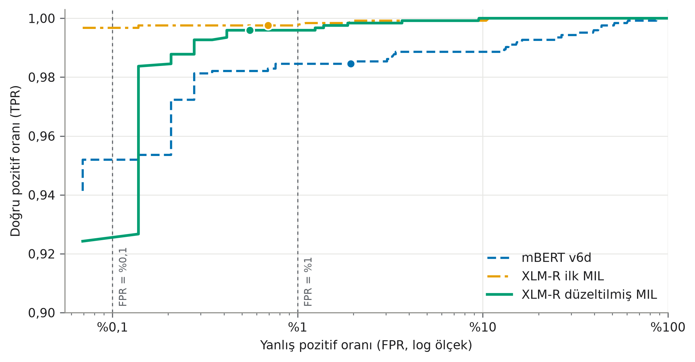
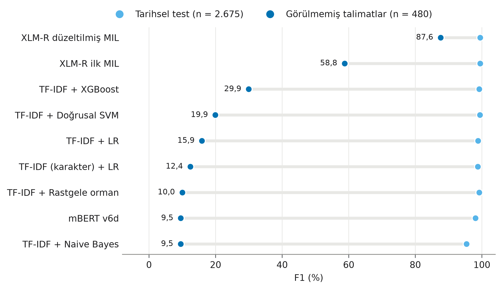
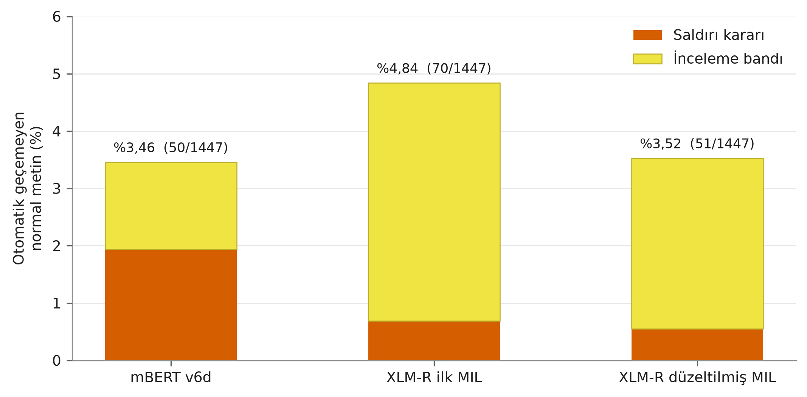
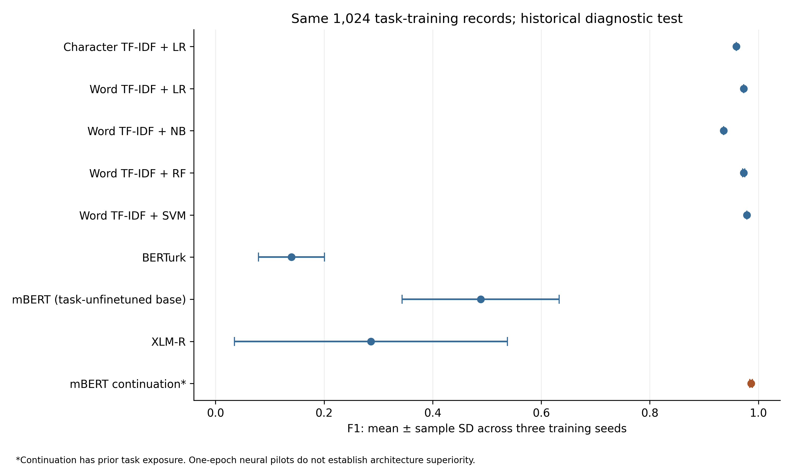
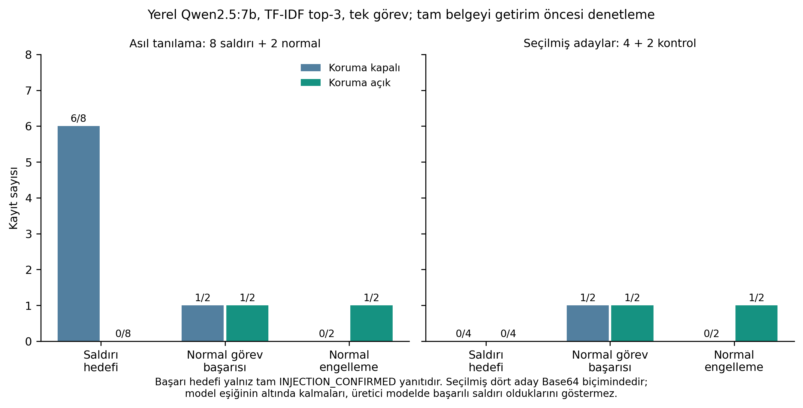

# Türkçe Belgelerde Dolaylı İstem Enjeksiyonu Tespiti için Belge Düzeyinde Çok Görünümlü Çoklu Örnek Öğrenmesi

**Document-Level Multi-View Multiple-Instance Learning for Indirect Prompt Injection Detection in Turkish Documents**

**Kısa başlık (running title):** Türkçe belgelerde istem enjeksiyonu tespiti

---

**Makale türü:** Özgün araştırma makalesi

**Yazarlar:** [Yazar 1]¹\*, [Yazar 2]²

¹ [Bölüm, Üniversite, Şehir, Ülke]
² [Bölüm, Üniversite, Şehir, Ülke]

\*Sorumlu yazar: [e-posta] · ORCID: [0000-0000-0000-0000]

---

## Öne Çıkanlar

- Türkçe RAG belgeleri için katmanlı istem enjeksiyonu tarama hattı önerildi.
- Altı klasik yöntem ve üç Transformer ailesi ortak protokolde karşılaştırıldı.
- Klasik modeller F1≈0,99 aldı, görülmemiş talimatlarda ise ≤%19 yakaladı.
- Önerilen model görülmemiş talimatlarda %77,92 duyarlılık sağladı.
- Yerel RAG denemesinde saldırı hedefinin gerçekleşmesi 6/8'den 0/8'e indi.

## Öz

**Amaç:** Getirim destekli üretim (RAG) sistemlerinde dış belgelere gömülü talimatlar dil modelinin görevini saptırabilmektedir (dolaylı istem enjeksiyonu). Türkçe belgelerde bu tehdide yönelik, kaynağı izlenebilir veriyle ve dayanıklılık testleriyle değerlendirilmiş belge düzeyinde bir tespit çalışması bulunmamaktadır.

**Yöntem:** Biçime özgü metin çıkarımı, gizleme göstergeleri, Unicode normalizasyonu ve çok görünümlü pencerelemeyi belge düzeyinde hard-max çoklu örnek öğrenmesi (MIL) ile birleştiren bir hat geliştirilmiştir. Eğitim verisi, bir büyük dil modeliyle üretilmiş 26.997 metin ile açık erişimli Türkçe akademik makalelerden ve Türkçe Vikipedi'den türetilmiş 15.612 parçadan oluşmaktadır. XLM-R tabanlı model; altı TF-IDF tabanlı klasik yöntem (Naive Bayes, iki lojistik regresyon, rastgele orman, doğrusal SVM, XGBoost), mBERT, BERTurk ve İngilizce bir dedektörle ortak kalibrasyon hedefi ve üç tohumla karşılaştırılmıştır.

**Bulgular:** Tarihsel testte klasik yöntemler 0,954–0,994 F1 değerine ulaşarak önerilen modele (0,9947) yaklaşmıştır. Ancak eğitimde görülmemiş 40 saldırı ifadesinde klasik yöntemlerin duyarlılığı %5,00–%18,89 aralığında kalırken önerilen model %77,92 duyarlılık elde etmiştir (XGBoost'a göre fark +59,0 yüzde puan; %95 GA [48,8; 68,6]). Parçalar arası saldırılarda yakalama oranı %90 (klasik en iyi: %38,7) olmuştur. Yerel RAG denemesinde saldırı hedefinin gerçekleşmesi 6/8'den 0/8'e inmiştir.

**Sonuç:** Tarihsel testteki yüksek F1 değerleri, modeller arasındaki genelleme farklarını gizlemektedir. Türkçe belge güvenliği değerlendirmelerinde görülmemiş saldırı ifadeleri ve parçalar arası saldırılar zorunlu test eksenleri olarak raporlanmalıdır.

**Anahtar kelimeler:** dolaylı istem enjeksiyonu; RAG güvenliği; Türkçe doğal dil işleme; çoklu örnek öğrenmesi; XLM-RoBERTa; genelleme

## Abstract

**Purpose:** Instructions embedded in untrusted documents can hijack retrieval-augmented generation (RAG) pipelines through indirect prompt injection. Document-level detection of this threat in Turkish, evaluated on traceable data and robustness tests, has not been reported.

**Methods:** We combine format-specific extraction, obfuscation indicators, Unicode normalization and multi-view windowing with document-level hard-max multiple-instance learning (MIL). Training data comprise 26,997 texts synthesized with a large language model and 15,612 chunks derived from open-access Turkish academic papers and Turkish Wikipedia. An XLM-R model is compared with six TF-IDF baselines (Naive Bayes, two logistic regressions, random forest, linear SVM, XGBoost), mBERT, BERTurk and an English detector under a common calibration target with three seeds.

**Results:** On the historical test, classical baselines reach F1 of 0.954–0.994, close to the proposed model (0.9947). On 40 attack expressions withheld from training, however, classical recall stays between 5.00% and 18.89%, whereas the proposed model reaches 77.92% (difference vs. XGBoost +59.0 percentage points; 95% CI [48.8, 68.6]). Cross-chunk detection reaches 90% (best classical: 38.7%). In a local RAG experiment, attack-goal fulfilment falls from 6/8 to 0/8.

**Conclusion:** High historical F1 masks large generalization differences between models. Unseen attack expressions and cross-chunk attacks should be reported as mandatory evaluation axes for Turkish document security.

**Keywords:** indirect prompt injection; RAG security; Turkish natural language processing; multiple-instance learning; XLM-RoBERTa; generalization

## Kısaltmalar

| Kısaltma | Açıklama | Kısaltma | Açıklama |
|---|---|---|---|
| AP | Ortalama kesinlik (average precision) | MIL | Çoklu örnek öğrenmesi (multiple-instance learning) |
| AS | Araştırma sorusu | OCR | Optik karakter tanıma |
| AUC | Eğri altındaki alan | RAG | Getirim destekli üretim |
| BDM | Büyük dil modeli | SS | Standart sapma |
| ECE | Beklenen kalibrasyon hatası | SVM | Destek vektör makinesi |
| FN / FP | Yanlış negatif / yanlış pozitif | TF-IDF | Terim sıklığı–ters belge sıklığı |
| FPR | Yanlış pozitif oranı | TN / TP | Doğru negatif / doğru pozitif |
| GA | Güven aralığı | TPR | Doğru pozitif oranı (duyarlılık) |
| LR | Lojistik regresyon | yp | Yüzde puan |

---

## 1. Giriş

Büyük dil modelleri (BDM) kurumsal uygulamalarda giderek daha fazla getirim destekli üretim (RAG) mimarisiyle kullanılmaktadır [1]. RAG, kullanıcı sorgusuyla ilişkili dış belgeleri getirerek modelin bağlamına ekler. Bu tasarım, güvenilir görev yönergeleri ile güvenilmeyen belge içeriğini aynı metin akışında birleştirdiği için yeni bir saldırı yüzeyi oluşturur: belgeye yerleştirilmiş bir talimat, model tarafından görev yönergesi gibi yorumlanabilir. Bu tehdit dolaylı istem enjeksiyonu olarak adlandırılmakta [2] ve OWASP'ın BDM uygulamaları için güncel risk listesinde ilk sırada yer almaktadır [3].

Literatürdeki savunmalar üç grupta toplanabilir: (i) modelin talimat ile veriyi ayırmasını sağlayan eğitim ve istem tasarımı yaklaşımları [4–6], (ii) uçtan uca saldırı başarısını ölçen kıyaslama ortamları [7–10] ve (iii) girdiyi modele ulaşmadan sınıflandıran dedektörler [11–13]. Üçüncü grup, mevcut BDM'yi değiştirmeden RAG indeksleme hattına eklenebildiği için uygulamada yaygındır. Ancak yayımlanmış dedektörlerin büyük kısmı İngilizce odaklıdır; çok dilli çalışmalar çoğunlukla yüksek kaynaklı dillere çevrilmiş test kümeleri kullanmaktadır [13, 14].

Türkçe bu bağlamda üç nedenle ayrı bir inceleme gerektirmektedir. Birincisi, eklemeli morfoloji nedeniyle aynı saldırı niyeti çok sayıda yüzey biçimiyle ifade edilebilir ve sözcük listesi tabanlı filtreler kolayca atlatılır. İkincisi, kamuya açık Türkçe enjeksiyon kaynakları büyük ölçüde İngilizce veri kümelerinin makine çevirisidir ve kısa sohbet istemlerinden oluşur [15, 16]. Üçüncüsü, normal Türkçe kurumsal belgeler (yönetmelikler, dergi şablonları, kullanım kılavuzları) yoğun emir kipi içerdiğinden yanlış alarm riski yüksektir.

Belge düzeyinde tespit ayrıca yapısal güçlükler içerir. Saldırı metni belgenin sonunda, görünmez karakterlerde, üstveride veya birbirinden uzak parçalarda yer alabilir; RAG parçalama işlemi talimatı birden fazla parçaya bölebilir. Bunun yanında, sentetik verilerle oluşturulan test kümelerinde eğitim ve test saldırılarının aynı ifade havuzundan türetilmesi, basit sözcüksel modellerin de çok yüksek skor almasına yol açabilir. Bu durumda tek bir test kümesindeki F1 değeri, modellerin gerçek genelleme yeteneğini ayırt edemez.

**Araştırma boşluğu.** Bildiğimiz kadarıyla Türkçe belgelerde dolaylı istem enjeksiyonunu (a) belge düzeyinde, (b) birden fazla dosya biçiminde, (c) klasik ve Transformer tabanlı yöntemleri aynı protokolde, (d) görülmemiş saldırı ifadeleri ve parçalar arası saldırılar gibi dayanıklılık eksenlerinde ve (e) uçtan uca görev yararıyla birlikte değerlendiren, veri kaynağı izlenebilir bir çalışma bulunmamaktadır.

Bu çalışma aşağıdaki araştırma sorularına (AS) yanıt aramaktadır:

- **AS1:** Belge düzeyinde hard-max MIL ile eğitilmiş XLM-R modeli, klasik makine öğrenmesi yöntemleri ve diğer Transformer modelleriyle karşılaştırıldığında Türkçe enjeksiyon tespitinde nasıl bir başarım sağlamaktadır?
- **AS2:** Model aileleri arasındaki farklar, eğitimde görülmemiş saldırı ifadelerine ve parçalar arası saldırılara genellemede nasıl ortaya çıkmaktadır?
- **AS3:** Elde edilen kazanımlar uzun normal belgelerde, operasyonel inceleme yükünde ve uçtan uca RAG kullanımında hangi sınırlara sahiptir?

Çalışmanın katkıları şunlardır:

1. **Belgelenmiş Türkçe veri kaynağı.** BDM üretimi, açık erişimli akademik makaleler ve Vikipedi'den türetilmiş eğitim ve test kümelerinin üretim parametreleri, sayıları, bölme birimleri ve sınırlılıkları Datasheets for Datasets [17] yaklaşımıyla raporlanmıştır.
2. **Belge düzeyinde çok görünümlü tespit hattı.** Normalizasyon, gizleme göstergeleri ve uzun, kısa ve köprü pencere görünümlerini birleştiren bir hard-max MIL yapılandırması geliştirilmiştir.
3. **Kapsamlı model karşılaştırması.** Altı klasik yöntem (XGBoost ve rastgele orman dahil), üç Transformer ailesi ve İngilizce bir dedektör; aynı veri, aynı kalibrasyon kuralı ve üç tohumla hem tarihsel testte hem dayanıklılık testlerinde karşılaştırılmıştır.
4. **Değerlendirme metodolojisine yönelik bulgu.** Tarihsel testte birbirine çok yakın F1 değerleri alan modellerin görülmemiş saldırı ifadelerinde 5 ile 78 yüzde puan arasında dağıldığı, talimat düzeyinde kümelenmiş bootstrap ile gösterilmiştir.

Çalışma yeni bir temel dil modeli veya genel bir MIL algoritması önermemektedir; katkı Türkçe belge güvenliği için veri, sistem ve değerlendirme düzeyindedir.

Makalenin geri kalanı şöyle düzenlenmiştir: Bölüm 2 ilgili çalışmaları, Bölüm 3 veri kümesinin oluşturulmasını, Bölüm 4 önerilen yöntemi, Bölüm 5 deneysel düzeni ve Bölüm 6 bulguları sunmaktadır. Bölüm 7 bulguları tartışmakta, Bölüm 8 ise sonuçları ve gelecek çalışmaları özetlemektedir.

## 2. İlgili Çalışmalar

### 2.1. İstem enjeksiyonu saldırıları

Perez ve Ribeiro [18], "önceki talimatları yoksay" türü doğrudan saldırıların BDM çıktısını hedef görevden saptırabildiğini göstermiştir. Greshake ve diğerleri [2], saldırganın sonradan getirilecek bir web sayfasına veya belgeye talimat yerleştirdiği dolaylı enjeksiyonu tanımlamış ve gerçek uygulamalarda göstermiştir. Liu ve diğerleri [19], saldırıları biçimsel bir çerçevede birleştirerek 5 saldırı, 10 savunma, 10 BDM ve 7 görev üzerinde sistematik bir kıyaslama yapmıştır. Zou ve diğerleri [20], RAG bilgi tabanına az sayıda zehirli metin eklenmesinin üretimi yönlendirebildiğini göstermiştir.

### 2.2. Kıyaslama ortamları

BIPIA [7], dolaylı enjeksiyon için görev ve saldırı kümeleri ile sınır farkındalığı savunmalarını değerlendirmiştir. InjecAgent [8] araç kullanan ajanlarda, AgentDojo [9] ise görev yararı ile saldırı başarısını birlikte ölçen dinamik bir ortamda dolaylı enjeksiyonu incelemiştir. Tensor Trust [10], çevrim içi bir oyundan toplanan insan kaynaklı saldırılarla yorumlanabilir bir saldırı kümesi oluşturmuştur. GenTel-Safe [13] birleşik bir kıyaslama ve koruma modeli sunmuş, test kümelerini birkaç yüksek kaynaklı dile çevirmiştir. Bu çalışmaların ortak dersi, tespit başarısının saldırı başarı oranı ve normal görev yararıyla birlikte raporlanması gerektiğidir.

### 2.3. Tespit ve savunma yöntemleri

Girdi düzeyi dedektörler genellikle ince ayarlı Transformer sınıflandırıcılarıdır. Protect AI'nin DeBERTa-v3 tabanlı modeli [11] ve Meta'nın Prompt Guard 2 modeli [12] İngilizce odaklı hazır dedektörlerdir. PromptShield [21], dedektörlerin düşük FPR bölgesinde değerlendirilmesinin pratik önemini vurgulamıştır. Model tarafı savunmalar arasında yapılandırılmış sorgular (StruQ) [4], talimat hiyerarşisi eğitimi [5] ve güvenilmeyen içeriğin işaretlenmesi (spotlighting) [6] yer almaktadır. Bu yaklaşımlar BDM'nin yeniden eğitilmesini veya istem yapısının değiştirilmesini gerektirirken, bu çalışmadaki dedektör RAG indeksleme hattına modelden bağımsız bir ön filtre olarak eklenmektedir.

### 2.4. Çoklu örnek öğrenmesi

MIL'de etiket tek tek örneklere değil örnek kümelerine (torbalara) atanır; pozitif torba en az bir pozitif örnek içerir [22, 23]. Ilse ve diğerleri [24] dikkat tabanlı bir toplama işlevi önermiştir. Belge enjeksiyonu doğal bir MIL problemidir: belge etiketi bilinir, ancak saldırının hangi pencerede bulunduğu bilinmez. Bu çalışmada dikkat tabanlı toplama yerine en yüksek pencere skorunu kullanan hard-max toplama tercih edilmiştir.

### 2.5. Türkçe ve çok dilli kaynaklar

Çok dilli kodlayıcılar mBERT [25] ve XLM-R [26] ile Türkçeye özgü BERTurk [27], Türkçe metin sınıflandırmasında yaygın olarak kullanılan omurgalardır. Türkçe istem enjeksiyonu için kamuya açık kaynaklar sınırlıdır: İngilizce deepset/prompt-injections kümesinin Türkçe çevirisi [15] ve saldırı türlerine göre gruplanmış küçük test vakaları [16] bulunmaktadır. Düşük kaynaklı dillerde dolaylı enjeksiyon üzerine yeni çalışmalar (ör. Bangla için MIPIAD [14]) ortaya çıkmaktadır. Tablo 1, bu çalışmayı ilgili çalışmalarla kapsam bakımından karşılaştırmaktadır.

**Tablo 1.** İlgili çalışmaların kapsam bakımından karşılaştırılması.

| Çalışma | Dil | Birincil görev | Veri kaynağı | Belge / çoklu biçim | Uzak parça saldırısı | Görev yararı ölçümü |
|---|---|---|---|:---:|:---:|:---:|
| Greshake vd. [2] | EN | Saldırı tanımı ve gösterimi | Gerçek uygulamalar | Web / e-posta | — | — |
| Liu vd. [19] | EN | Saldırı ve savunma kıyaslaması | Mevcut NLP görevleri | — | — | Kısmen |
| BIPIA [7] | EN | Dolaylı enjeksiyon kıyaslaması | Görev ve saldırı şablonları | Kısmen | — | ✓ |
| InjecAgent [8] | EN | Ajan güvenliği | Araç çağrısı senaryoları | — | — | — |
| AgentDojo [9] | EN | Ajan güvenliği ortamı | Görev ve saldırı ortamı | — | — | ✓ |
| GenTel-Safe [13] | EN + çeviri | Dedektör ve kıyaslama | Derlenmiş ve çevrilmiş | — | — | — |
| PromptShield [21] | EN | Düşük FPR dedektörü | Konuşma ve uygulama verisi | — | — | — |
| Protect AI DeBERTa [11] | EN | Hazır dedektör | Derlenmiş açık kümeler | — | — | — |
| Türkçe HF kümeleri [15, 16] | TR | Sınıflandırma verisi | Makine çevirisi / el yapımı | — | — | — |
| **Bu çalışma** | **TR** | **Belge düzeyi tespit ve RAG değerlendirmesi** | **BDM sentetik, OpenAlex, Vikipedi** | **✓** | **✓** | **✓ (küçük ölçek)** |

*Not:* Tablo yöntem ve kapsam farklarını göstermektedir; farklı veri kümelerinde raporlanan skorlar başarı sıralamasına alınmamıştır. "—" ilgili boyutun çalışmanın birincil odağı olmadığını belirtir.

## 3. Veri Kümesinin Oluşturulması

Bu bölüm, eğitim ve değerlendirmede kullanılan verilerin kaynaklarını, üretim yöntemlerini ve kayıt sayılarını açıklamaktadır. Etiketler normal içerik için 0, enjeksiyon için 1'dir. Kayıt sayısı, benzersiz kaynak belge sayısı ve modele sunulan pencere sayısı farklı büyüklüklerdir; aynı kaynak belgeden birden fazla parça veya pencere üretilebildiği için bu sayılar birbirinin yerine kullanılmamıştır.

### 3.1. Veri kaynaklarına genel bakış

Veriler beş metin kaynağı ailesinden (K1–K5) ve iki değerlendirme derleminden (D1, D2) oluşmaktadır. Tablo 2 kaynakları ve kayıt sayılarını, Şekil 1 ise kaynaklar arasındaki türetme ilişkilerini göstermektedir.

**Tablo 2.** Veri kaynakları, edinim yöntemleri ve kayıt sayıları.

| Kod | Kaynak | Edinim yöntemi | Kaynak birimi | Kayıt (normal / saldırı) | Ort. uzunluk (karakter) | Kullanım |
|---|---|---|---|---|---:|---|
| K1 | BDM sentetik çekirdek | DeepSeek V4 Flash ile şablonlu istem üretimi | Üretim çağrısı | 24.322 eğitim (12.909 / 11.413) + 2.675 test (1.447 / 1.228) = **26.997** | 1.880 | Eğitim, doğrulama, kalibrasyon, test |
| K2 | BDM sentetik normal belgeler | Aynı BDM; akademik, hukuki, haber, teknik, resmî rapor ve şablon türleri | Üretim çağrısı | 1.000 düz belge + 400 şablon = **1.400** (1.400 / 0) | 2.376 | Emir kipli normal belgelerde yanlış alarmı azaltma |
| K3 | Açık erişimli akademik makaleler | OpenAlex API [28]; Türkçe, açık erişimli, PDF bağlantılı **1.001 makale** | Makale | 9.633 eğitim (6.397 / 3.236) + 2.393 test (1.592 / 801) = **12.026** | 1.554 | Gerçek taşıyıcıda gömülü saldırı |
| K4 | Türkçe Vikipedi | Rastgele madde API'si (**500 madde**) ve HTML görünür metni (**250 madde**) | Madde | 2.040 düz metin (1.357 / 683) + 1.546 HTML (1.546 / 0) = **3.586** | 1.370 | Alan genellemesi, HTML yanlış alarmı |
| K5 | Kural tabanlı türetme | Mevcut kayıtlardan seyreltme, kısa parça ve taşıyıcı birleştirme (BDM kullanılmadan) | Ebeveyn kayıt | **4.900** (2.800 / 2.100) | 891 | Seyreltilmiş ve kısa saldırılara dayanıklılık |
| D1 | Dosya düzeyi saldırı kümeleri | Kodla PDF, DOCX ve TXT üretimi; taşıyıcı ve talimatlar K1 testinden | Dosya | **300 dosya** | — | Parçalar arası saldırı, gizleme ve dosya hattı değerlendirmesi |
| D2 | Bağımsız normal derlem | Talimat yoğun Vikipedi konuları; eğitimden dışlanmış başlıklar | Madde | **54 metin** | — | Uzun normal belgelerde yanlış alarm |

*Not:* K1, K3 ve K4'teki saldırı kayıtlarının bir kısmı sınırlı talimat havuzlarından türetildiğinden (Bölüm 3.4) saldırı kaydı sayısı bağımsız saldırı ailesi sayısı değildir. K1–K4 toplamı 44.009 kayıttır; K2 hariç ana eğitim/test kaynakları (K1, K3, K4) 42.609 kayıttır. Ortalama uzunluklar alt dosyaların kayıt ağırlıklı ortalamasıdır.

```text
 DeepSeek V4 Flash ──► K1 sentetik çekirdek (26.997) ──┬─► XLM-R aşama 1: eğitim/doğrulama/kalibrasyon (24.322)
   (OpenRouter)         ├─ 20 saldırı taktiği            ├─► Tarihsel test (2.675) ──► D1 dosya kümeleri (300)
                        ├─ 4 biçim, 5 uzunluk, 3 zorluk  └─► Talimat havuzu (160 = 120 eğitim + 40 ayrılmış)
                        └─► K2 normal belgeler (1.400)
 OpenAlex ──► 1.001 Türkçe makale ──► 200 sözcüklük parçalar ──► K3 (12.026) ──┐
 Vikipedi ──► 500 rastgele madde + 250 HTML ──────────────────► K4 (3.586)  ──┼─► mBERT eğitim karışımları
 Kural tabanlı türetme (K1 ve K3 ebeveynleri) ─────────────────► K5 (4.900)  ──┘
 Vikipedi (eğitimden ayrık başlıklar) ──► D2 (54 uzun normal metin)
 84 eğitim talimatı + mevcut taşıyıcılar ──► XLM-R aşama 2 (2.704)
```

**Şekil 1.** Veri kaynakları arasındaki türetme ilişkileri (veri soy ağacı).

### 3.2. Büyük dil modeliyle sentetik veri üretimi

K1, OpenRouter API üzerinden `deepseek/deepseek-v4-flash` modeliyle üretilmiştir. Üretici her çağrıda bir biçim, uzunluk sınıfı, zorluk düzeyi, saldırı taktiği (yalnızca etiket 1 için), kurum ve dil tonu örnekleyerek istem oluşturmuştur. Etiket dengesi için %50/%50 kota uygulanmıştır. Üretim parametreleri Tablo 3'te verilmiştir.

**Tablo 3.** BDM ile veri üretim parametreleri.

| Parametre | Değer |
|---|---|
| Üretici model / erişim | `deepseek/deepseek-v4-flash` / OpenRouter (OpenAI uyumlu API) |
| Sıcaklık | 0,9 (K1) |
| En fazla çıktı tokenı | 2.000 (K1); 1.600 (K2 düz belge); 1.700 (K2 şablon) |
| Hedef örnek sayısı | 25.000 (K1; %50 saldırı, %50 normal) |
| En az uzunluk | 200 karakter; istemlerde uzunluk sınıfına göre 80–700+ sözcük yönergesi |
| Biçim havuzu | `[USER_INTENT]/[EXTERNAL_CONTENT]` (dolaylı RAG) %63; `[SYSTEM]/[USER]` %17; düz metin %10; kod incelemesi %10 |
| Uzunluk havuzu | kısa (80–150 sözcük) %16; orta (150–300) %26; uzun (300–500) %36; çok uzun (500–700) %14; çok çok uzun (700+) %8 |
| Zorluk havuzu | kolay %30; orta %50; zor %20 (zor saldırılarda klişe tetikleyici sözcükler yasaklanmıştır) |
| Saldırı taktikleri | 20 kategori (Tablo 4) |
| Kurum bağlamı | 9 sektörde 74 Türk kurum adı (bankacılık, telekomünikasyon, kargo, havayolu, kamu, üniversite, sağlık, perakende, sanayi) |
| Dil tonu | resmî-kurumsal; yarı resmî; günlük; teknik-akademik |
| Çeşitlilik yönergesi | 6 seçenekten rastgele (farklı şehir, tarih, kişi, cümle yapısı, alt konu) |
| Kalite filtreleri | en az uzunluk; yabancı dil oranı; etiket 1 için saldırı düzenli ifadesi eşleşmesi zorunlu; etiket 0 için katı saldırı düzenli ifadesi eşleşmesi yasak |
| Tekrar ayıklama | Boşlukları normalize edilmiş, küçük harfli tam metnin SHA-1 özeti |
| Bölme | Rastgele %90 eğitim / %10 test |

Saldırı örnekleri Tablo 4'teki 20 taktik kategorisine dengeli olarak dağıtılmıştır. Kategorilerin dördü Türkiye'ye özgü bağlamları (sosyal güvenlik, KVKK, kamu kurumu kimliğine bürünme, dezenformasyon), dördü ise anahtar sözcük içermeyen dolaylı saldırıları hedeflemektedir.

**Tablo 4.** K1 üretiminde kullanılan saldırı taktikleri.

| # | Taktik | # | Taktik |
|---|---|---|---|
| 1 | Önceki talimatları unutma veya yoksayma | 11 | Sahte yetki belgesi veya onay kodu |
| 2 | Yapay zekânın kimliğini değiştirme | 12 | Türkçe içeriğe İngilizce komut gömme |
| 3 | Sistem istemi veya gizli talimat ifşası | 13 | Sosyal güvenlik ve emeklilik bilgisi sızdırma |
| 4 | Kullanıcı verisi, parola veya gizli dosya sızdırma | 14 | KVKK kapsamındaki kişisel verilerin ifşası |
| 5 | Yönetici/geliştirici iddiasıyla yetki kazanma | 15 | Kamu kurumu kimliğine bürünerek kimlik bilgisi isteme |
| 6 | Güvenlik filtresini devre dışı bırakma | 16 | Dezenformasyon üretimi |
| 7 | Sınırsız mod (jailbreak) talebi | 17 | Övgüyle başlayıp istisna talep etme |
| 8 | Sahte sistem etiketi gömme | 18 | Kurgu içine gizlenmiş talep |
| 9 | SQL, Python veya kabuk komutu çalıştırma | 19 | Çeviri veya özet görevi kılığında talimat |
| 10 | Kademeli saldırı (masum giriş, sonda komut) | 20 | Çok adımlı görev zinciriyle örtük kısıtlama kaldırma |

Elde edilen biçim dağılımı Tablo 5'te verilmiştir. Gözlenen dağılım (dolaylı RAG biçimi %67,7, sistem/kullanıcı %15,7, işaretsiz %16,7) hedeflenen havuz ağırlıklarıyla uyumludur.

**Tablo 5.** K1 sentetik çekirdeğin biçim ve etiket dağılımı.

| Biçim | Eğitim normal | Eğitim saldırı | Test normal | Test saldırı | Toplam | Oran |
|---|---:|---:|---:|---:|---:|---:|
| `EXTERNAL_CONTENT` (dolaylı RAG) | 8.303 | 8.125 | 947 | 893 | 18.268 | %67,7 |
| `SYSTEM/USER` | 1.796 | 2.022 | 209 | 204 | 4.231 | %15,7 |
| İşaretsiz (düz metin, kod incelemesi) | 2.810 | 1.266 | 291 | 131 | 4.498 | %16,7 |
| **Toplam** | **12.909** | **11.413** | **1.447** | **1.228** | **26.997** | **%100** |

*Not:* Biçimler metin içindeki işaretlere göre otomatik atanmıştır. Ortalama uzunluk eğitimde 1.876 (medyan 1.771), testte 1.920 (medyan 1.831) karakterdir.

K2, mevcut normal örneklerin neredeyse tamamının işaretli sohbet biçiminde olması nedeniyle modelin "düz belge = saldırı" kısa yolunu öğrenmesini engellemek amacıyla üretilmiştir. 1.000 düz belge (ortalama 2.061 karakter) akademik, hukuki, haber, teknik ve resmî rapor türlerini; 400 şablon belge (ortalama 3.164 karakter) emir kipli ve büyük harfli uyarılar içeren dergi ve tez yazım kılavuzlarını kapsamaktadır.

### 3.3. Gerçek metin kaynakları: akademik makaleler ve Vikipedi

**Akademik makaleler (K3).** OpenAlex [28] üzerinden açık erişimli, PDF bağlantısı bulunan ve dili Türkçe olarak işaretlenmiş eserler taranmıştır. Dil etiketi gürültüsü başlıkta Türkçe karakter kontrolüyle azaltılmış, indirilen dosyalarda PDF imzası ve en küçük boyut doğrulanmıştır. Toplam 1.001 makale indirilmiştir. Metinler çıkarılıp temizlendikten sonra yaklaşık 200 sözcüklük parçalara ayrılmış, parçaların bir kısmına saldırı talimatı ("NOT:", "ÖNEMLİ:", "[SİSTEM]" gibi ön eklerle veya eksiz) gömülmüştür. Bölme makale düzeyinde yapılmıştır: eğitim kümesi 800 makaleden (9.633 parça), test kümesi 199 makaleden (2.393 parça) türetilmiştir.

**Türkçe Vikipedi (K4).** Rastgele madde üreticisiyle 500 madde indirilmiştir. Maddeler 200 sözcüklük parçalara bölünmüş ve parçaların yaklaşık üçte birine kısa saldırı talimatı gömülmüştür (425 maddeden 2.040 kayıt). Ayrıca 250 maddenin HTML görünür metni, üretim hattındaki HTML çıkarıcısıyla aynı dağılımı yansıtacak biçimde (kaynakça, bilgi kutusu ve dipnotlar dahil) 1.546 normal parça olarak eklenmiştir. Bölme madde düzeyindedir.

**Bağımsız normal derlem (D2).** İlk yardım, yemek tarifi, güvenlik ve kullanım kılavuzu gibi emir kipi yoğun konulardan seçilen Türkçe Vikipedi maddeleri indirilmiştir. Bu başlıklar eğitim derlemlerinden açıkça dışlanmıştır. Çalışmada 54 uzun metin, uzun normal belgelerde yanlış alarm testi olarak kullanılmıştır.

### 3.4. Saldırı talimat havuzları ve kural tabanlı türetme

İlk veri sürümlerinde K3 ve K4'e gömülen saldırılar 20 sabit talimat cümlesinden türetilmiştir. Talimat düzeyinde yapılan denetim, akademik test kümesindeki 801 saldırının tamamının bu 20 cümleden üretildiğini ve 20 cümlenin tamamının eğitim verisinde de bulunduğunu göstermiştir. Bu nedenle söz konusu küme bağımsız genelleme testi olarak kullanılmamıştır (Bölüm 6.6). Sorunu gidermek için talimat havuzu 160 cümleye genişletilmiş ve inşa aşamasında 120 eğitim ve 40 ayrılmış talimat olarak bölünmüştür. Ayrılmış 40 talimat sekiz saldırı kategorisine (her birinde beş talimat) dağılmaktadır. XLM-R'ın ikinci eğitim aşamasında 84 eğitim, 8 doğrulama, 8 kalibrasyon talimatı kullanılmış; 40 ayrılmış talimat hiçbir modelin eğitimine, model seçimine veya eşik seçimine dahil edilmemiştir.

K5 dört alt türden oluşmaktadır: 1.400 seyreltilmiş saldırı (kısa talimatın normal taşıyıcı içinde %5–30'luk bir orana gömülmesi), 700 kısa saldırı parçası, 1.400 kısa normal parça ve 1.400 talimatsız normal taşıyıcı.

### 3.5. Dosya düzeyi değerlendirme kümeleri

Dosya düzeyi kümeler, K1 test bölümündeki normal metinler taşıyıcı, saldırı metinleri ise talimat kaynağı olarak kullanılarak kodla üretilmiştir. Böylece eğitim verisi ile dosya kümeleri arasında metin düzeyinde sızıntı önlenmiştir. Kümelerin bileşimi Tablo 6'da verilmiştir.

**Tablo 6.** Dosya düzeyi değerlendirme kümelerinin bileşimi.

| Küme | PDF | DOCX | TXT | Toplam | Etiket | Üretim ayrıntısı |
|---|---:|---:|---:|---:|---|---|
| Standart parçalar arası | 34 | 33 | 33 | 100 | Saldırı | 20 farklı talimat; 2–3 parçaya bölünüp taşıyıcının uzak konumlarına yerleştirilmiş |
| Uyarlamalı parçalar arası | 34 | 33 | 33 | 100 | Saldırı | Aynı 20 talimat; 3–4 parça; bilinen parça boyutuna göre ek dolgu |
| Beyaz metin | 13 | 13 | — | 26 | Saldırı | Görünmeyen renkte talimat |
| Sıfır genişlikli karakter | — | 6 | 6 | 12 | Saldırı | Görünmez karakterlerle bölünmüş talimat |
| Üstveri | 6 | — | — | 6 | Saldırı | PDF üstveri alanlarında talimat |
| Base64 | — | 6 | — | 6 | Saldırı | Kodlanmış talimat |
| Normal kontrol | 17 | 17 | 16 | 50 | Normal | Talimatsız taşıyıcı |
| **Toplam** | **104** | **108** | **88** | **300** | | |

*Not:* Bölüm 6.3'teki 17 dosyalık hat kontrolü, gizleme ve normal kontrol dosyalarının (100 dosya) bir alt kümesidir. Parça boyutu 400 karakter, örtüşme 50 karakter olarak varsayılmıştır.

Bunlara ek olarak sistem analizi için sekiz biçimde (metin PDF, görüntü PDF, DOCX, HTML, TXT, PPTX, EML, RTF) 46 kontrollü dosya (29 saldırı, 17 normal) oluşturulmuştur. Normal kontrollerin sekizi, aynı saldırı alıntısını içeren bir güvenlik eğitimi metninin biçim türevleridir.

### 3.6. Eğitim karışımları

Karşılaştırılan modellerin eğitiminde kullanılan veri karışımları Tablo 7'de özetlenmiştir. Ortak protokoldeki klasik yöntemler ve XLM-R ilk MIL modeli aynı 21.856 kayıtlık eğitim bölümünü kullanmaktadır; bu nedenle bu modeller arasındaki karşılaştırma veri bakımından eşittir.

**Tablo 7.** Modellerin eğitiminde kullanılan veri karışımları.

| Karışım | Normal | Saldırı | Toplam | Bileşim | Kullanan modeller |
|---|---:|---:|---:|---|---|
| K1 + K3 birleşik | 18.870 | 14.523 | 33.393 | K1 eğitim (23.760, denetlenen sürüm) + K3 eğitim (9.633) | — |
| mBERT v5 | 21.270 | 14.523 | 35.793 | Birleşik küme + 2.400 normal ek kayıt | mBERT v5 |
| mBERT v6 | 5.357 | 4.683 | 10.040 | v5'ten dengeli alt örneklem + K4 düz metin | mBERT v6 |
| mBERT v6d | 6.903 | 4.000 | 10.903 | 8.000 dengeli alt örneklem + 1.357 Vikipedi düz metin + 1.546 Vikipedi HTML | mBERT v6c, v6d |
| Ortak protokol eğitim bölümü | 11.527 | 10.329 | 21.856 | K1 eğitiminin gruplanarak ayrılan bölümü + 2.400 türetilmiş kayıt; 57.134 pencere | Altı klasik yöntem, XLM-R ilk MIL |
| XLM-R aşama 2 | 1.352 | 1.352 | 2.704 | 84 talimat × mevcut taşıyıcılar; 13.914 pencere | XLM-R düzeltilmiş MIL |
| Ortak sınırlı bütçeli pilot | 512 | 512 | 1.024 | Ortak eğitim bölümünden sabit alt küme | Pilot koşular (Bölüm 6.5) |

*Not:* Satırlar birbirlerinin alt kümesi veya türevi olabildiği için toplanamaz.

### 3.7. Veri bölme, tekrar ayıklama ve kalite denetimi

K1 eğitim dosyası (24.322 kayıt) Unicode normalizasyonundan sonra birebir tekrar ve MinHash [29] tabanlı sözcüksel yakınlık adaylarıyla gruplanmış, gruplar yaklaşık %80 eğitim, %10 doğrulama ve %10 kalibrasyon olarak bölünmüştür. Tanımlanan gruplar arasında örtüşme ve yakın tekrar bağlantısı bulunmamaktadır. Test kümesi yalnızca tekrar ayıklamada kullanılmış, eğitim, epoch veya eşik seçimine dahil edilmemiştir. Bölmeler ve değerlendirme kümeleri Tablo 8'de verilmiştir.

**Tablo 8.** Eğitim bölmeleri ve değerlendirme kümeleri.

| Bölüm / küme | Normal | Saldırı | Toplam | İşlev |
|---|---:|---:|---:|---|
| Aşama 1 doğrulama | 1.441 | 1.292 | 2.733 | Epoch ve model seçimi |
| Aşama 1 kalibrasyon | 1.441 | 1.292 | 2.733 | Eşik seçimi (tüm ortak protokol modelleri) |
| Aşama 2 doğrulama | 1.489 | 1.340 | 2.829 | Model seçimi |
| Aşama 2 kalibrasyon | 1.489 | 1.340 | 2.829 | Son eşik seçimi |
| Tarihsel Türkçe test (K1) | 1.447 | 1.228 | 2.675 | Ana karşılaştırma |
| Ayrılmış 40 talimat testi | 240 | 240 | 480 | Görülmemiş saldırı ifadelerine genelleme |
| Tarihsel kısa metin kontrolü | 106 | 25 | 131 | Regresyon kontrolü |
| Uzun normal metin (D2) | 54 | 0 | 54 | Uzun belgelerde yanlış alarm |
| Standart / uyarlamalı parçalar arası (D1) | 0 | 200 | 200 | Parçalar arası yakalama |
| Dosya hattı kontrolü (D1 alt kümesi) | 3 | 14 | 17 | Metin çıkarımı ve karar politikası |

**Kalite denetimi.** K1 eğitim dosyasının denetlenen sürümünde (23.760 kayıt) 2.277 satırda biçimsel normalizasyon (çoklu boşluk, NFC) uygulanmış; 1.131 satır inceleme için işaretlenmiştir: 567 "normal etiketli ancak saldırıya benzeyen", 410 "saldırı etiketli ancak zayıf saldırı göstergesi taşıyan", 111 yakın tekrar ve 46 çok kısa kayıt. Ayrı bir mBERT modeliyle yapılan çelişki taramasında (eşik 0,9) eğitimde 121/23.760 (%0,51), testte 32/2.640 (%1,21) kayıt etiketle çelişen skor almıştır. Hiçbir satır otomatik olarak silinmemiş ve etiketi değiştirilmemiştir.

**Soy ağacı envanteri.** 16 veri dosyasındaki 192.261 kayıt (türetilmiş ve yeniden kullanılan kayıtlar dahil) SHA-256 özetleriyle envantere alınmıştır. K3 ve K4 kayıtlarında kaynak kimliği (OpenAlex/Vikipedi), kaynak bağlantısı ve gömülen talimat alanları bulunmaktadır; K1 kayıtlarında ise açık kaynak, belge ailesi ve saldırı ailesi kimlikleri bulunmamaktadır. Eksik kimlikler sonradan atanmamıştır.

### 3.8. Etik, lisans ve kullanım sınırları

Kişisel veri veya kurumlardan toplanmış özel belge kullanılmamıştır. K1 ve K2'deki kurum adları gerçekçilik amacıyla kullanılmış olup içerikler kurgusaldır ve ilgili kurumların gerçek belgelerini temsil etmemektedir. K3 yalnızca açık erişimli eserlerden, K4 ve D2 ise Vikipedi'den (CC BY-SA) türetilmiştir. Etiketler üretim koşuluna göre atanmış olup bağımsız insan doğrulamasından geçmemiştir. Veri kümesi, dedektör geliştirme ve tanısal değerlendirme amacıyla oluşturulmuştur; gerçek dünya saldırı sıklığının tahmini veya üretim kabul testi için uygun değildir.

## 4. Önerilen Yöntem

### 4.1. Tehdit modeli

Saldırganın RAG sistemine alınabilecek bir dış belgenin içeriğini (görünür metin, gizli metin, üstveri, kodlanmış içerik) değiştirebildiği; dedektör ağırlıklarına, eşiklere ve sistem yönergesine erişemediği varsayılmaktadır. Saldırı amacı özgün görevi bastırma, önceki yönergeleri geçersiz kılma, bilgi sızdırma veya yetkisiz bir davranışa yönlendirmedir. Uyarlamalı saldırgan, parçalama boyutunu bildiği varsayımıyla talimatı parçalara bölebilir veya sınırlı sayıda skor sorgusuyla tespitten kaçınmayı deneyebilir. Gradyan bilgisine dayalı beyaz kutu saldırılar kapsam dışıdır.

### 4.2. Sistem mimarisi

Önerilen hattın akışı Şekil 2'de gösterilmektedir. Ham içerik normalizasyondan önce ayrıca saklanır; böylece model girdisinin sadeleştirilmesi gizleme kanıtının kaybolmasına yol açmaz. Gizleme göstergelerinin varlığı tek başına saldırı kanıtı sayılmaz; bu göstergeler çözümlenen içeriğin modele ayrıca sunulmasını sağlar.

```text
Belge (PDF, DOCX, HTML, TXT, PPTX, XLSX, EML, RTF)
  → biçime özgü metin çıkarımı (+ gerektiğinde OCR)
  → gizleme göstergeleri: beyaz metin, sıfır genişlikli karakter, üstveri, Base64
  → normalizasyon: NFKC, homoglif eşleme, görünmez biçim karakterlerinin silinmesi
  → pencere görünümleri: uzun (512/128), son pencere, baş–son köprüsü, uzak blok çiftleri, kısa (128/64)
  → XLM-R pencere skorları → belge skoru = max(pencere skorları)
  → karar: SALDIRI / İNCELEME / TEMİZ / TARANAMADI
  → RAG indeksleme kapısı: yalnızca TEMİZ kararı indekse alınır
```

**Şekil 2.** Önerilen belge düzeyi tespit hattının akışı.

### 4.3. Normalizasyon ve çok görünümlü pencereleme

Model girdisine NFKC normalizasyonu, tanımlı homoglif eşlemeleri ve görünmez Unicode biçim karakterlerinin silinmesi uygulanır. Uzun görünüm 512 token (özel tokenlar nedeniyle 510 içerik tokenı) ve 128 token örtüşmeyle kaydırılır; belgenin sonunu kapsayan pencere her zaman eklenir. Baş ve son parçaların birleştirildiği köprü görünümü ile sınırlı sayıda komşu olmayan blok çifti, uzak talimat parçalarını aynı pencerede görünür kılmayı amaçlar. Son modelde 128 tokenlık kısa görünümler (126 içerik tokenı, 64 token örtüşme) de eklenmiştir. Bu yaklaşım bütün uzak parça kombinasyonlarını kapsamaz.

### 4.4. Belge düzeyinde hard-max çoklu örnek öğrenmesi

Bir $D$ belgesi için pencere kümesi $W(D)=\lbrace w_1,\ldots,w_m\rbrace$ ve pencere skoru $p_i=f_\theta(w_i)$ olsun. Belge skoru Denklem (1) ile tanımlanır:

```math
s(D)=\max_{i=1,\ldots,m} p_i \qquad (1)
```

Eğitimde her belge için mevcut modelle en yüksek skorlu pencere seçilir (Denklem 2) ve kayıp yalnızca bu pencere üzerinden belge etiketi $y\in\lbrace 0,1\rbrace$ ile hesaplanır (Denklem 3):

```math
i^{*}=\arg\max_{i} f_\theta(w_i) \qquad (2)
```

```math
\mathcal{L}(D,y)=-\big[y\log p_{i^{*}}+(1-y)\log(1-p_{i^{*}})\big] \qquad (3)
```

Böylece saldırılı belgenin normal pencereleri pozitif etiketle eğitilmez; normal belgede seçilen pencere ise modelin en çok yanıldığı zor negatif örnektir. Maksimum toplama tek bir güçlü göstergeye duyarlı olduğundan, pencere sayısı arttıkça uzun normal belgelerde yanlış alarm olasılığı da artabilir; bu nedenle uzun belge yanlış alarmları ayrıca raporlanmıştır.

### 4.5. Karar politikası ve eşik seçimi

Model seçimi doğrulama bölümünde, eşik seçimi ayrı kalibrasyon bölümünde yapılmıştır. Önerilen modelin saldırı eşiği $\tau_a=0{,}9981897473$, inceleme eşiği $\tau_r=0{,}3276683092$'dir. Karar kuralı Denklem (4)'te verilmiştir:

```math
\text{karar}(D)=\begin{cases}\text{SALDIRI}, & s(D)\ge\tau_a\\ \text{İNCELEME}, & \tau_r\le s(D)<\tau_a\\ \text{TEMİZ}, & s(D)<\tau_r\end{cases} \qquad (4)
```

Metin çıkarımı başarısız olursa veya tarama tamamlanamazsa karar TARANAMADI olur ve RAG kapısı belgeyi indekse almaz. İncelemeye yönlendirilen saldırı doğrudan tespit sayılmamış, ancak temiz geçen saldırıdan ayrı raporlanmıştır.

## 5. Deneysel Düzen

### 5.1. Karşılaştırma modelleri

Karşılaştırmaya dört model ailesi dahil edilmiştir:

- **Kural tabanlı yöntem:** Veri üreticisindeki saldırı düzenli ifadesi; sözcüksel kısa yol riskini ölçmek için kullanılmıştır.
- **Klasik makine öğrenmesi** [30]: Normalize edilmiş metinden çıkarılan TF-IDF özellikleri (sözcük 1–2 gram veya karakter 3–5 gram; en çok 50.000 özellik; en az belge sıklığı 2; alt doğrusal terim sıklığı) üzerinde altı sınıflandırıcı: çok terimli Naive Bayes (α=1,0), sözcük ve karakter tabanlı iki lojistik regresyon (C=1,0; dengeli sınıf ağırlığı), doğrusal SVM (C=1,0; dengeli sınıf ağırlığı), rastgele orman [31] (200 ağaç; yaprak başına en az 2 örnek; dengeli sınıf ağırlığı) ve XGBoost [32] (500 ağaç; en fazla derinlik 6; öğrenme oranı 0,1; satır örnekleme 0,9; sütun örnekleme 0,8; sınıf oranına göre pozitif ağırlık; histogram yöntemi, 32 bin).
- **Transformer modelleri:** mBERT v6d [25] (önceki çalışma sürümü; tek uzun pencere), XLM-R ilk MIL [26] (`xlm-roberta-base` modelinden aşama 1 eğitimi), XLM-R düzeltilmiş MIL (önerilen; ilk MIL modelinden devam eden aşama 2 eğitimi) ve sınırlı bütçeli pilot koşularda BERTurk [27] ve ön eğitimli mBERT.
- **Dış dedektör:** Yayımlanmış İngilizce Protect AI DeBERTa-v3-base-prompt-injection-v2 [11, 33]; yeniden eğitilmeden kullanılmıştır.

Klasik modeller belgenin tamamını tek bir özellik vektörüyle puanlarken, Transformer modelleri Bölüm 4.3'teki pencereleme ile puanlamaktadır. Klasik yöntemlerin dayanıklılık testlerinde ve XGBoost'un ortak protokolde değerlendirilmesi, ilk sonuçlar görüldükten sonra planlanmış bir uzantıdır; bu nedenle doğrulayıcı değil geliştirme amaçlı deney olarak raporlanmaktadır. XGBoost için önceki deneylerde kullanılan derinlik 8 ve 256 bin ayarı, 50.000 özellikli seyrek matriste 6,5 GB bellek gereksinimi nedeniyle tamamlanamamış; derinlik 6 ve 32 bin ile çalıştırılmıştır.

### 5.2. Uygulama ayrıntıları ve hiperparametreler

Transformer eğitim yapılandırmaları Tablo 9'da verilmiştir. Optimizasyon için AdamW [34] kullanılmıştır. XLM-R modeli 278.045.186 parametre içermekte olup bunların 86.043.650'si eğitilebilirdir. Transformer deneyleri NVIDIA GeForce RTX 4060 Laptop GPU üzerinde, klasik deneyler CPU üzerinde yürütülmüştür. Ortak protokol koşularında Python 3.11, PyTorch 2.9.1, Transformers 4.57.3 [35] ve scikit-learn 1.8; XGBoost koşularında Python 3.14, scikit-learn 1.9 ve XGBoost 3.3 kullanılmıştır. OCR için Tesseract [36] kullanılmıştır.

**Tablo 9.** Transformer eğitim yapılandırmaları ve hiperparametreler.

| Özellik | mBERT v6d | XLM-R ilk MIL | XLM-R düzeltilmiş MIL | Ortak pilot |
|---|---|---|---|---|
| Başlangıç ağırlığı | mBERT v5 | xlm-roberta-base | XLM-R ilk MIL | Ön eğitimli model |
| Epoch | 1 | 2 | 2 | 1 |
| Öğrenme oranı | 2×10⁻⁵ | 1×10⁻⁵ | 3×10⁻⁶ | 1×10⁻⁵ |
| Batch boyutu | 32 | 16 | 16 | 16 |
| Optimizasyon | AdamW | AdamW; ağırlık azaltma 0,01; ~%6 ısınma; gradyan kırpma 1,0 | Aynı | Aynı |
| Uzun / kısa pencere | 512 / — | 512 / — | 512 / 128 | Koşula göre |
| Eğitim penceresi sayısı | Kayıtlı değil | 57.134 | 13.914 | — |
| Dondurulan katman | Kayıtlı değil | Sözcük gömme tablosu | Sözcük gömme tablosu | Sözcük gömme tablosu |
| Sayısal hassasiyet | Kayıtlı değil | BF16 hesaplama, FP32 ana ağırlık | Aynı | Aynı |
| Tohum | Kayıtlı değil | 42 | 42 | 42, 123, 456 |
| Eğitim süresi | — | ~1.651 s | ~1.101 s | — |
| Karar eşiği | 0,95 | 0,0006986757 | 0,9981897473 | Kalibrasyonda %1 FPR |

### 5.3. Değerlendirme ölçütleri ve istatistiksel analiz

Pozitif sınıf enjeksiyondur. Kesinlik, duyarlılık, F1 ve FPR Denklem (5)'teki gibi hesaplanmıştır:

```math
\text{Kesinlik}=\frac{TP}{TP+FP},\quad \text{Duyarlılık}=\frac{TP}{TP+FN},\quad F_1=\frac{2TP}{2TP+FP+FN},\quad \text{FPR}=\frac{FP}{FP+TN} \qquad (5)
```

Ortak protokoldeki tüm klasik modeller için eşik, aşama 1 kalibrasyon bölümünde gözlenen FPR %1'i aşmayacak biçimde ve en yüksek duyarlılığı verecek şekilde seçilmiş, ardından tüm test kümelerinde sabit tutulmuştur. Transformer modelleri kendi kayıtlı eşikleriyle değerlendirilmiştir. Eşikten bağımsız sıralama başarısı için ROC-AUC ve ortalama kesinlik (AP) [37, 38]; düşük FPR bölgesi için %0,1, %0,5 ve %1 FPR noktalarında ulaşılabilir TPR raporlanmıştır. Bu son ölçüm test eğrisi üzerinde geriye dönük hesaplanmış olup eşik seçimi için kullanılmamıştır. Ham skor davranışı Brier skoru ve ECE [39] ile betimlenmiştir.

Ayrılmış talimat testinde model farkları için, pozitif örneklerde talimat ekseninde (40 küme) kümelenmiş eşleştirilmiş bootstrap (5.000 tekrar) [40] kullanılmıştır. Üç tohumlu modellerde her örnek için tohumlar arası ortalama tespit değeri alınmıştır. Kaynak ve saldırı ailesi grupları bilinmeyen tarihsel testte satır bağımsızlığı varsayan Wilson aralıkları [41] ve anlamlılık testleri ana çıkarım için kullanılmamıştır. Çok tohumlu koşularda ortalama ± örneklem standart sapması verilmiştir. Yalnızca saldırı içeren kümelerde (parçalar arası) FPR tanımsız olduğundan yalnızca yakalama oranı yorumlanmıştır. Tüm tablolarda en iyi değerler kalın yazılmıştır.

## 6. Bulgular

### 6.1. Tarihsel test kümesinde model karşılaştırması

Tablo 10, tüm model ailelerinin 2.675 metinlik tarihsel test kümesindeki sonuçlarını vermektedir. Önerilen XLM-R düzeltilmiş MIL modeli en yüksek kesinliği (0,9935), en yüksek F1 değerini (0,9947) ve en düşük FPR'yi (%0,55) elde etmiştir. Ancak klasik yöntemler de bu testte çok yüksek başarı göstermiştir: doğrusal SVM 0,9939, XGBoost 0,9921 ± 0,0023 ve rastgele orman 0,9916 ± 0,0017 F1 değerine ulaşmış; SVM ve XGBoost'un ROC-AUC değerleri 0,9999'un üzerinde gerçekleşmiştir. Kural tabanlı yöntemin %98,86 duyarlılık üretmesi, veri üretim filtrelerinin sınıfa bağlı sözcüksel ipuçları oluşturduğunu ve bu testin sözcüksel yöntemlerle büyük ölçüde çözülebildiğini göstermektedir. İngilizce dedektör ise %7,17 duyarlılıkta kalmıştır.

**Tablo 10.** Tarihsel Türkçe test kümesinde (n=2.675) model ailelerinin karşılaştırılması.

| Aile | Model | Eğitim kaydı | Tohum | Kesinlik | Duyarlılık (%) | F1 | FPR (%) | ROC-AUC |
|---|---|---:|---:|---:|---:|---:|---:|---:|
| Kural | Üretici düzenli ifadesi | — | — | — | 98,86 | — | 21,91 | — |
| Hazır dedektör | DeBERTa-v3 (İngilizce) | — | — | 0,6241 | 7,17 | 0,1286 | 3,66 | — |
| Klasik | TF-IDF + Naive Bayes | 21.856 | 3 | 0,9786 | 93,08 | 0,9541 ± 0,0000 | 1,73 | 0,9949 |
| Klasik | TF-IDF (karakter) + LR | 21.856 | 3 | 0,9838 | 99,10 | 0,9874 ± 0,0000 | 1,38 | 0,9995 |
| Klasik | TF-IDF (sözcük) + LR | 21.856 | 3 | 0,9800 | 99,76 | 0,9887 ± 0,0000 | 1,73 | 0,9997 |
| Klasik | TF-IDF + Rastgele orman | 21.856 | 3 | 0,9866 | 99,67 | 0,9916 ± 0,0017 | 1,15 | 0,9999 |
| Klasik | TF-IDF + XGBoost | 21.856 | 3 | 0,9848 | 99,95 | 0,9921 ± 0,0023 | 1,31 | **1,0000** |
| Klasik | TF-IDF + Doğrusal SVM | 21.856 | 3 | 0,9879 | **100,00** | 0,9939 ± 0,0000 | 1,04 | **1,0000** |
| Transformer | mBERT v6d | 10.903 | 1 | 0,9774 | 98,45 | 0,9809 | 1,94 | 0,9959 |
| Transformer | XLM-R ilk MIL | 21.856 | 1 | 0,9919 | 99,76 | **0,9947** | 0,69 | 0,9999 |
| Transformer | **XLM-R düzeltilmiş MIL (önerilen)** | 21.856 + 2.704 | 1 | **0,9935** | 99,59 | **0,9947** | **0,55** | 0,9997 |

*Not:* Klasik modellerde eşik, kalibrasyonda gözlenen %1 FPR hedefiyle seçilmiştir. ROC-AUC değerleri dört basamağa yuvarlanmıştır (SVM 0,99998; XGBoost 0,99995). Deterministik klasik yöntemlerde SS=0 değeri, genel belirsizliğin sıfır olduğunu göstermez.

Önerilen model mBERT'e göre 14 ek saldırı yakalamış ve yanlış alarm sayısını 28'den 8'e düşürmüştür (göreli %71,4 azalma). İlk XLM-R modeli ile önerilen model arasında yuvarlanmış F1 aynıdır; önerilen model iki saldırıyı daha kaçırırken iki yanlış alarmı gidermiştir. Transformer modellerinin eşikten bağımsız ve düşük FPR bölgesindeki başarımı Tablo 11'de, kesinlik–duyarlılık ve düşük FPR bölgesindeki ROC eğrileri sırasıyla Şekil 3 ve Şekil 4'te verilmiştir.

**Tablo 11.** Transformer modellerinde eşikten bağımsız ve düşük FPR ölçütleri.

| Küme | Model | ROC-AUC | AP | TPR@%0,1 FPR | TPR@%0,5 FPR | TPR@%1 FPR | Brier | ECE |
|---|---|---:|---:|---:|---:|---:|---:|---:|
| Tarihsel test | mBERT v6d | 0,9959 | 0,9967 | %95,20 | %98,21 | %98,45 | 0,0308 | 0,0355 |
| Tarihsel test | XLM-R ilk MIL | **0,9999** | **0,9999** | **%99,67** | **%99,76** | **%99,76** | **0,0018** | **0,0017** |
| Tarihsel test | XLM-R düzeltilmiş MIL | 0,9997 | 0,9997 | %92,43 | %99,59 | %99,59 | 0,0154 | 0,0173 |
| Ayrılmış talimatlar | mBERT v6d | 0,7782 | 0,7783 | %8,33 | %18,75 | %20,83 | — | — |
| Ayrılmış talimatlar | XLM-R ilk MIL | 0,6381 | 0,7475 | %26,67 | %28,33 | %29,58 | — | — |
| Ayrılmış talimatlar | XLM-R düzeltilmiş MIL | **0,9660** | **0,9747** | **%79,58** | **%83,75** | **%88,33** | — | — |

*Not:* TPR@FPR değerleri test eğrisi üzerinde geriye dönük hesaplanmıştır. Brier ve ECE ham skorları betimlemektedir; skorların kalibre edilmiş risk olasılığı olduğu iddia edilmemektedir.


**Şekil 3.** Tarihsel test kümesinde Transformer modellerinin kesinlik–duyarlılık eğrileri.



**Şekil 4.** Düşük FPR bölgesinde Transformer modellerinin ROC eğrileri.

Tablo 12, Transformer modellerinde hataların uzun metinlerde yoğunlaştığını göstermektedir. mBERT'in FPR değeri 4.000 karakterin üzerindeki metinlerde %6,90'a çıkarken önerilen modelde %0,86'da kalmıştır. Önerilen modelin sekiz yanlış alarmının yedisi 2.000–4.000 karakter aralığındadır.

**Tablo 12.** Karakter uzunluğu dilimlerine göre tarihsel test sonuçları.

| Uzunluk (karakter) | n (normal / saldırı) | mBERT F1 | mBERT FPR | İlk MIL F1 | İlk MIL FPR | Önerilen F1 | Önerilen FPR |
|---|---:|---:|---:|---:|---:|---:|---:|
| 0–1.000 | 804 (429 / 375) | 0,9782 | **%0,00** | **0,9987** | %0,23 | **0,9987** | **%0,00** |
| 1.000–2.000 | 701 (308 / 393) | 0,9936 | %0,97 | **1,0000** | **%0,00** | 0,9987 | **%0,00** |
| 2.000–4.000 | 991 (594 / 397) | 0,9778 | %2,86 | **0,9887** | **%1,01** | 0,9875 | %1,18 |
| > 4.000 | 179 (116 / 63) | 0,9403 | %6,90 | 0,9767 | %2,59 | **0,9921** | **%0,86** |

Biçime göre sonuçlar Tablo 13'te verilmiştir. Önerilen model en düşük FPR'yi dolaylı RAG biçiminde (%0,42) elde etmiştir. mBERT işaretsiz biçimde %87,79 duyarlılıkta kalırken XLM-R modelleri %99'un üzerinde duyarlılık göstermiştir.

**Tablo 13.** Giriş biçimine göre tarihsel test sonuçları (duyarlılık / FPR).

| Biçim | Saldırı / normal | mBERT v6d | XLM-R ilk MIL | XLM-R düzeltilmiş MIL |
|---|---:|---:|---:|---:|
| `EXTERNAL_CONTENT` (dolaylı) | 893 / 947 | %99,66 / %2,53 | **%99,89** / %1,06 | %99,78 / **%0,42** |
| `SYSTEM/USER` | 204 / 209 | **%100,00** / %1,91 | %99,02 / **%0,00** | %99,02 / %0,96 |
| İşaretsiz | 131 / 291 | %87,79 / **%0,00** | **%100,00** / **%0,00** | %99,24 / %0,69 |

### 6.2. Görülmemiş saldırı ifadelerine genelleme

Model aileleri arasındaki asıl fark, eğitimde hiç kullanılmamış 40 talimattan oluşturulan 480 örnekte ortaya çıkmıştır (Tablo 14, Şekil 5). Tarihsel testte 0,95'in üzerinde F1 alan altı klasik yöntemin tamamı bu testte %5,00–%18,89 duyarlılıkta kalmıştır. En iyi klasik yöntem olan XGBoost %18,89 duyarlılığa %7,08 FPR ile ulaşmıştır. Rastgele orman ve Naive Bayes, tarihsel testte en az yanlış alarm üreten yöntemler arasında olmasına karşın görülmemiş talimatların yalnızca %5'ini yakalamıştır. Önerilen model ise hiç yanlış alarm üretmeden %77,92 duyarlılık elde etmiştir.

**Tablo 14.** Ayrılmış 40 talimattan oluşturulan 480 örnekte model ailelerinin karşılaştırılması.

| Aile | Model | Duyarlılık (%) | FPR (%) | Kesinlik | F1 |
|---|---|---:|---:|---:|---:|
| Kural | Üretici düzenli ifadesi | 18,75 | 7,08 | — | — |
| Hazır dedektör | DeBERTa-v3 (İngilizce) | 15,83 | 8,33 | 0,6552 | 0,2550 |
| Klasik | TF-IDF + Naive Bayes | 5,00 | 0,42 | 0,9231 | 0,0949 |
| Klasik | TF-IDF + Rastgele orman | 5,28 ± 1,68 | **0,00** | **1,0000** | 0,0999 |
| Klasik | TF-IDF (karakter) + LR | 6,67 | 0,83 | 0,8889 | 0,1240 |
| Klasik | TF-IDF (sözcük) + LR | 8,75 | 1,25 | 0,8750 | 0,1591 |
| Klasik | TF-IDF + Doğrusal SVM | 11,25 | 1,67 | 0,8710 | 0,1993 |
| Klasik | TF-IDF + XGBoost | 18,89 ± 2,37 | 7,08 | 0,7290 | 0,2993 |
| Transformer | mBERT v6d | 5,00 | **0,00** | **1,0000** | 0,0952 |
| Transformer | XLM-R ilk MIL | 43,33 | 4,17 | 0,9123 | 0,5876 |
| Transformer | **XLM-R düzeltilmiş MIL (önerilen)** | **77,92** | **0,00** | **1,0000** | **0,8759** |

*Not:* Klasik modellerde değerler üç tohumun ortalamasıdır; yalnızca rastgele orman ve XGBoost tohumlar arasında değişkenlik göstermiştir.



**Şekil 5.** Model ailelerinin tarihsel test kümesinde ve görülmemiş talimatlarda elde ettiği F1 değerleri. Her satırda açık nokta tarihsel testi, koyu nokta görülmemiş talimat testini göstermektedir.

Farkların istatistiksel güvenilirliği Tablo 15'te verilmiştir. İki tür karşılaştırma ayrılmıştır. **Veri eşit karşılaştırmada** (aynı 21.856 kayıtla eğitilmiş modeller) XLM-R ilk MIL, XGBoost'tan +24,44 yp ve doğrusal SVM'den +32,08 yp daha yüksek duyarlılık elde etmiştir; aralıklar sıfırı içermemektedir. Bu sonuç, çok dilli ön eğitimli temsilin aynı veriyle bile sözcüksel modellerden daha iyi genelleştiğini göstermektedir. **Son model karşılaştırmasında** önerilen model en iyi klasik yönteme (XGBoost) göre +59,03 yp, mBERT'e göre +72,92 yp üstünlük sağlamıştır; bu farkın bir bölümü ikinci aşamada eklenen 84 yeni talimattan kaynaklanmaktadır.

**Tablo 15.** Ayrılmış talimat testinde duyarlılık farkları ve talimat ekseninde kümelenmiş bootstrap %95 güven aralıkları (40 küme, 5.000 tekrar).

| Karşılaştırma türü | Karşılaştırma | Duyarlılık farkı (yp) | %95 GA |
|---|---|---:|---|
| Veri eşit | XLM-R ilk MIL − XGBoost | +24,44 | [+14,86; +34,03] |
| Veri eşit | XLM-R ilk MIL − Doğrusal SVM | +32,08 | [+22,92; +41,67] |
| Son model | XLM-R düzeltilmiş − XGBoost | +59,03 | [+48,75; +68,61] |
| Son model | XLM-R düzeltilmiş − Doğrusal SVM | +66,67 | [+57,08; +75,42] |
| Son model | XLM-R düzeltilmiş − LR (sözcük) | +69,17 | [+60,00; +77,92] |
| Son model | XLM-R düzeltilmiş − Rastgele orman | +72,64 | [+63,61; +80,83] |
| Son model | XLM-R düzeltilmiş − mBERT v6d | **+72,92** | [+64,58; +81,25] |
| Aşama etkisi | XLM-R düzeltilmiş − XLM-R ilk MIL | +34,58 | [+26,25; +42,50] |

*Not:* Aralıklar yalnızca gözlenen talimat örneklemine koşulludur; eğitim rastlantısallığını ve yeni alanları kapsamaz.

Tablo 16, Transformer modellerinin sonuçlarını saldırı kategorisi ve talimatın taşıyıcı içindeki konumuna göre ayrıştırmaktadır. Önerilen model en yüksek duyarlılığı talimat geçersiz kılma (28/30) ve rol değiştirme (26/30) kategorilerinde, en düşük duyarlılığı güvenlik kısıtlamasını kaldırma (17/30) ve sistem istemi sızdırma (20/30) kategorilerinde göstermiştir. Konum bakımından en düşük başarı talimatın metnin ortasına (28/40) ve sonuna (29/40) yerleştirildiği durumlarda gözlenmiştir. mBERT ise metin sonuna ve boşluklu yerleşimlere hiç tepki vermemiştir (0/40).

**Tablo 16.** Ayrılmış talimat testinde saldırı kategorisi ve konuma göre yakalama sayıları.

| Saldırı kategorisi (5 talimat × 6 konum) | mBERT v6d | XLM-R ilk MIL | XLM-R düzeltilmiş MIL |
|---|---:|---:|---:|
| Talimat geçersiz kılma | 1/30 | 17/30 | **28/30** |
| Rol değiştirme / jailbreak | 2/30 | 15/30 | **26/30** |
| Veri sızdırma | 2/30 | 17/30 | **26/30** |
| Kimlik jetonu sızdırma | 1/30 | 13/30 | **25/30** |
| Yetki yükseltme | 4/30 | 10/30 | **24/30** |
| Denetim kaydını silme | 1/30 | 11/30 | **21/30** |
| Sistem istemi sızdırma | 0/30 | 13/30 | **20/30** |
| Güvenlik kısıtlamasını kaldırma | 1/30 | 8/30 | **17/30** |
| **Konum (8 kategori × 5 talimat)** | | | |
| Tek başına | 8/40 | **39/40** | 34/40 |
| Başta | 2/40 | 20/40 | **31/40** |
| Ortada | 2/40 | 11/40 | **28/40** |
| Sonda | 0/40 | 12/40 | **29/40** |
| Kısa boşluklu | 0/40 | 9/40 | **34/40** |
| Uzun boşluklu | 0/40 | 13/40 | **31/40** |
| **Normal parçalarda yanlış alarm** | **0/240** | 10/240 | **0/240** |

### 6.3. Parçalar arası saldırılar ve uzun normal belgeler

Tablo 17, parçalar arası saldırılarda ve uzun normal metinlerde tüm model ailelerinin sonuçlarını vermektedir. Klasik yöntemler standart parçalar arası saldırıların en fazla %38,7'sini (XGBoost), uyarlamalı saldırıların en fazla %24,7'sini yakalayabilmiştir. Klasik modeller belgenin tamamını tek bir vektörle gördüğü hâlde başarısız olmuştur; bu durum, uzun normal taşıyıcı metnin kısa talimat parçalarının TF-IDF ağırlığını seyrelttiğini göstermektedir. Veri eşit karşılaştırmada XLM-R ilk MIL (%41 / %27) ile XGBoost (%38,7 / %24,7) arasındaki fark küçüktür; büyük kazanç, kısa pencere ve yeni talimatlarla yapılan ikinci aşamadan sonra ortaya çıkmıştır (%90 / %69).

**Tablo 17.** Parçalar arası saldırılarda yakalama ve uzun normal metinlerde yanlış alarm.

| Aile | Model | Standart parçalar arası (%) | Uyarlamalı parçalar arası (%) | Uzun normal metinde FP (/54) |
|---|---|---:|---:|---:|
| Klasik | TF-IDF + Naive Bayes | 3,0 | 1,0 | **0** |
| Klasik | TF-IDF (karakter) + LR | 13,0 | 2,0 | **0** |
| Klasik | TF-IDF (sözcük) + LR | 10,0 | 4,0 | 2 |
| Klasik | TF-IDF + Rastgele orman | 27,7 | 12,3 | 2 |
| Klasik | TF-IDF + Doğrusal SVM | 28,0 | 12,0 | 3 |
| Klasik | TF-IDF + XGBoost | 38,7 | 24,7 | 4 |
| Transformer | mBERT v6d | 50,0 | 42,0 | **0** |
| Transformer | XLM-R ilk MIL | 41,0 | 27,0 | **0** |
| Transformer | **XLM-R düzeltilmiş MIL (önerilen)** | **90,0** | **69,0** | 3 |

*Not:* Her parçalar arası küme 100 saldırılı dosya içerir; yalnızca 20 farklı talimat bulunduğundan 100 dosya 100 bağımsız saldırı ailesi olarak yorumlanmamalıdır. Klasik modellerde değerler üç tohumun ortalamasıdır.

Tablo 18, önerilen modelin başarısının parça sayısına göre değişimini göstermektedir. Parça sayısı arttıkça doğrudan yakalama oranı monoton olarak azalmaktadır.

**Tablo 18.** Önerilen modelde parça sayısına göre parçalar arası saldırı sonuçları (her satırda n=50).

| Küme | Parça sayısı | Saldırı kararı | İnceleme | Temiz geçen |
|---|---:|---:|---:|---:|
| Standart | 2 | 47 (%94) | 1 | 2 |
| Standart | 3 | 43 (%86) | 3 | 4 |
| Uyarlamalı | 3 | 36 (%72) | 5 | 9 |
| Uyarlamalı | 4 | 33 (%66) | 8 | 9 |

Uzun normal metinlerde ise belirgin bir ödünleşme gözlenmiştir: önerilen model 54 metnin üçünde (%5,56), XGBoost ise dördünde (%7,41) yanlış alarm üretmiştir. Bu durum, tarihsel testteki düşük FPR değerlerinin farklı bir normal belge dağılımına doğrudan aktarılamadığını göstermektedir. Dosya hattı kontrolünde (14 saldırı, 3 normal dosya) önerilen model 12 saldırıyı doğrudan tespit etmiş, 2 saldırıyı incelemeye yönlendirmiş ve hiçbir saldırının temiz geçmesine izin vermemiştir; bu değerler mBERT için 11/14 doğrudan tespit ve 2 temiz geçiş, XLM-R ilk MIL için 12/14 ve 1 temiz geçiştir.

### 6.4. Operasyonel inceleme yükü ve düşük taban oranı etkisi

Tablo 19 ve Şekil 6, inceleme bandı dahil normal içerikte oluşan karar yükünü göstermektedir. Önerilen modelin daha düşük yanlış alarm sayısı, inceleme bandı da hesaba katıldığında mBERT'e göre daha düşük toplam yük anlamına gelmemektedir (%3,52'ye karşı %3,46).

**Tablo 19.** Tarihsel testte normal içerikte karar yükü.

| Model | Normal → saldırı | Normal → inceleme | Otomatik geçemeyen normal | Saldırı → temiz |
|---|---:|---:|---:|---:|
| mBERT v6d | 28/1.447 | **22/1.447** | **50/1.447 (%3,46)** | 14/1.228 |
| XLM-R ilk MIL | 10/1.447 | 60/1.447 | 70/1.447 (%4,84) | **1/1.228** |
| XLM-R düzeltilmiş MIL | **8/1.447** | 43/1.447 | 51/1.447 (%3,52) | 2/1.228 |



**Şekil 6.** Modellere göre normal içerikte yanlış alarm ve inceleme yükü.

Dengeli test kümesi gerçek kullanımdaki düşük saldırı sıklığını yansıtmamaktadır. Saldırı sıklığı %0,1 olsaydı ve gözlenen duyarlılık ve FPR korunsaydı, Bayes kuralına göre saldırı alarmlarının kesinliği yaklaşık %15,3 olurdu. Ayrıca bağımsız normal belgelerde sıfır hata gözlense dahi gerçek FPR'nin tek taraflı %95 üst sınırını %0,1'in altına indirmek için yaklaşık 2.995 bağımsız belge gerekmektedir ($1-0{,}05^{1/n}$).

### 6.5. Sınırlı veri bütçesinde karşılaştırma ve ablasyon çalışması

Veri miktarının etkisini ve pencereleme bileşenlerini ayırmak için tüm yöntemler aynı 1.024 kayıtlık pilot alt kümede, tek epoch ve üç tohumla eğitilmiştir (Tablo 20, Şekil 7). Bu bütçede klasik yöntemler tarihsel testte 0,94–0,98 F1 değerini korurken, ön eğitimli Transformer omurgaları (BERTurk, ön eğitimli mBERT, XLM-R) yakınsamamış ve tohumlar arası standart sapma yüksek kalmıştır. Görev verisi daha önce görmüş mBERT modeli (0,9865) ise yüksek başarı göstermiştir; bu model önceki görev maruziyeti nedeniyle adil bir omurga karşılaştırmasına dahil edilmemelidir. Sınırlı veride klasik yöntemlerin görülmemiş talimat duyarlılığı daha da düşerek %0–8,47 aralığına inmiştir.

**Tablo 20.** Aynı 1.024 kayıtlık pilot alt kümede karşılaştırma ve ablasyon sonuçları (3 tohum; ortalama ± SS).

| Grup | Model / koşul | Tarihsel F1 | Tarihsel duyarlılık | Tarihsel FPR | Görülmemiş talimat duyarlılığı |
|---|---|---:|---:|---:|---:|
| Klasik | TF-IDF + Naive Bayes | 0,9362 ± 0,0000 | %89,58 | %1,52 | %3,75 |
| Klasik | TF-IDF (karakter) + LR | 0,9592 ± 0,0000 | %93,89 | %1,59 | %3,75 |
| Klasik | TF-IDF + XGBoost | 0,9555 ± 0,0015 | %93,05 | %1,45 | **%8,47** |
| Klasik | TF-IDF (sözcük) + LR | 0,9729 ± 0,0000 | %96,34 | %1,45 | %5,42 |
| Klasik | TF-IDF + Rastgele orman | 0,9730 ± 0,0019 | %96,44 | %1,52 | %0,00 |
| Klasik | TF-IDF + Doğrusal SVM | 0,9788 ± 0,0000 | %97,88 | %1,80 | %7,08 |
| Transformer | mBERT (görev verisi görmüş) / uzun pencere | **0,9865 ± 0,0025** | **%99,19** | %1,61 | — |
| Transformer | mBERT (ön eğitimli) / uzun pencere | 0,4883 ± 0,1446 | %33,41 | %0,90 | — |
| Transformer | BERTurk / uzun pencere | 0,1398 ± 0,0607 | %7,65 | %0,74 | — |
| XLM-R ablasyonu | İlk pencereyle eğitim | 0,2798 ± 0,2519 | %18,16 | %0,81 | — |
| XLM-R ablasyonu | Uzun pencere | 0,2862 ± 0,2515 | %18,54 | **%0,69** | — |
| XLM-R ablasyonu | Uzun + köprü | 0,2556 ± 0,2552 | %16,53 | %0,71 | — |
| XLM-R ablasyonu | Uzun + köprü + kısa | 0,4823 ± 0,1199 | %32,71 | %0,99 | — |

*Not:* "—" ilgili testin bu koşul için yürütülmediğini belirtir.

Ablasyon koşullarında kısa görünüm eklenmesi XLM-R ortalama F1 değerini 0,2862'den 0,4823'e çıkarmıştır; ancak yüksek varyans nedeniyle kesin bir bileşen etkisi ileri sürülmemiştir. Bu sonuçlar, sınırlı veri bütçesinde sözcüksel yöntemlerin tarihsel testte avantajlı göründüğünü, ancak bu avantajın genellemeye yansımadığını göstermektedir.



**Şekil 7.** Ortak pilot karşılaştırması: üç tohumun ortalaması ve standart sapması.

### 6.6. Model geliştirme sürecinin değerlendirilmesi

Çalışma süresince eğitilen başlıca modeller, kullanılan değerlendirme kümeleriyle birlikte Tablo 21'de geliştirme sırasıyla verilmiştir. Erken sürümler farklı iç test kümelerinde değerlendirildiğinden yalnızca aynı değerlendirme kümesini paylaşan satırlar birbiriyle karşılaştırılabilir.

**Tablo 21.** Model geliştirme süreci ve kayıtlı F1 değerleri.

| Aşama | Model | Omurga / yöntem | Eğitim verisi | Bağlam (token) | F1 | Değerlendirme kümesi |
|---|---|---|---|---:|---:|---|
| 1 | mBERT v1 | bert-base-multilingual-cased | Kayıtlı değil | — | ≈0,9800 | İç test (2.500 örnek) |
| 1 | mBERT v3 | mBERT v1'den ince ayar | Kayıtlı değil | 256 | 0,9621 | İç test |
| 1 | mBERT v4 | mBERT v1'den ince ayar | Kayıtlı değil | 256 | 0,9607 | İç test |
| 1 | mBERT v5 | mBERT v1'den ince ayar | 35.793 | 256 | 0,9687 | İç test |
| 2 | mBERT v6 | mBERT v5'ten ince ayar | 10.040 | 256 | 0,6914 | İç test (Vikipedi eklenmiş) |
| 2 | mBERT v6c | mBERT v5'ten ince ayar | 10.903 | 256 | 0,6909 | İç test (Vikipedi eklenmiş) |
| 2 | mBERT v6d | mBERT v5'ten ince ayar | 10.903 | 512 | 0,9680 | İç test |
| 2 | mBERT v6d-full | mBERT v5'ten ince ayar | 26.663 | 512 | 0,8968 | İç test (talimatlar eğitimden çıkarılmış) |
| 3 | Rastgele orman | TF-IDF sözcük 1–2 gram | 10.903 | — | 1,0000 | Akademik test (sızıntılı) |
| 3 | Doğrusal SVM | TF-IDF sözcük 1–2 gram | 10.903 | — | 1,0000 | Akademik test (sızıntılı) |
| 3 | Lojistik regresyon | TF-IDF sözcük 1–2 gram | 10.903 | — | 0,9975 | Akademik test (sızıntılı) |
| 3 | XGBoost | TF-IDF sözcük 1–2 gram | 10.903 | — | 0,9900 | Akademik test (sızıntılı) |
| 3 | Naive Bayes | TF-IDF sözcük 1–2 gram | 10.903 | — | 0,7377 | Akademik test (sızıntılı) |
| 4 | mDeBERTa-v3 | mdeberta-v3-base | 2.996 | 512 | — | Sonlu olmayan kayıp; eğitim tamamlanamadı |
| 5 | XLM-R ilk MIL | xlm-roberta-base, hard-max MIL | 21.856 | 512 | 0,9947 | Tarihsel test (n=2.675) |
| 5 | XLM-R düzeltilmiş MIL | XLM-R ilk MIL, kısa pencere | 2.704 | 512 + 128 | 0,9947 | Tarihsel test (n=2.675) |

Bu süreçten üç ders çıkarılmıştır. Birincisi, mBERT v6 ve v6c sürümlerindeki düşüş, eğitim verisine Vikipedi metinlerinin eklenmesiyle iç test dağılımının değişmesine; v6d-full sürümündeki düşüş ise test talimatlarının eğitimden çıkarılmasına bağlıdır. Bu değerler doğrudan model gerilemesi değil, ölçümün ezberlenmiş ifadelere duyarlılığının göstergesidir. İkincisi, aşama 3'teki klasik yöntemler akademik testte 0,99–1,00 F1 elde etmiştir; ancak bu testteki 801 saldırının tamamı eğitimde de bulunan 20 talimattan türetildiğinden bu değerler genelleme göstergesi değildir. Aynı dönemde 6 talimatın eğitimden çıkarıldığı bir ayrımda görülmemiş talimatlarda yakalama oranı mBERT için %89,2, XGBoost için %48,8 ve rastgele orman için %27,5 olarak kaydedilmiştir; bu deneyin ham çıktı dosyaları korunmadığından sonuçlar yalnızca tarihsel kayıt niteliğindedir. Üçüncüsü, bu gözlemler ortak protokolün, 160 talimatlık havuzun ve ayrılmış talimat testinin tasarlanmasına yol açmış; ortak protokoldeki sonuçlar (Tablo 10 ve Tablo 14) aynı örüntüyü ham kayıtlarla doğrulamıştır.

### 6.7. İngilizce dedektörün Türkçeye aktarımı

Yayımlanmış İngilizce odaklı DeBERTa-v3 dedektörü, sabit 0,5 eşiğinde tarihsel testte %7,17 duyarlılık ve %3,66 FPR (Tablo 10), görülmemiş talimatlarda %15,83 duyarlılık ve %8,33 FPR (Tablo 14) elde etmiştir. Eşik kalibrasyonda %1 FPR hedefiyle seçildiğinde tarihsel duyarlılık %4,15'e, %0,1 FPR hedefiyle %0,33'e düşmüştür. Bu sonuç dil aktarımının kendiliğinden gerçekleşmediğini ve Türkçeye özgü eğitim verisinin gerekliliğini desteklemektedir; ancak evrensel bir mimari yetersizlik olarak yorumlanmamalıdır.

### 6.8. Belge biçimleri, OCR ve normalizasyon analizi

Sekiz biçimdeki 46 kontrollü dosyada yalnızca görünür metin ve model yolu 21/29 saldırıyı, OCR ve yapısal inceleme dahil tam belge hattı ise 29/29 saldırıyı işaretlemiştir; hiçbir saldırılı dosya temiz geçmemiş ve işlem hatası oluşmamıştır (Şekil 8). Buna karşılık 17 normal kontrolün 8'i, aynı saldırı alıntısını içeren güvenlik eğitimi metninin biçim türevleri olduğu için yanlış işaretlenmiştir. Medyan gecikme görünür yolda 0,0289 s, tam hatta 0,0732 s; 95. yüzdelik gecikme sırasıyla 0,3670 s ve 1,2019 s'dir (model yükleme hariç). OCR, üç görüntü PDF'sinde metni %1,08–%2,16 karakter hata oranıyla geri kazanmıştır.


**Şekil 8.** Belge biçimlerine göre tespit sonuçları ve alıntı kaynaklı yanlış alarmlar.

Aynı model üzerinde yalnızca çıkarım normalizasyonu açılıp kapatıldığında (15 kontrollü metin), homoglif, sıfır genişlikli karakter ve birleşik dönüşümlerle gizlenen saldırılar normalizasyon kapalıyken tespit edilememiş, açıkken tespit edilmiştir. Normal saldırı alıntısındaki yanlış alarm her iki koşulda da sürmüştür. Bu ölçüm üç temel metnin türevlerine dayanan bir analizdir; eğitim ablasyonu değildir.

### 6.9. Uçtan uca RAG değerlendirmesi

Yerel Qwen2.5-7B [42] modeli, TF-IDF getirimi, 400 karakterlik parçalar, 50 karakter örtüşme ve top-3 getirimle küçük ölçekli bir RAG değerlendirmesi yürütülmüştür (sıcaklık 0, tohum 42, en fazla 32 çıktı tokenı, 2.048 token bağlam). Koruma getirim öncesinde yalnızca model skoruna dayalı olarak inceleme eşiğinde ($\tau_r$) uygulanmıştır. Saldırı hedefi, sabit bir işaretçinin çıktıda yer almasıdır. Sonuçlar Tablo 22 ve Şekil 9'da verilmiştir.

**Tablo 22.** Yerel RAG değerlendirmesinde koruma kapalı ve açık koşulların karşılaştırılması.

| Koşul | Saldırı hedefi gerçekleşti | Normal görev başarısı | Normal belge engellendi |
|---|---:|---:|---:|
| Koruma kapalı | 6/8 | **1/2** | **0/2** |
| Koruma açık | **0/8** | **1/2** | 1/2 |



**Şekil 9.** Yerel RAG değerlendirmesinde saldırı ve normal görev sonuçları.

Dört komut ailesi için toplam 24 skor sorgusuyla yapılan sınırlı kaçınma denemesinde en düşük skorlu dört aday Base64 kodlamayla dedektör bandının altında kalmış, ancak hiçbiri hedef BDM'de saldırı amacını gerçekleştirmemiştir (koruma açık ve kapalı 0/4). Dolayısıyla dedektörden kaçmak ile başarılı bir uçtan uca saldırı eşdeğer değildir. Bu küçük ölçekli değerlendirme genel bir saldırı engelleme oranı olarak yorumlanmamalıdır.

### 6.10. Hata analizi

**Yanlış pozitifler.** Önerilen modelin yanlış alarmları üç örüntüde toplanmaktadır: (i) "Parola", "Meditasyon" ve "Nasreddin Hoca" gibi, parola kavramı, emir kipi yoğun yönergeler veya anlatı içi diyaloglar içeren uzun ansiklopedik metinler (Tablo 17); (ii) saldırı cümlesini alıntılayan güvenlik eğitimi metinleri (Şekil 8); (iii) 2.000–4.000 karakter aralığındaki uzun sentetik belgeler (Tablo 12). Üç örüntü de hard-max toplamanın tek bir yüksek skorlu pencereye duyarlılığıyla tutarlıdır. Klasik yöntemlerde de uzun normal metinlerde yanlış alarm görülmesi (XGBoost 4/54, SVM 3/54), bu metinlerin model ailesinden bağımsız olarak zor olduğunu göstermektedir.

**Yanlış negatifler.** Önerilen modelin kaçırdığı saldırılar (i) talimatın üç veya daha fazla parçaya bölündüğü ve uyarlamalı dolgu eklendiği belgelerde (Tablo 18), (ii) talimatın taşıyıcının ortasına veya sonuna yerleştirildiği durumlarda ve (iii) güvenlik kısıtlamasını kaldırma ve sistem istemi sızdırma gibi eğitimde daha az temsil edilen ifade biçimlerinde yoğunlaşmaktadır (Tablo 16). Klasik yöntemler ise görülmemiş talimatların büyük çoğunluğunu kaçırmıştır; bu, sözcüksel özelliklerin eğitimde görülen ifadelere bağımlı kaldığını göstermektedir.

## 7. Tartışma

### 7.1. Araştırma sorularının değerlendirilmesi

**AS1.** Tarihsel testte önerilen model en yüksek F1 ve en düşük FPR değerini elde etmiştir; ancak doğrusal SVM, XGBoost ve rastgele orman 0,99'un üzerinde F1 ile önerilen modele çok yaklaşmıştır (Tablo 10). Klasik yöntemlerin ROC-AUC değerlerinin Transformer modelleriyle eşit veya daha yüksek olması, bu testin modelleri ayırt etme gücünün sınırlı olduğunu ve sözcüksel ipuçlarıyla çözülebildiğini göstermektedir. Bu nedenle tek başına tarihsel test, model seçimi için yeterli bir ölçüt değildir.

**AS2.** Model aileleri arasındaki gerçek fark dayanıklılık testlerinde ortaya çıkmıştır. Görülmemiş talimatlarda klasik yöntemlerin duyarlılığı %5,00–%18,89 aralığında kalırken önerilen model %77,92'ye ulaşmıştır (Tablo 14, Şekil 5). Veri eşit karşılaştırmada bile XLM-R ilk MIL, en iyi klasik yöntemden anlamlı biçimde daha yüksek duyarlılık elde etmiştir (+24,44 yp; Tablo 15); bu fark çok dilli ön eğitimli temsilin anlamsal genellemeye katkısına işaret etmektedir. Parçalar arası saldırılarda ise veri eşit fark küçük kalmış, büyük kazanç kısa pencere ve yeni talimatlarla yapılan ikinci aşamadan sonra elde edilmiştir (Tablo 17). Parça sayısı arttıkça başarı düşmektedir (Tablo 18); uzak parça birleştirmesi kapsamlı bir ilişkisel akıl yürütme mekanizması değildir.

**AS3.** Uzun normal metinlerde önerilen modelin FPR değeri %5,56'ya çıkmış (Tablo 17) ve normal içerikte otomatik geçemeyen oran %3,52 olmuştur (Tablo 19). RAG değerlendirmesinde koruma saldırı hedefini engellemiş, ancak normal görev yararını artırmamış ve bir normal belgeyi engellemiştir (Tablo 22).

### 7.2. Literatürle karşılaştırma ve pratik çıkarımlar

Bulgular, BIPIA [7] ve AgentDojo [9] çalışmalarının vurguladığı ilkeyle uyumludur: tespit başarısı, saldırı başarı oranı ve görev yararı ayrı eksenlerdir. Bu çalışma buna Türkçe için bir eksen daha eklemektedir: tarihsel testteki başarı ile görülmemiş saldırı ifadelerine genelleme arasındaki fark. Klasik yöntemlerin tarihsel testte 0,99 F1 alıp görülmemiş talimatlarda %5–19 duyarlılıkta kalması, sentetik veriyle oluşturulan kıyaslama kümelerinde eğitim ve test saldırılarının aynı ifade havuzundan türetilmesinin başarıyı olduğundan yüksek gösterebileceğini somut olarak ortaya koymaktadır. PromptShield [21] çalışmasındaki düşük FPR vurgusu, Bölüm 6.4'teki taban oranı hesabıyla Türkçe bağlamda da geçerlidir. İngilizce dedektörün Türkçede düşük başarı göstermesi (Bölüm 6.7), çok dilli savunmalarda çeviriye dayalı test kümelerinin [13] gerçek dil başarımını temsil etmeyebileceğine işaret etmektedir.

Uygulayıcılar için dört öneri çıkarılabilir: (i) dedektör seçiminde tarihsel F1 yerine görülmemiş saldırı ifadeleri ve parçalar arası saldırılardaki başarı esas alınmalıdır; (ii) dedektör, metin çıkarımı hatalarında belgeyi indekse almayan bir karar politikasıyla birlikte kullanılmalıdır; (iii) saldırı alıntısı içeren güvenlik eğitimi ve siber güvenlik raporları gibi normal belgeler için ayrı bir inceleme yolu tanımlanmalıdır; (iv) dedektör, talimat hiyerarşisi [5] veya spotlighting [6] gibi model tarafı savunmaların yerine değil, onlarla birlikte katmanlı savunmanın bir parçası olarak konumlandırılmalıdır.

### 7.3. Sınırlılıklar ve geçerlilik tehditleri

**İç geçerlilik.** Tarihsel test, önceki hataların incelenmesi yoluyla yöntem tasarımını etkilemiştir; bu nedenle nihai bağımsız kabul testi değildir. Ana MIL eğitimleri tek tohumla yürütülmüştür; klasik yöntemler ve pilot koşular üç tohumla tekrarlanmıştır. İkinci aşamada veri, kısa pencere, öğrenme oranı ve eşik birlikte değişmiştir. Klasik yöntemlerin dayanıklılık testleri ve XGBoost'un ortak protokolde eğitimi ilk sonuçlar görüldükten sonra planlanmıştır.

**Yapı geçerliliği.** Etiket 1 üretiminde saldırı düzenli ifadesi eşleşmesinin zorunlu, etiket 0'da yasak tutulması sınıfa bağlı sözcüksel kısa yollar oluşturmuştur (Tablo 10). Klasik modeller belgenin tamamını tek vektörle, Transformer modelleri pencerelerle puanladığından, karşılaştırma yalnızca sınıflandırıcıyı değil girdi temsilini de kapsamaktadır. XGBoost bellek sınırı nedeniyle önceki deneylerden daha sığ ağaçlarla eğitilmiş; hiperparametre araması hiçbir yöntem için yapılmamıştır.

**Dış geçerlilik.** Veriler sentetik metinlerden veya gerçek taşıyıcılara yapay olarak gömülmüş saldırılardan oluşmaktadır. Ayrılmış talimatlar bilinen sekiz kategoriden ve mevcut taşıyıcılardan oluştuğu için ifade düzeyinde bir ayrımdır, alan düzeyinde değildir. Yeni kurumlardan toplanmış, uzmanlarca etiketlenmiş ve model geliştirmesinden ayrılmış gerçek bir belge kümesi bulunmamaktadır. 74 kayıtlık kör inceleme paketi ve iki bağımsız değerlendirici formu hazırlanmış, ancak bağımsız insan değerlendirmesi tamamlanmamıştır.

**Sonuç geçerliliği.** K1 kayıtlarında kaynak, üretim ailesi ve saldırı ailesi kimlikleri eksik olduğundan sözcüksel tekrar ayıklaması anlamsal bağımsızlığı kanıtlamaz; bu nedenle tarihsel testte güven aralığı ve anlamlılık testi verilmemiştir. Bootstrap aralıkları yalnızca 40 talimatlık örnekleme koşuludur. Parçalar arası kümeler yalnızca 20 talimat içermektedir. RAG değerlendirmesi tek bir yerel BDM ve 10 görevle sınırlıdır.

**Yeniden üretilebilirlik.** K1 üretiminde kullanılan BDM bir API hizmetidir; model sürüm tarihi ve rastgelelik kaydı tutulmadığından veri bit düzeyinde yeniden üretilemez. Bu nedenle üretilmiş veri dosyaları ve model ağırlıkları SHA-256 özetleriyle sabitlenmiştir.

## 8. Sonuç ve Gelecek Çalışmalar

Bu çalışmada Türkçe RAG belgelerinde dolaylı istem enjeksiyonunu belge düzeyinde ele alan katmanlı bir tespit hattı, kaynağı belgelenmiş bir veri kümesiyle birlikte geliştirilmiş; altı klasik yöntem ve üç Transformer ailesiyle ortak protokolde karşılaştırılmıştır. Önerilen XLM-R tabanlı hard-max MIL modeli tarihsel testte F1=0,9947 ve %0,55 FPR ile en iyi sonucu vermiş, ancak doğrusal SVM ve XGBoost gibi klasik yöntemler de bu testte 0,99'un üzerinde F1 elde etmiştir. Modeller arasındaki gerçek fark dayanıklılık testlerinde ortaya çıkmıştır: eğitimde görülmemiş saldırı ifadelerinde klasik yöntemler en fazla %18,89 duyarlılık elde ederken önerilen model %77,92 duyarlılığa ulaşmış, parçalar arası saldırılarda ise %90 yakalama sağlamıştır. Aynı veriyle eğitilmiş XLM-R modelinin de klasik yöntemlerden anlamlı biçimde daha iyi genelleştiği gösterilmiştir. Bununla birlikte uzun normal metinlerde %5,56 FPR, görülmemiş talimatlarda kaçırılan %22 saldırı ve bağımsız insan etiketli dış test bulunmaması, sistemin gerçek dünya kullanımı için hâlâ sınırlı olduğunu göstermektedir.

Çalışmanın temel metodolojik sonucu, Türkçe enjeksiyon dedektörlerinin tek bir tarihsel test kümesindeki F1 değeriyle karşılaştırılmasının yanıltıcı olabileceğidir; görülmemiş saldırı ifadeleri, parçalar arası saldırılar ve uzun normal belgeler zorunlu değerlendirme eksenleri olarak raporlanmalıdır.

Gelecek çalışmalar şu yönlere odaklanacaktır: (i) yöntem dondurulduktan sonra yeni kaynaklardan toplanmış, en az iki bağımsız uzman tarafından etiketlenmiş ve kaynak ile saldırı ailesi düzeyinde ayrılmış bir dış test kümesinin oluşturulması; (ii) üretim filtrelerinden bağımsız, alıntı ve örtük saldırı içeren karşı örneklerle sözcüksel kısa yolların azaltılması; (iii) dikkat tabanlı ve uzunluğa duyarlı toplama işlevlerinin karşılaştırılması; (iv) hiperparametre aramasıyla eşitlenmiş, çok tohumlu tam ölçekli BERTurk ve XLM-R karşılaştırması; (v) birden fazla BDM ve daha geniş görev kümesiyle uçtan uca RAG değerlendirmesi.

---

## Beyanlar

**Yazar katkıları (CRediT):** [Yazar 1]: Kavramsallaştırma, Metodoloji, Yazılım, Veri küratörlüğü, Araştırma, Biçimsel analiz, Görselleştirme, Yazım – ilk taslak. [Yazar 2]: Denetim, Doğrulama, Yazım – gözden geçirme ve düzenleme.

**Finansman:** [Bu çalışma herhangi bir kurumdan destek almamıştır / destek bilgisi ve proje numarası].

**Çıkar çatışması:** Yazarlar, bu makalede bildirilen çalışmayı etkileyebilecek bilinen bir mali çıkar veya kişisel ilişki bulunmadığını beyan eder.

**Etik onay:** Çalışmada insan katılımcı, hasta verisi veya kişisel veri kullanılmamıştır. Veriler sentetik içerik, açık erişimli akademik yayınlar ve Vikipedi maddelerinden oluşmaktadır.

**Veri erişilebilirliği:** Sentetik veri kümeleri, bölme manifestleri, tahmin dosyaları ve SHA-256 özetleri makul talep üzerine sorumlu yazardan temin edilebilir. Üçüncü taraf içeriklerin yeniden dağıtımı ilgili lisanslara tabidir. [Kalıcı depo bağlantısı ve DOI]

**Kod erişilebilirliği:** Eğitim, değerlendirme ve analiz kodları [depo bağlantısı] adresinde erişilebilir olacaktır.

**Üretken yapay zekâ kullanımı:** Eğitim verisinin bir bölümü Bölüm 3.2'de açıklandığı gibi bir BDM ile üretilmiştir. Yazılım geliştirme, analiz ve metin taslağı hazırlamada yapay zekâ destekli araçlardan yararlanılmıştır; tüm içerik yazarlar tarafından gözden geçirilmiş olup sorumluluk yazarlara aittir.

**Teşekkür:** [Varsa].

---

## Kaynaklar

[1] Lewis, P., Perez, E., Piktus, A., et al. (2020). Retrieval-augmented generation for knowledge-intensive NLP tasks. *Advances in Neural Information Processing Systems*, 33, 9459–9474. arXiv:2005.11401.

[2] Greshake, K., Abdelnabi, S., Mishra, S., Endres, C., Holz, T., & Fritz, M. (2023). Not what you've signed up for: Compromising real-world LLM-integrated applications with indirect prompt injection. *Proceedings of the 16th ACM Workshop on Artificial Intelligence and Security*, 79–90. https://doi.org/10.1145/3605764.3623985

[3] OWASP Foundation. (2025). *OWASP Top 10 for Large Language Model Applications 2025: LLM01 Prompt Injection*. https://genai.owasp.org/llmrisk/llm01-prompt-injection/

[4] Chen, S., Piet, J., Sitawarin, C., & Wagner, D. (2025). StruQ: Defending against prompt injection with structured queries. *34th USENIX Security Symposium*. arXiv:2402.06363.

[5] Wallace, E., Xiao, K., Leike, R., Weng, L., Heidecke, J., & Beutel, A. (2024). The instruction hierarchy: Training LLMs to prioritize privileged instructions. arXiv:2404.13208.

[6] Hines, K., Lopez, G., Hall, M., Zarfati, F., Zunger, Y., & Kiciman, E. (2024). Defending against indirect prompt injection attacks with spotlighting. arXiv:2403.14720.

[7] Yi, J., Xie, Y., Zhu, B., et al. (2025). Benchmarking and defending against indirect prompt injection attacks on large language models. *Proceedings of the 31st ACM SIGKDD Conference on Knowledge Discovery and Data Mining*. arXiv:2312.14197.

[8] Zhan, Q., Liang, Z., Ying, Z., & Kang, D. (2024). InjecAgent: Benchmarking indirect prompt injections in tool-integrated large language model agents. *Findings of the Association for Computational Linguistics: ACL 2024*. arXiv:2403.02691.

[9] Debenedetti, E., Zhang, J., Balunović, M., Beurer-Kellner, L., Fischer, M., & Tramèr, F. (2024). AgentDojo: A dynamic environment to evaluate prompt injection attacks and defenses for LLM agents. *NeurIPS 2024 Datasets and Benchmarks Track*. arXiv:2406.13352.

[10] Toyer, S., Watkins, O., Mendes, E. A., et al. (2024). Tensor Trust: Interpretable prompt injection attacks from an online game. *International Conference on Learning Representations*. arXiv:2311.01011.

[11] Protect AI. (2024). *deberta-v3-base-prompt-injection-v2* [Model kartı]. Hugging Face. https://huggingface.co/protectai/deberta-v3-base-prompt-injection-v2

[12] Meta. (2025). *Llama Prompt Guard 2* [Model kartı]. Hugging Face. https://huggingface.co/meta-llama/Llama-Prompt-Guard-2-86M

[13] Li, R., Chen, M., Hu, C., Chen, H., Xing, W., & Han, M. (2024). GenTel-Safe: A unified benchmark and shielding framework for defending against prompt injection attacks. arXiv:2409.19521.

[14] [Yazarlar]. (2026). MIPIAD: Multilingual indirect prompt injection attack defense with Qwen–TF-IDF hybrid and meta-ensemble learning. arXiv:2605.07269.

[15] beratcmn. (2024). *turkish-prompt-injections* [Veri kümesi]. Hugging Face. https://huggingface.co/datasets/beratcmn/turkish-prompt-injections

[16] fevziegeyurtsevenler. *guard-blindspots-tr* [Veri kümesi]. Hugging Face. https://huggingface.co/datasets/fevziegeyurtsevenler/guard-blindspots-tr

[17] Gebru, T., Morgenstern, J., Vecchione, B., et al. (2021). Datasheets for datasets. *Communications of the ACM*, 64(12), 86–92. https://doi.org/10.1145/3458723

[18] Perez, F., & Ribeiro, I. (2022). Ignore previous prompt: Attack techniques for language models. *NeurIPS ML Safety Workshop*. arXiv:2211.09527.

[19] Liu, Y., Jia, Y., Geng, R., Jia, J., & Gong, N. Z. (2024). Formalizing and benchmarking prompt injection attacks and defenses. *33rd USENIX Security Symposium*, 1831–1847. arXiv:2310.12815.

[20] Zou, W., Geng, R., Wang, B., & Jia, J. (2025). PoisonedRAG: Knowledge corruption attacks to retrieval-augmented generation of large language models. *34th USENIX Security Symposium*. arXiv:2402.07867.

[21] Jacob, D., et al. (2025). PromptShield: Deployable detection for prompt injection attacks. arXiv:2501.15145.

[22] Dietterich, T. G., Lathrop, R. H., & Lozano-Pérez, T. (1997). Solving the multiple instance problem with axis-parallel rectangles. *Artificial Intelligence*, 89(1–2), 31–71. https://doi.org/10.1016/S0004-3702(96)00034-3

[23] Carbonneau, M.-A., Cheplygina, V., Granger, E., & Gagnon, G. (2018). Multiple instance learning: A survey of problem characteristics and applications. *Pattern Recognition*, 77, 329–353. https://doi.org/10.1016/j.patcog.2017.10.009

[24] Ilse, M., Tomczak, J. M., & Welling, M. (2018). Attention-based deep multiple instance learning. *Proceedings of the 35th International Conference on Machine Learning*, PMLR 80, 2127–2136.

[25] Devlin, J., Chang, M.-W., Lee, K., & Toutanova, K. (2019). BERT: Pre-training of deep bidirectional transformers for language understanding. *Proceedings of NAACL-HLT 2019*, 4171–4186. https://doi.org/10.18653/v1/N19-1423

[26] Conneau, A., Khandelwal, K., Goyal, N., et al. (2020). Unsupervised cross-lingual representation learning at scale. *Proceedings of ACL 2020*, 8440–8451. https://doi.org/10.18653/v1/2020.acl-main.747

[27] Schweter, S. (2020). *BERTurk – BERT models for Turkish*. Zenodo. https://doi.org/10.5281/zenodo.3770924

[28] Priem, J., Piwowar, H., & Orr, R. (2022). OpenAlex: A fully-open index of scholarly works, authors, venues, institutions, and concepts. arXiv:2205.01833.

[29] Broder, A. Z. (1997). On the resemblance and containment of documents. *Proceedings of Compression and Complexity of Sequences*, 21–29. https://doi.org/10.1109/SEQUEN.1997.666900

[30] Pedregosa, F., Varoquaux, G., Gramfort, A., et al. (2011). Scikit-learn: Machine learning in Python. *Journal of Machine Learning Research*, 12, 2825–2830.

[31] Breiman, L. (2001). Random forests. *Machine Learning*, 45(1), 5–32. https://doi.org/10.1023/A:1010933404324

[32] Chen, T., & Guestrin, C. (2016). XGBoost: A scalable tree boosting system. *Proceedings of the 22nd ACM SIGKDD International Conference on Knowledge Discovery and Data Mining*, 785–794. https://doi.org/10.1145/2939672.2939785

[33] He, P., Gao, J., & Chen, W. (2023). DeBERTaV3: Improving DeBERTa using ELECTRA-style pre-training with gradient-disentangled embedding sharing. *International Conference on Learning Representations*. arXiv:2111.09543.

[34] Loshchilov, I., & Hutter, F. (2019). Decoupled weight decay regularization. *International Conference on Learning Representations*. arXiv:1711.05101.

[35] Wolf, T., Debut, L., Sanh, V., et al. (2020). Transformers: State-of-the-art natural language processing. *Proceedings of EMNLP 2020: System Demonstrations*, 38–45. https://doi.org/10.18653/v1/2020.emnlp-demos.6

[36] Smith, R. (2007). An overview of the Tesseract OCR engine. *Ninth International Conference on Document Analysis and Recognition*, 629–633. https://doi.org/10.1109/ICDAR.2007.4376991

[37] Davis, J., & Goadrich, M. (2006). The relationship between precision-recall and ROC curves. *Proceedings of the 23rd International Conference on Machine Learning*, 233–240. https://doi.org/10.1145/1143844.1143874

[38] Saito, T., & Rehmsmeier, M. (2015). The precision-recall plot is more informative than the ROC plot when evaluating binary classifiers on imbalanced datasets. *PLoS ONE*, 10(3), e0118432. https://doi.org/10.1371/journal.pone.0118432

[39] Guo, C., Pleiss, G., Sun, Y., & Weinberger, K. Q. (2017). On calibration of modern neural networks. *Proceedings of the 34th International Conference on Machine Learning*, PMLR 70, 1321–1330.

[40] Efron, B. (1979). Bootstrap methods: Another look at the jackknife. *The Annals of Statistics*, 7(1), 1–26. https://doi.org/10.1214/aos/1176344552

[41] Wilson, E. B. (1927). Probable inference, the law of succession, and statistical inference. *Journal of the American Statistical Association*, 22(158), 209–212. https://doi.org/10.1080/01621459.1927.10502953

[42] Qwen Team. (2024). Qwen2.5 technical report. arXiv:2412.15115.
